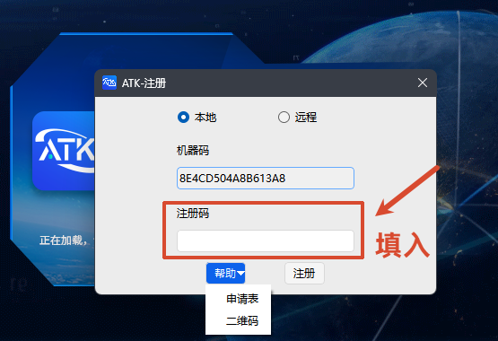
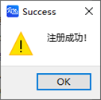

## Entering the Register Id

After obtaining the Register Id, return to the ATK Registration window to complete activation.

### Steps to Enter

1. Enter the obtained Register Id in the Register Id input box (pasting it directly is recommended to avoid manual entry errors);

2. Click the <kbd>Register</kbd> button to submit.

### Registration Result

- **Registration successful**: the window reports success, and all ATK features are available.

  

- **Registration failed**: if **Registration failed** is reported, check the following:
  1. Whether the machine code matches the Register Id (a Register Id works only on the device with the matching machine code)
  2. Whether the Register Id was entered correctly (it is case-sensitive; copying and pasting directly is recommended)
  3. If registration still fails after these checks, [contact us](../../../发布说明/联系我们.md) to obtain a new Register Id
