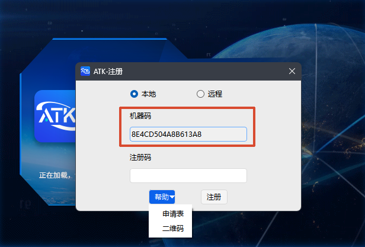

# Before You Begin

Make sure you have completed the software installation steps. When you launch ATK for the first time, the **ATK Registration** window appears automatically, as shown below:

## Machine Code

The **machine code** is a unique identifier automatically generated by the ATK Registration window (a 16-character alphanumeric string, such as `30C48ACB13924C96`) and is used to bind the software to the current device.

**Be sure to note down the machine code shown in the window**; it is required when applying for a Register Id.

::: warning Important
The machine code is tied to the device. **If you change computers or reinstall the operating system, the machine code will change**, and you will need to apply for a new Register Id.
:::

## Registration Methods

ATK registration is divided into two methods by license scope:

| Registration method | License scope | How to apply |
| --- | --- | --- |
| Standalone registration | The Register Id is bound to the machine code submitted with the application and works only on that computer | Mini Program Application, Online Application on the Website, Email Application |
| Network floating registration | The Register Id can be shared by multiple computers, with usage rights allocated dynamically over the local network | Applied for through the ATK development team |

For personal use or a single computer, choose standalone registration; when several computers on the same local network need to share one license, choose network floating registration.

- [Standalone Registration](./单机版注册/README.md): three application methods, any one of which is sufficient. Each application page ends with the activation steps.

- [Network Floating Registration](./网络浮动注册/README.md): must be applied for through the ATK development team, and shares one license among multiple computers by deploying the ATK remote service.

## Activation Location

The two registration methods are activated in different places:

- **Standalone registration**: enter the Register Id in the input box of the ATK Registration window and click <kbd>Register</kbd> to activate.

- **Network floating registration**: the server enters the Register Id in the startup terminal to complete registration; clients on the local network select **Remote** in the registration window, fill in the server IP and port, and then click <kbd>Register</kbd>.
