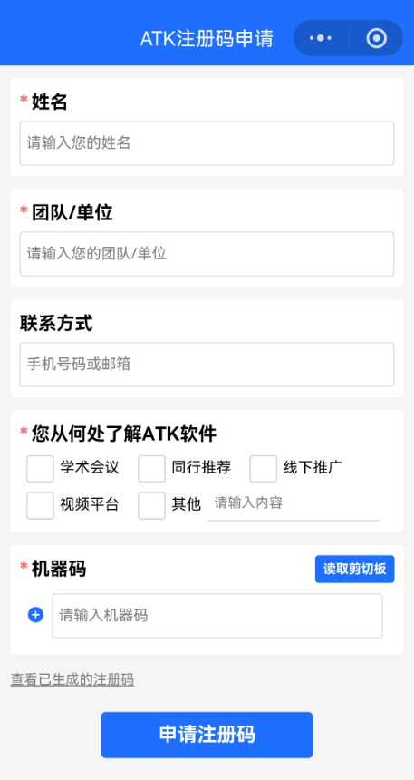
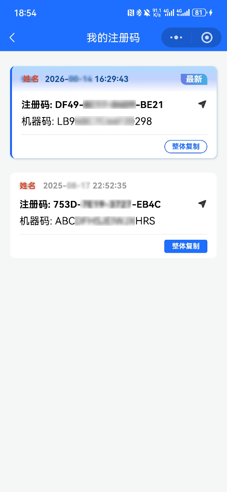

# Mini Program Application

## Application Process

### Scan the QR Code to Open the Mini Program

Open WeChat and scan the QR code below to open the ATK Register Id application Mini Program.

::: tip Alternative Method
If the QR code cannot be recognized, search for the Mini Program **"AerospaceToolKit"** in WeChat to open it directly.
:::

### Fill in the Application Form

After scanning the QR code and entering the form page, fill in the following information as required:

::: warning Important
Check the machine code carefully. **An incorrect entry will make the Register Id unusable.**
:::

### Get the Register Id

After confirming that the information is correct, click **Apply for Register Id**. Once the application is complete, you can view all Register Ids generated under this WeChat account on the page.

::: tip Saving the Register Id
We recommend clicking the copy-all button to copy the Register Id directly and avoid manual entry errors. Previously applied Register Ids can also be viewed in the Mini Program later.
:::

<!--@include:../.include/填入注册码.md-->
