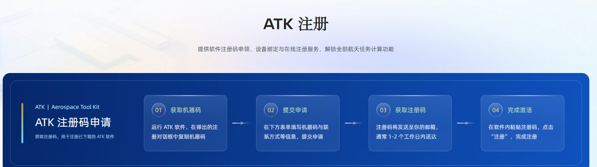
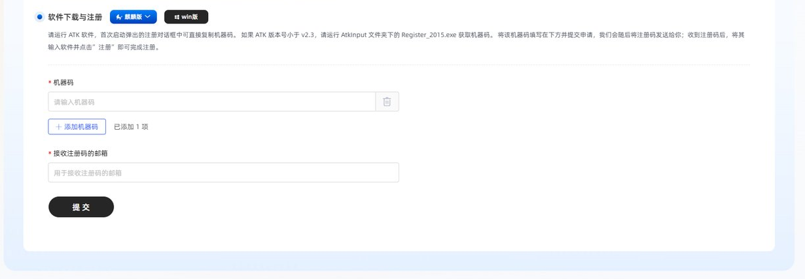

# Online Application on the Website

The ATK official website provides an online entry point for Register Id applications, where the form can be filled in and submitted directly in a browser.

## Open the Registration Page

Visit the [ATK Ecosystem Community](https://gitlink.org.cn/zone/atk/atksource) and locate the **Download and Register** page.

The page divides the application process into four steps:

1. **Obtain the machine code**: run ATK and copy the machine code from the registration dialog that appears.
2. **Submit the application**: fill in the machine code, contact information, and other details in the form, then submit.
3. **Receive the Register Id**: the Register Id is sent to the email address you fill in.
4. **Complete activation**: paste the Register Id in the software and click **Register**.

## Fill in the User Information

The form provides two tabs, **Standalone Registration** and **Network Floating Registration**. This page covers standalone registration. Network floating registration must be applied for through the ATK development team; see [Network Floating Registration](../网络浮动注册/README.md) for details.

Fields marked with * in the user information are mandatory:

- **Name**, **Team/Organization**: the applicant's name and the full name of the organization.
- **Contact information**: a mobile number or email address, used for communication during review.
- **How you learned about ATK**: select academic conference, peer recommendation, offline promotion, video platform, or other as applicable.

## Fill in the Machine Code and Receiving Email Address

Fill in the machine code and the email address that will receive the Register Id in the **Software Download and Registration** section.

- **Machine code**: on first launch the machine code can be copied directly from the registration dialog; for ATK versions earlier than v2.3, run Register_2015.exe in the Atkinput folder to obtain it. One license corresponds to one computer; click **Add Machine Code** to add more when applying for multiple devices.
- **Email address for the Register Id**: the Register Id is sent to this address, so make sure it is correct.

::: warning Important
Check the machine code carefully. **An incorrect entry will make the Register Id unusable.** We recommend copying and pasting directly from the registration dialog.
:::

## Submit the Application

Click **Submit** and wait for review; the Register Id is sent to the email address you fill in. After receiving it, paste it in the software and click **Register** to activate.

<!--@include:../.include/填入注册码.md-->
