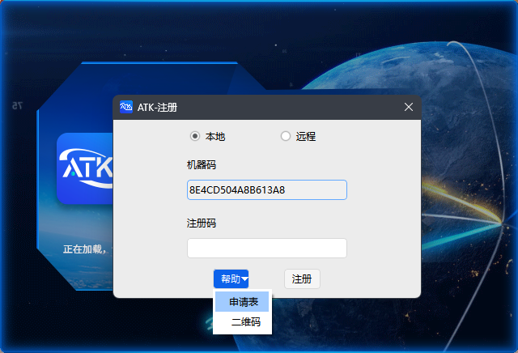
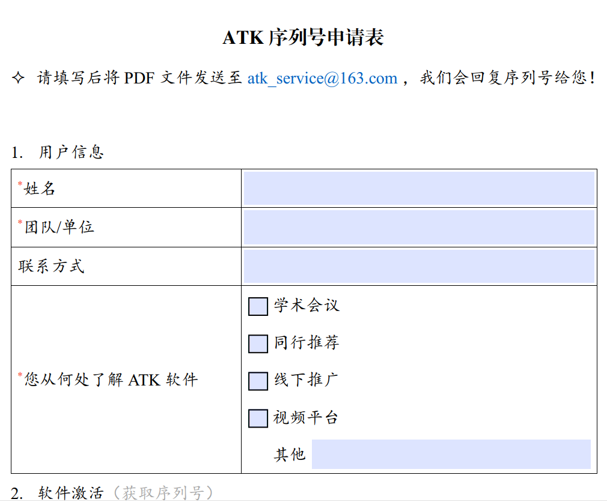

# Email Application

## Application Process

### Open the Application Form

Click the <kbd>Application Form</kbd> button in the software registration window.

Wait for the system to load and open the PDF guide.

::: tip Tip
If the PDF does not open automatically, check whether a PDF reader is installed on your system.
:::

### Fill in the Application Form

Fill in the information as described in the PDF document:

::: warning Important
Check the machine code carefully. **An incorrect entry will make the Register Id unusable.** We recommend copying and pasting directly from the registration window.
:::

### Send the Email

Send the completed application form to the designated email address:

::: info Email Details

- **Recipient email**: `atk_service@163.com`
- **Email subject**: `ATK Register Id Application - [Your Organization Name]`

:::

### Wait for Review

Our staff will review the application and reply with the Register Id as soon as possible.

::: warning Note
If no reply arrives for a long time, check your spam folder, or check the progress through [Contact Us](../../../发布说明/联系我们.md)
:::

<!--@include:../.include/填入注册码.md-->
