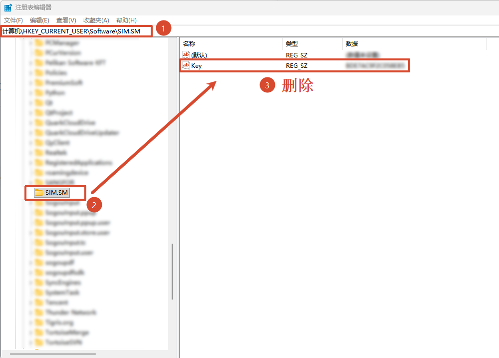
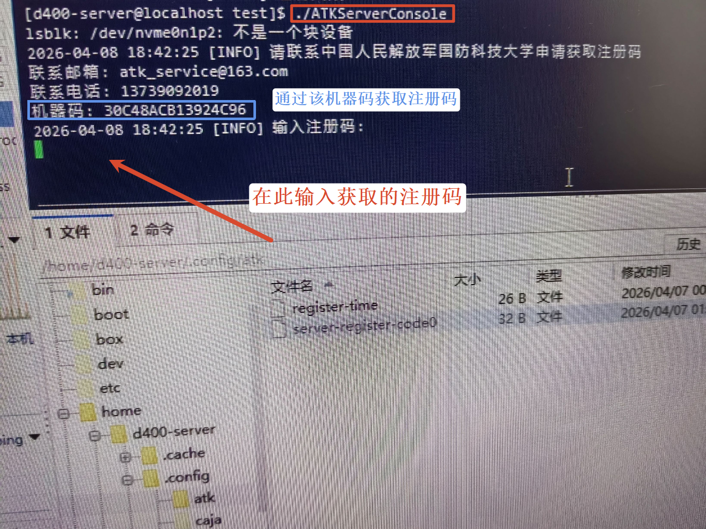
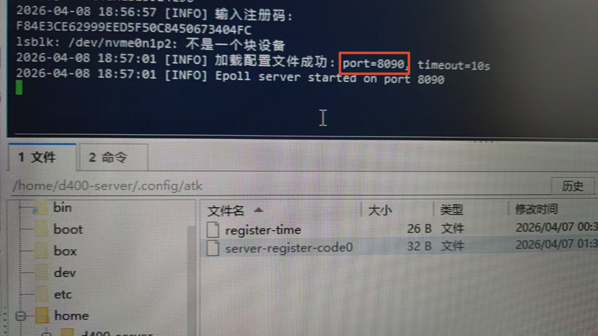
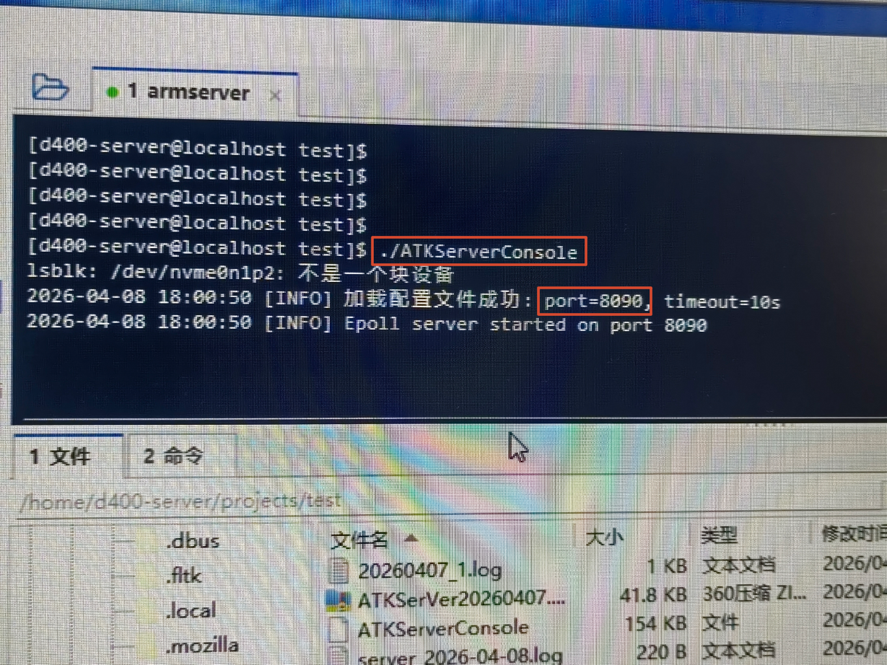
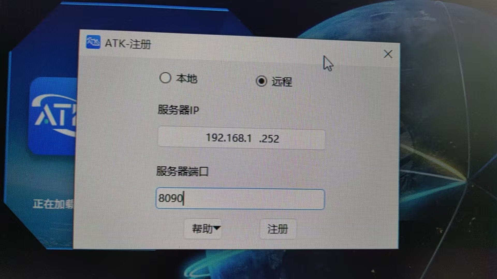

# Remote Service Deployment and Configuration

Network floating registration is implemented through the ATK remote service: the server holds the Register Id, and clients on the local network share the usage rights through the server IP and port, with no need to apply for a Register Id for each computer.

## Server Deployment

### Clean Up Leftover Registry Entries

If ATK has previously been registered locally, clean up the leftover registry entries first:

1. Open the Registry Editor (press `Win + R`, type `regedit`, and press Enter);

2. Navigate to: `Computer\HKEY_CURRENT_USER\Software\SIM.SM`;

3. Right-click and delete the registry entry named `Key`.



### Start the Server and Complete Registration

1. Log in to the server hosting the ATK server, and navigate to the directory containing the server program via the terminal;

2. Run the server startup command:

   ```bash
   ./ATKServerConsole
   ```

3. After the program starts, it automatically generates a **machine code** (example: `30C48ACB13924C96`) and prompts **Enter Register Id**;

4. Contact the ATK development team to obtain a Register Id (email: `atk_service@163.com`, phone: `13739092019`), enter the provided Register Id, and press <kbd>Enter</kbd> to confirm.



5. After successful registration, the terminal outputs the startup log, showing that the **configuration file was loaded successfully** and the **service port** (default or custom port, example: `8090`).



### Quick Start for a Registered Server

If the server has already been registered, there is no need to repeat the cleanup or enter the Register Id; run the startup command directly:

```bash
./ATKServerConsole
```

The terminal log records the **service port number**, which is the key setting for the client configuration; the example port is `8090`.



::: warning Custom Port
The server configuration file `server_config.ini` supports changing the port; the default port is `8090`, and the service must be restarted for a change to take effect.
:::

## Client Configuration

### Confirm the License Agreement

1. Launch the ATK client; the **ATK License Agreement** window appears automatically;

2. Check the **I have carefully read this agreement** checkbox;

3. Click **Agree** to enter the main interface.


### Fill in the Remote Registration Information

The client must be linked to the server IP and port to complete remote registration. Follow these steps:

1. In the **ATK Registration** window, select the **Remote** radio button;

2. In the **Server IP** input box, enter the IP address of the server hosting the ATK server (example: `192.168.1.252`);

3. In the **Server Port** input box, enter the port number used when the server started (example: `8090`);

4. Click **Register** to complete remote service registration.


