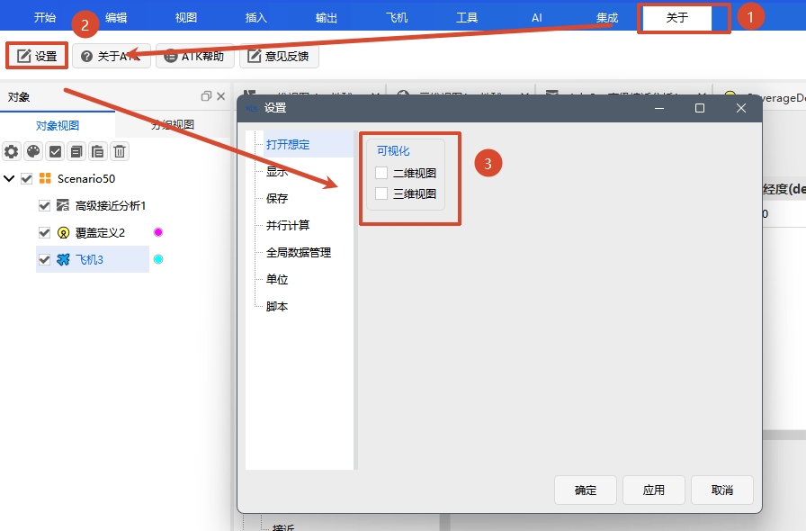

# OpenGL Version Too Low

If the computer's OpenGL version is too low to support the library versions required by the ATK 2D and 3D views, the software reports an "OpenGL version too low" error, and in severe cases crashes immediately on launch.

## Turning Off the 2D and 3D Views

Turning off the 2D and 3D views is used to verify the cause: if the software runs normally after they are turned off, it can be determined that the OpenGL version on the computer is too low, and the problem can then be solved by updating the graphics driver.

### Option 1: Change the Setting in the Interface

On the menu bar, click the <kbd>About</kbd> menu, then click the <kbd>Preferences</kbd> button to open the **Preferences** dialog. On the **Open Scenario** page, in the **Visualization** group, clear **2D View** and **3D View**, then click <kbd>OK</kbd> to close the dialog.

> The setting takes effect only after ATK is restarted. This option controls whether the 2D and 3D views open together when a scenario is opened; it does not affect the scenario that is currently open.



### Option 2: Modify the Configuration File

1. Open the systemConfig.ini file in the ATK installation directory:

   ```
   <ATK installation directory>\config\systemConfig.ini
   ```

2. Locate the **[OPEN_SETTING]** section, set **Open2D** and **Open3D** to false, then save the file.

   ```ini
   [OPEN_SETTING]
   Open2D=false
   Open3D=false
   ```

3. Restart ATK.

    If the software opens normally, it can be determined that the cause is the low OpenGL version. The 2D and 3D views are now turned off; to use them again, update the graphics driver and select them again.

## Updating the Graphics Driver

- **Windows**:
  - NVIDIA graphics cards: visit the [NVIDIA website](https://www.nvidia.cn/drivers/) and download the driver for the corresponding model
  - Other graphics cards: obtain the latest driver from the graphics card vendor's website
- **Kylin OS**:
  - Check for updates under **System Settings → Display → Graphics Driver**
  - Or download the Linux driver from the graphics card vendor's website (such as NVIDIA, AMD, or Intel)
  - You can also update it with the system package manager: `sudo apt update && sudo apt upgrade`

After the driver is updated, select **2D View** and **3D View** again in the **Preferences** dialog, or change Open2D and Open3D back to true in the configuration file, to restore the 2D and 3D views.
