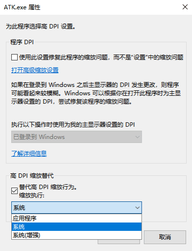

# High-DPI Display Issues

::: tip How to Tell If You Need to Adjust
If any of the following occurs after opening ATK, follow this guide to adjust:
- Text or icons in the interface are blurry
- Buttons overlap or are partially clipped
- The window proportions are abnormal, and part of the content is cut off
:::

## Adjustment Steps

1. Right-click ATK and select <kbd>Properties</kbd>: for a desktop shortcut, right-click the shortcut; for the portable version that runs directly after extraction, right-click ATK.exe;

2. In the **Properties** dialog, switch to the **Compatibility** tab;

3. Find and click <kbd>Change high DPI settings</kbd>;

4. In the **High DPI Settings** dialog, check **Override high DPI scaling behavior**;

5. In the **Scaling performed by** drop-down list, change the default **Application** to **System** or **System (Enhanced)**;

6. Click <kbd>OK</kbd> in the **High DPI Settings** dialog, then click <kbd>OK</kbd> in the **Properties** dialog to save the settings, and **restart ATK** for the changes to take effect.

## If the Problem Persists

If the problem is still not resolved after the steps above, try the following:

1. Temporarily set the Windows display scaling to **100%** (Settings → Display → Scale and layout);
2. Restart ATK and check whether the display is normal;
3. If it is normal, try gradually increasing the scaling to find a balance between clarity and usability;
4. If none of the methods above solves the problem, please [Contact Us](../03-ATK注册码获取指南/05-直接联系我们.md) for technical support.
