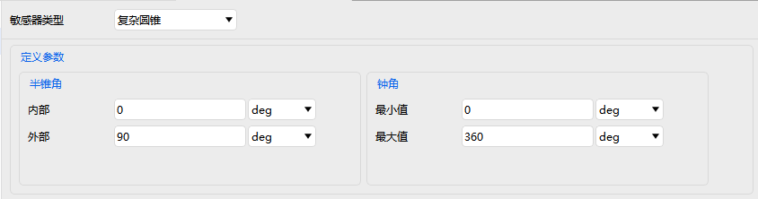
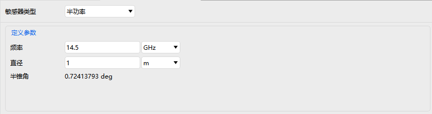
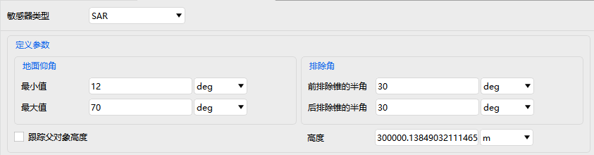

# Sensor

Sensor properties are used to configure detection equipment mounted on various platforms, and include four modules: **Basic Properties, 2D Graphics, 3D Graphics, and Constraints**.

---

## Basic Properties

Used to define the sensor type, geometric/physical parameters, relative position, and pointing method.

### Sensor Types and Corresponding Parameters

| Sensor Type | Key Definition Parameters |
| ---------- | ------------------------------------------ |
| Simple Conic | Cone Half Angle |
| Rectangular | Vertical Half Angle, Horizontal Half Angle |
| Complex Conic | Cone Half Angle, Clock Angle |
| Half Power | Frequency, Diameter |
| SAR | Ground Elevation Angle, Exclusion Angle, Track Parent Altitude, Altitude |

The pointing settings include the pointing type and the parameters belonging to each type.

::: details Pointing Type: Fixed
| Offset Attitude Form | Parameters | Description |
| :----------- | :------------------------------- | :----------------------------------------------------------- |
| **Az-El**    | Azimuth, Elevation | Azimuth is the horizontal direction angle and Elevation is the pitch angle, in degrees. |
| **Quaternion** | qx, qy, qz, qs | A quaternion represents the attitude, and qs is the scalar part. |
| **Euler Angles** | Euler1, Euler2, Euler3, Rotation Sequence | Three Euler angles (deg) and the rotation sequence (such as ZYX, XYZ). |
| **YPR Angles** | Yaw, Pitch, Roll, Rotation Sequence | The three angles and the rotation sequence (such as YPR, YRP). |
| **Transformation Matrix** | 3×3 matrix | Directly enter the 9 elements of a 3×3 rotation matrix. |
:::

::: details Pointing Type: Spinning
| Definition | Description |
| :----------- | :----------------------------------------------------------- |
| **Scan Mode** | - **Continuous**: rotation at a constant rate; the rotation rate and initial offset angle must be set. - **Unidirectional**: scans in one direction from the start angle to the end angle; the start angle, end angle, rotation rate and initial offset angle must be set. - **Bidirectional**: sweeps back and forth, with the same parameters as unidirectional. |
| **Spin Axis** | Options: azimuth, elevation, cone angle. |
:::

::: details Pointing Type: Targeted
| Parameter | Description |
| :------------- | :----------------------------------------------------------- |
| **Boresight Type** | - **Tracking (Receive/Transmit/Transpond)**: tracks the target in real time and adjusts the pointing according to the signal type (receive, transmit, transpond). - **Fixed**: adopts the same offset attitude forms as "Fixed" pointing (such as Az-El, quaternion) and applies a fixed offset to the target. |
| **Option Filter** | Used to filter the selectable targets, which can be chosen from scenario objects or library targets. |
:::

::: details Pointing Type: Grazing Altitude
| Parameter | Description |
| :--------------- | :-------------------------------- |
| **Azimuth Offset** | Horizontal offset angle relative to the reference direction. |
| **Grazing Altitude** | Altitude value of the target point (the unit is usually km). |
:::

::: details Pointing Type: External
| Parameter | Description |
| :----------- | :--------------------------------------------------------- |
| **External File** | Select a file containing pointing data (in a format supported by the software, such as a .pattern file). |
:::

## 2D Graphics

Controls the display style of the sensor in the 2D view:

| Option | Description |
| ------------ | -------------------------- |
| Show | Whether to display the sensor in the 2D view |
| Fill | Whether to fill the detection range with color |
| Color | Fill and outline color |
| Show Intersections | Options: None, Central Body, Terrain |
| Line Width | Outline line width |

---

## 3D Graphics

Used to set the spatial representation of the sensor in the 3D view, including **Space Projection, Pulse, Vector, and Data Display**.

### Space Projection

- Space projection distance (unit: km)
- Whether to use the range constraint

### Pulse

- Show: whether to display the detection pulse animation
- Amplitude, pulse length, frequency value
- Reverse: whether to display the pulse in reverse
- <kbd>Reset to Defaults</kbd>: restores the default parameters with one click

### Vector and Data Display

For details, see the corresponding sections in [Aircraft Property Settings](./飞机.md).

---

## Constraints

| Property | Description |
| --- | --- |
| [Basic](../03-约束配置/01-基本约束.md) | Geometric and line-of-sight conditions that access between the sensor and other objects must satisfy (azimuth, elevation, range, altitude, etc.) |
| [Sun](../03-约束配置/02-太阳约束.md) | Conditions determined by the relative positions of the Sun and the Moon that access between the sensor and other objects must satisfy (Sun/Moon elevation angle, exclusion angle, additional central body obstruction, etc.) |
| [Time](../03-约束配置/03-时间约束.md) | Time windows within which access between the sensor and other objects must fall (local time/GMT/local solar time/duration/time intervals) |
