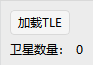

# SatelliteSystem

SatelliteSystem properties are used to configure a SatelliteSystem composed of multiple satellites as a whole, and include four modules: **Basic Properties, 2D Graphics, 3D Graphics, and Constraints**.

---

## Basic Properties

Orbit settings are the core configuration item and mainly support:

- Loading TLE ephemeris data
- Displaying the number of satellites currently in the system

---

## 2D Graphics

Controls how the SatelliteSystem as a whole is displayed in the 2D scene:

- Whether to display
- Whether to show labels
- Color settings
- Marker type settings

---

## 3D Graphics

Includes the **Model** and **Data Display** related configurations.
The specific setting rules are the same as those in the 3D Graphics section of [Aircraft Property Settings](./飞机.md) and are not repeated here.

---

## Constraints

| Property | Description |
| --- | --- |
| [Basic](../03-约束配置/01-基本约束.md) | Geometric and line-of-sight conditions that access between the SatelliteSystem and other objects must satisfy (azimuth, elevation, range, range rate, altitude, line-of-sight/terrain constraints, etc.) |
| [Sun](../03-约束配置/02-太阳约束.md) | Conditions determined by the relative positions of the Sun and the Moon that access between the SatelliteSystem and other objects must satisfy (Sun/Moon elevation angle, exclusion angle, additional central body obstruction, etc.) |
