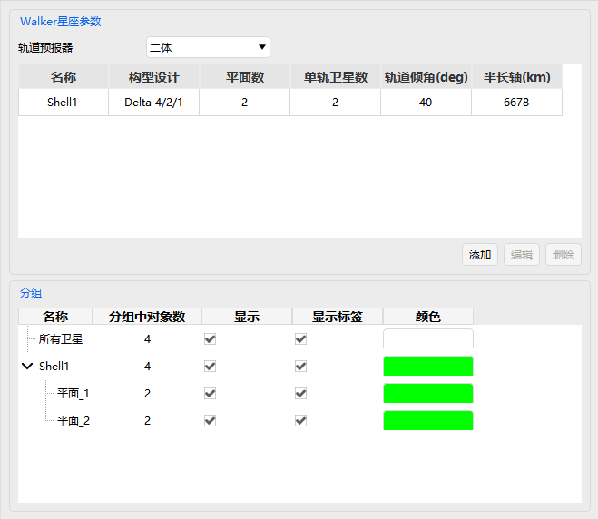

# SatelliteCollection

SatelliteCollection properties are used to build and manage homogeneous satellite constellations in batches, and mainly include three configuration modules: **Basic Properties, 3D Graphics, and Constraints**.

---

## Basic Properties

The core purpose is to quickly generate standardized satellite constellations. Configuration items include:

- **Walker Constellation Parameters**: generate a Walker constellation configuration with one click
- **Subset Settings**: classify and manage the satellites within the cluster

---

## 3D Graphics

The data display related settings are the same as those in the 3D Graphics section of [Aircraft Property Settings](./飞机.md) and are not repeated here.

---

## Constraints

| Property | Description |
| --- | --- |
| [Basic](../03-约束配置/01-基本约束.md) | Geometric and line-of-sight conditions that access between the SatelliteCollection and other objects must satisfy (azimuth, elevation, range, propagation delay, altitude, field of view, etc.) |
| [Sun](../03-约束配置/02-太阳约束.md) | Conditions determined by the relative positions of the Sun and the Moon that access between the SatelliteCollection and other objects must satisfy (Sun/Moon elevation angle, exclusion angle, additional central body obstruction, etc.) |
