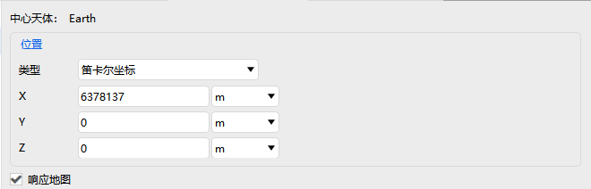

# Facility

Facility properties are used to configure Earth-fixed observation and telemetry/tracking sites, and include five modules: **Basic Properties, 2D Graphics, 3D Graphics, Constraints, and RF**.

---

## Basic Properties

The core is **Position Settings**:

- Select the position type and configure the corresponding coordinate parameters
- <kbd>Respond to map interaction settings</kbd> can be checked

---

## 2D Graphics

Includes the **Show** and **Range** related configurations,

and the specific settings are the same as those in the 2D Graphics section of [Aircraft Property Settings](./飞机.md).

---

## 3D Graphics

Includes **Model, Vector, Attitude Sphere, Range, and Data Display**,

and the specific settings are the same as those in the 3D Graphics section of [Aircraft Property Settings](./飞机.md).

---

## Constraints

| Property | Description |
| --- | --- |
| [Basic](../03-约束配置/01-基本约束.md) | Geometric and line-of-sight conditions that access between the facility and other objects must satisfy (azimuth, elevation, range, propagation delay, altitude, etc.) |
| [Sun](../03-约束配置/02-太阳约束.md) | Conditions determined by the relative positions of the Sun and the Moon that access between the facility and other objects must satisfy (Sun/Moon elevation angle, exclusion angle, additional central body obstruction, etc.) |
| [Time](../03-约束配置/03-时间约束.md) | Time windows within which access between the facility and other objects must fall (local time/GMT/local solar time/duration/time intervals) |

---

## RF

| Property | Description |
| --- | --- |
| [Environment](../08-RF/RF.md) | Describes the additional attenuation of RF signal propagation caused by propagation environments such as atmospheric absorption, rain, clouds, and fog, and includes it in communication or radar link performance calculations. |
| [Radar Cross Section](../08-RF/雷达散射截面.md) | Describes the equivalent scattering capability of a target under radar electromagnetic wave illumination, and provides target scattering parameters for radar echo and detection performance calculations through frequency band, RCS computation model, and Swerling fluctuation model. |
