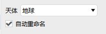

# Planet

Planet properties are used to configure solar system planetary bodies, and include three sections: **Basic Properties, 3D Graphics, and Constraints**.

---

## Basic Properties

- Select the corresponding celestial body
- Optionally check <kbd>Auto-Rename</kbd>

---

## 3D Graphics

Data display related settings are the same as those in the Data Display section of [Aircraft Property Settings](./飞机.md); not repeated here.

---

## Constraints

| Property | Description |
| --- | --- |
| [Basic](../03-约束配置/01-基本约束.md) | Line-of-sight conditions that access between the planet and other objects must satisfy (line of sight constraint, terrain constraint, etc.) |
