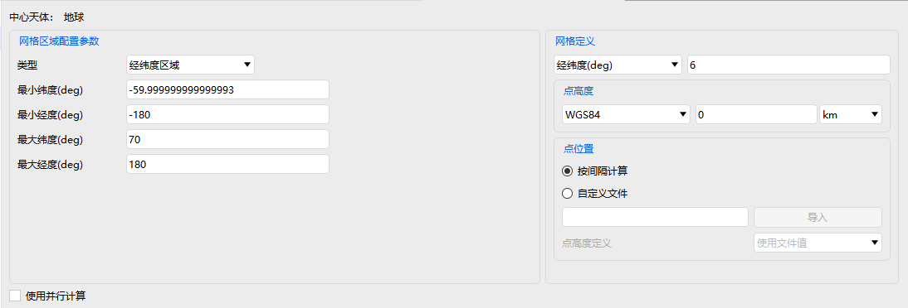

# CoverageDefinition

CoverageDefinition properties are used to configure the grid and evaluation rules for regional coverage analysis, and include three sections: **Basic Properties, Visualization, and Constraints**.

---

## Basic Properties

The core is **Grid Settings**:

- Grid Area Configuration: Select the type and configure the corresponding region parameters.
- Grid Definition: Grid type, point altitude, point locations. The point locations can be defined by importing **grid point files** (`.pnt`, `.txt` formats).
- Option to use <kbd>Parallel Computing</kbd> for acceleration.

---

## Visualization

Controls the display of the coverage grid in the scene:

- Show
- Show Region
- Show Points
- Color
- Point Size
- Fill

---

## Constraints

| Property | Description |
| --- | --- |
| [Basic](../../03-约束配置/01-基本约束.md) | Geometric and line-of-sight conditions that access between the CoverageDefinition and other objects must satisfy (azimuth, elevation, range, propagation delay, altitude, etc.) |
| [Sun](../../03-约束配置/02-太阳约束.md) | Conditions determined by the relative positions of the Sun and the Moon that access between the CoverageDefinition and other objects must satisfy (Sun/Moon elevation angle, exclusion angle, additional central body obstruction, etc.) |
| [Time](../../03-约束配置/03-时间约束.md) | Time windows within which access between the CoverageDefinition and other objects must fall (local time/GMT/local solar time/duration/time intervals) |
