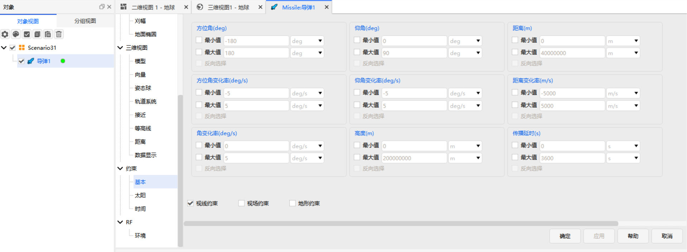

# Basic Constraints

## Function Description

Basic Constraints are a set of standard access constraints applied to an object, used to filter visibility intervals, communication intervals, or coverage intervals by relative geometry.

::: info Related Documents
For the geometric definitions, reference coordinate systems, and computational models of each parameter, see [Theory - Basic Constraints](../../../04-理论基础/02-约束配置/01-基本约束.md).
:::

## Parameter Descriptions

<Entry meta="Dimension: Angle|Unit: deg, rad, arcSec, arcMin, revs" name="Azimuth" desc="The direction angle of the associated object's projection in the reference plane relative to the analysis object, describing the horizontal bearing of the associated object." objects="Receiver,GroundVehicle,Sensor,Missile,Facility,Transmitter,Aircraft,CoverageDefinition,LaunchVehicle,SatelliteCollection,Ship,Submarine,Satellite,SatelliteSystem">

<HtmlDemo
  src="../../../../zh/03-基础使用指南/03-对象管理/03-约束配置/media/01-基本约束/satellite-azimuth-elevation.html"
  title="Schematic of satellite azimuth and elevation"
/>

For the geometric definition and reference coordinate systems, see [Geometric Definitions and Reference Frames](../../../04-理论基础/02-约束配置/01-基本约束.md#geometric-definitions-and-reference-frames). For the calculation method, see [Azimuth](../../../04-理论基础/02-约束配置/01-基本约束.md#azimuth).

</Entry>

<Entry meta="Dimension: Angular Velocity|Unit: deg/s, rad/s, revs/day" name="Azimuth Rate" desc="The rate of change of azimuth over time, reflecting the target's rotational speed in the reference plane." objects="Receiver,GroundVehicle,Sensor,Missile,Facility,Transmitter,Aircraft,CoverageDefinition,LaunchVehicle,SatelliteCollection,Ship,Submarine,Satellite,SatelliteSystem">

For the calculation method, see [Azimuth Rate](../../../04-理论基础/02-约束配置/01-基本约束.md#azimuth-rate).

</Entry>

<Entry meta="Dimension: Angle|Unit: deg, rad, arcSec, arcMin, revs" name="Elevation" desc="The angle between the line of sight from the analysis object to the associated object and the reference plane, describing the vertical direction of the associated object relative to the analysis object." objects="Receiver,GroundVehicle,Sensor,Missile,Facility,Transmitter,Aircraft,CoverageDefinition,LaunchVehicle,SatelliteCollection,Ship,Submarine,Satellite,SatelliteSystem">

For the geometric definition and reference coordinate systems, see [Geometric Definitions and Reference Frames](../../../04-理论基础/02-约束配置/01-基本约束.md#geometric-definitions-and-reference-frames). For the calculation method, see [Elevation](../../../04-理论基础/02-约束配置/01-基本约束.md#elevation).

</Entry>

<Entry meta="Dimension: Angular Velocity|Unit: deg/s, rad/s, revs/day" name="Elevation Rate" desc="The rate of change of elevation over time, reflecting the target's angular motion speed in the vertical direction." objects="Receiver,GroundVehicle,Sensor,Missile,Facility,Transmitter,Aircraft,CoverageDefinition,LaunchVehicle,SatelliteCollection,Ship,Submarine,Satellite,SatelliteSystem">

For the calculation method, see [Elevation Rate](../../../04-理论基础/02-约束配置/01-基本约束.md#elevation-rate).

</Entry>

<Entry meta="Dimension: Length|Unit: m, km, dm, cm, mm, in, kin, ft, kft, yd, kyd, fur, mi, nm, Au, ly, Re" name="Range" desc="The straight-line distance between the analysis object and the associated object." objects="Receiver,GroundVehicle,Sensor,Missile,Facility,Transmitter,Aircraft,CoverageDefinition,LaunchVehicle,SatelliteCollection,Ship,Submarine,Satellite,SatelliteSystem">

For the calculation method, see [Range](../../../04-理论基础/02-约束配置/01-基本约束.md#range).

</Entry>

<Entry meta="Dimension: Speed|Unit: m/s, km/s, m/h, km/h" name="Range Rate" desc="The rate of change of the distance between the two objects over time." objects="Receiver,GroundVehicle,Sensor,Missile,Facility,Transmitter,Aircraft,CoverageDefinition,LaunchVehicle,SatelliteCollection,Ship,Submarine,Satellite,SatelliteSystem">

A positive value indicates that the two objects are moving apart, while a negative value indicates that they are approaching each other.

For the calculation method, see [Range Rate](../../../04-理论基础/02-约束配置/01-基本约束.md#range-rate).

</Entry>

<Entry meta="Dimension: Angular Velocity|Unit: deg/s, rad/s, revs/day" name="Angular Rate" desc="Angular Rate represents the rotational speed of the associated object relative to the analysis object." objects="Receiver,GroundVehicle,Sensor,Missile,Facility,Transmitter,Aircraft,CoverageDefinition,LaunchVehicle,SatelliteCollection,Ship,Submarine,Satellite,SatelliteSystem">

<HtmlDemo
  src="../../../../zh/03-基础使用指南/03-对象管理/03-约束配置/media/01-基本约束/angular-rate.html"
  title="Schematic of angular rate"
/>

Angular Rate can be used to evaluate tracking capability. When constructing a communication link, it can also be used to characterize the stability of the link between two objects.

For the calculation method, see [Angular Rate](../../../04-理论基础/02-约束配置/01-基本约束.md#angular-rate).

</Entry>

<Entry meta="Dimension: Length|Unit: m, km, dm, cm, mm, in, kin, ft, kft, yd, kyd, fur, mi, nm, Au, ly, Re" name="Altitude" desc="The height of an object relative to the reference surface of the central body." objects="Receiver,GroundVehicle,Sensor,Missile,Facility,Transmitter,Aircraft,CoverageDefinition,LaunchVehicle,SatelliteCollection,Ship,Submarine,AreaTarget,Satellite,SatelliteSystem">

**Minimum** and **Maximum** values can be set to limit the altitude range within which the analysis object establishes a visibility relationship with the associated object.

For the calculation method, see [Altitude](../../../04-理论基础/02-约束配置/01-基本约束.md#altitude).

</Entry>

<Entry meta="Dimension: Time|Unit: s, min, h, day, cd, EarthTU, SunTU, FN, yr" name="Propagation Delay" desc="Propagation Delay represents the time required to transmit information between the analysis object and the associated object." objects="GroundVehicle,Missile,Facility,Aircraft,CoverageDefinition,LaunchVehicle,SatelliteCollection,Ship,Submarine,Satellite">

For the calculation method, see [Propagation Delay](../../../04-理论基础/02-约束配置/01-基本约束.md#propagation-delay).

</Entry>

<Entry meta="Dimension: Angle|Unit: deg, rad, arcSec, arcMin, revs" name="Minimum Elevation" desc="Available only for AreaTarget objects. Specifies the minimum elevation required for the analysis object to observe or access an AreaTarget. Accesses below this angle do not satisfy the constraint." objects="AreaTarget">

<HtmlDemo
  src="../../../../zh/03-基础使用指南/03-对象管理/03-约束配置/media/01-基本约束/min-elevation.html"
  title="Schematic of minimum elevation"
/>

Minimum Elevation limits the lowest elevation allowed when the analysis object accesses an AreaTarget. Accesses whose elevation is below this value are removed as a whole, which is equivalent to cutting out a ring of low-elevation sky around the AreaTarget so that only accesses entering from higher angles take part in the subsequent evaluation. Its vertex is at the AreaTarget (its centroid) rather than at the analysis object, and it measures the direction in which the AreaTarget looks toward the analysis object.

</Entry>

<Entry name="Access to Whole Object" desc="Available only for AreaTarget objects. When enabled, the access must cover the entire range of the AreaTarget; when disabled, covering only part of the target is considered sufficient." objects="AreaTarget">

</Entry>

<Entry name="Line of Sight" desc="Determines whether the line of sight between the analysis object and the associated object is obstructed by the Earth or another central body." objects="Receiver,GroundVehicle,Sensor,Missile,Facility,Transmitter,Aircraft,CoverageDefinition,LaunchVehicle,SatelliteCollection,Ship,Submarine,AreaTarget,Satellite,SatelliteSystem,Planet">

The Line of Sight constraint analyzes cases in which central body obstruction makes two objects invisible to one another, and evaluates the line-of-sight quality between them. Its output value is computed differently depending on the type of object to which the constraint belongs.

For the computational models for fixed objects and moving objects, as well as the simplified calculation and negative elevation handling for objects on the celestial body surface, see [Line-of-Sight Constraint](../../../04-理论基础/02-约束配置/01-基本约束.md#line-of-sight-constraint).

</Entry>

<Entry name="Field of View" desc="Determines whether the associated object is within the sensor's effective observation range." objects="Sensor,Missile,SatelliteCollection">

The field of view is defined by the characteristic angles of the sensor. The Field of View constraint is satisfied at the current time only when the target direction is inside the sensor field of view.

</Entry>

<Entry name="Terrain Mask" desc="Determines whether the line of sight between objects is obstructed by actual terrain, accounting for the effects of terrain elevation on visibility and coverage." objects="Receiver,GroundVehicle,Sensor,Missile,Facility,Transmitter,Aircraft,CoverageDefinition,LaunchVehicle,SatelliteCollection,Ship,Submarine,Satellite,SatelliteSystem,Planet">

::: tip Terrain Data Configuration
- Before selecting **Terrain Mask**, configure the terrain data to be used in the analysis under **[Scenario Object Properties - Terrain](../../02-场景管理/03-场景属性配置/02-基本/03-地形.md)**.

- The terrain data used in constraint calculations is independent of the terrain visualization configured in a 3D view. Even if terrain is already displayed in a 3D view, that terrain data is not necessarily used in constraint calculations.

- To display terrain in a 3D view, configure the corresponding **terrain visualization data** separately in each **3D View**.
:::

</Entry>
