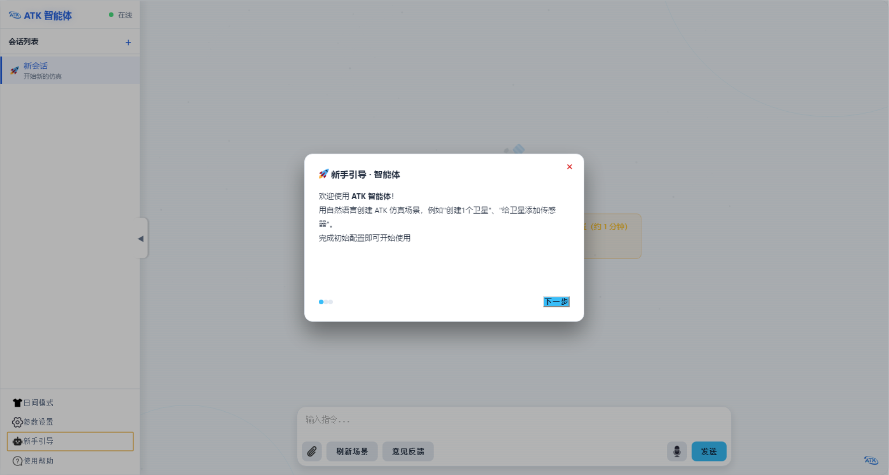

# Quick Start

The ATK Agent drives ATK's tool-based computation, data organization, and visual display with natural language and multimodal large models. Requirements can be described in many forms, including natural language text, speech, images, tables, technical reports, and academic papers, to design, generate, modify, and analyze ATK scenarios without writing code or memorizing Connect command formats. The user states only the task objective, such as the orbit type, payload parameters, and simulation period, and the agent completes the entire workflow: object creation, parameter assignment, simulation runs, and data post-processing.

## First Launch

A beginner guide opens automatically on the first launch of the software; complete the initial configuration following the guide and the software is ready to use. Afterwards, click **Beginner Guide** at the bottom left at any time to view it again.

## Model Access and Configuration

All model configuration is done in **Settings** at the bottom left, covering two items: the primary model and the speech recognition model.

### Primary Model

The primary model is the core component of the software; without it, no conversation is possible. In the primary model section, enter the API Key, Base URL, and model name provided by the service provider. Any large-model service compatible with the OpenAI API specification is supported, such as DeepSeek, Qwen, and GLM.

| Item | Description |
|--------|------|
| API Key | The API key provided by the service provider; it may be left blank when using a service that requires no authentication, such as a local Ollama |
| Base URL | Endpoint address of the model service |
| Model name | Name of the model to call |

For example, with DeepSeek, set Base URL to `https://api.deepseek.com` and the model name to `deepseek-v4-pro`; for the exact values, see the [DeepSeek official documentation](https://api-docs.deepseek.com/zh-cn/).

The agent also supports locally deployed models. For example, with Ollama, set Base URL to `http://localhost:11434/v1`; for detailed usage, see the [Ollama API documentation](https://docs.ollama.com/api/introduction).

### Multimodal Visual Understanding

After **Enable Multimodal Visual Understanding** is selected, images can be chosen as conversation attachments, provided that the configured large model has multimodal visual understanding capability.

### Speech Recognition Model

The speech recognition model is optional. For speech input, enter the App ID, API Key, and API Secret obtained from the iFlytek console in the speech recognition model section.

The speech dictation service must first be enabled in the iFlytek console; the free quota is 500 calls per day. Leaving it unconfigured does not affect text conversations.
