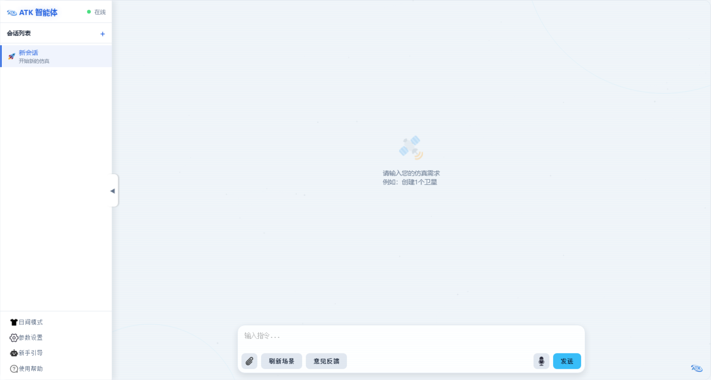
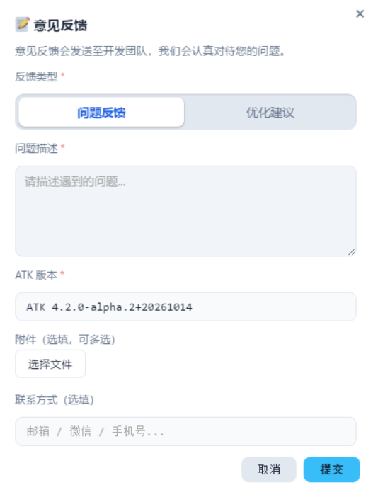

# Interface and Basic Operations

## Interface Layout

The left side of the software is the conversation pane and the right side is the chat area.

The conversation pane provides the following main functions:

- History conversations are grouped as today, yesterday, and earlier
- Creating, switching, and deleting conversations is supported
- Multiple conversations can run in parallel in the background; switching conversations does not interrupt a task that is running
- The bottom of the conversation pane provides entries for day/night mode switching, settings, the beginner guide, and help

## Input and Sending

Describe the requirement in the input box, press Enter to send, and press Shift+Enter for a new line. Answers are streamed; click **Stop** at any time during sending to interrupt, and the elapsed time of the turn is shown once the answer is complete.

## Tool Calls

The agent's tool invocations are shown as a collapsible **Tool Calls** group, where the name, parameters, and execution result of each tool can be viewed. Click the parameter text to copy the complete parameters.

## Deletion Confirmation

When the agent needs to delete a scenario object, **Cancel** and **Confirm Delete** buttons appear in the message, and deletion is performed only after confirmation, which prevents accidental operations. Operations such as deleting objects and clearing routes all follow this procedure.

## Refreshing the Scenario

Clicking **Refresh Scenario** on the input box toolbar refreshes the ATK animation and simulation state. The button is equivalent to sending the "reset scenario simulation state" instruction and corresponds to the Connect command Animate Reset.

## Attachment Upload

Clicking the attachment button at the lower left of the input box allows a file to be uploaded and sent with the message. The software automatically extracts the text in the document as reference content for the question.

| Attachment type | Supported formats | Size limit |
|----------|----------|----------|
| Document | PDF, Word (docx), Excel (xlsx/xls), TXT, Markdown, CSV | A single file must not exceed 20 MB |
| Image | Requires **Enable Multimodal Visual Understanding** to be selected in settings | A single image must not exceed 10 MB |

After an image is sent, click it to enlarge it.

## Speech Input

After iFlytek speech recognition is configured, click the microphone button on the right of the input box to start speech input; the recognized text is written into the input box in real time. Clicking the button again or remaining silent for a period ends input automatically, and a single session lasts about 55 seconds at most. Microphone permission must be granted on first use.

## Feedback

If a problem is encountered or an improvement is suggested during use, click **Feedback** on the input box toolbar to submit it.

| Item | Description |
|------|------|
| Feedback type | Problem report or improvement suggestion |
| Problem description | Description of the problem encountered or of the suggestion |
| ATK version | Filled in automatically and can be modified |
| Contact information | Optional; used for follow-up communication |
| Attachments | Optional; at most 5 files, each no larger than 10 MB and no more than 30 MB in total |

The feedback automatically includes the chat history of the current conversation so that the development team can locate the problem. A success or failure result is shown after submission; on failure, the feedback can be modified and submitted again.
