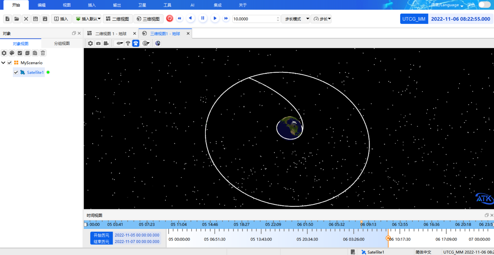
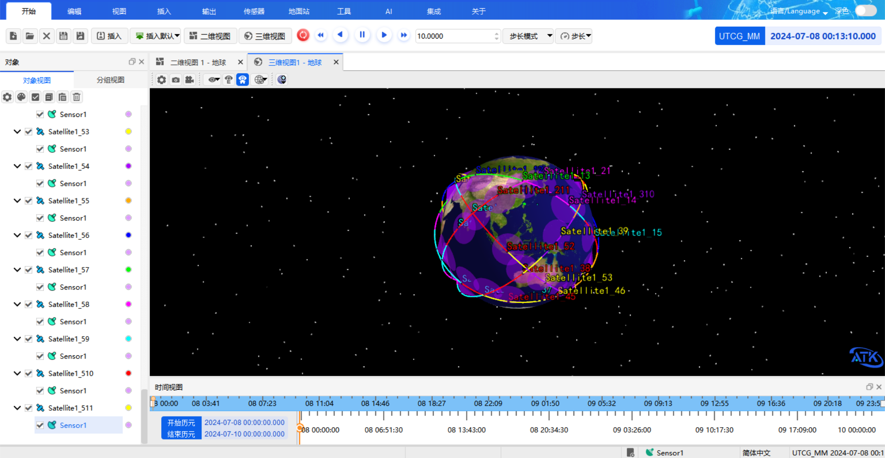

# Usage Examples

The ATK Agent supports many input forms: natural language text, speech, images, Excel spreadsheets, and technical documents. The examples below cover basic object operations, each type of input, and the complete generation of scenarios such as maneuver planning and access analysis.

## Basic Scenario and Object Operations

Covers creating, deleting, renaming, and querying scenarios and objects.

::: details open **Create objects in batches**

Create 20 satellites, 10 LaunchVehicles, and 5 missiles for me.

:::

::: details open **Delete by type**

Delete all missiles for me.

:::

::: details open **Rename in batches**

Rename sat1-5 to satellite1-5 for me.

:::

::: details open **Query the current scenario status**

Summarize the current scenario information for me.

:::

## Natural Language Text Input

Describing the task objective in natural language is sufficient; the agent parses it into a concrete sequence of operation commands and executes them. For requirements that can be implemented in several ways, the agent first presents the available options and confirms the orbit parameters, then executes according to the confirmed result.

::: details open **A high-orbit satellite with satellites evenly distributed in its orbital plane**

Create a high-orbit satellite for me and distribute one hundred satellites evenly along that satellite's orbit.

:::

## Speech Input

After the speech recognition model is configured, click the microphone button on the right of the input box to start speech input; what is spoken is converted to text in real time and written into the input box.

::: details open **Aircraft route and satellite access analysis**

Create an aircraft flying from Changsha to Xi'an at 4 p.m. on September 10, 2026, create a satellite above the route at the same time, and analyze the access of the satellite to the aircraft.

:::

## Image Input

After **Enable Multimodal Visual Understanding** is selected in settings and a large model that supports visual understanding is connected, an image can be uploaded together with a text description, and the agent parses the scenario structure shown in the image.

::: details open **Generate a scenario from an image**

Generate the scenario shown in the image for me.

:::

## Excel Input

The agent can parse tabular data in Excel, such as a list of satellites and their orbital elements. Upload the Excel document with a text description.

::: details open **Generate a scenario from an Excel spreadsheet**

Generate the simulation scenario in the Excel file for me.

:::

## Word Document Input

The agent can parse Word documents such as technical documents and WeChat official-account case articles, extracting object and parameter information from them and generating the corresponding scenario.

::: details open **Generate a scenario from a Word document**

Generate the simulation scenario described in the document for me.

:::

## Maneuver Planning Fast-Transfer Case

This case consists of creating the scenario, setting the initial state segment, two propagation segments, and two targeting corrections, and finally completes a fast transfer from the initial orbit to the target orbit.

::: details open **Fast-transfer maneuver planning**

Create a scenario with the simulation time from November 5, 2022 to November 7, 2022. Insert a satellite, set the orbit propagator to Maneuver Planning, and set the initial state segment with Earth as the central body, J2000 as the coordinate system, and orbital elements as the coordinate type (semi-major axis 6700000 m, eccentricity 0, inclination 0°, right ascension of the ascending node 0°, argument of periapsis 0°, true anomaly 0°).

Insert a propagate segment, set the gravity model to JGM3, select the Sun for third-body gravity, and set the stopping condition to duration with a trigger value of 7200 seconds. Select atmospheric drag perturbation and solar radiation pressure, select the Moon for third-body gravity, and insert a target sequence segment. Under that target sequence segment, insert a maneuver segment, set the constraint configuration to radius of apoapsis and the thrust axes to VNC, and set the velocity increment Vx as a design variable; then set the differential correction of the target sequence segment, select Vx and the radius of apoapsis, and set the trigger value of the radius of apoapsis to 84328394 m.

After the target sequence, insert another propagate segment with the same settings as before, a stopping condition of distance to the central body, and a trigger value of 42164197 m. Insert another target sequence segment, create a maneuver segment under that segment, set the constraint configuration to eccentricity and the thrust axes to VNC, and select Vx and Vz as design variables. Set the differential correction of the target sequence segment, select the control variables Vx and Vz, change their maximum step sizes to 300, select the eccentricity constraint, and set the convergence tolerance to 0.001. After that target sequence segment, insert a propagate segment with a stopping condition of duration and a trigger value of 172800.

Finally, run maneuver planning.

:::

## Access Scenario Generation Case

This case covers creating facilities and CoverageDefinitions, configuring sensors, generating a constellation configuration, and resetting the simulation state; it can be used to build a regional access and coverage analysis scenario.

::: details open **Regional access and coverage scenario**

Create a scenario and set the simulation time from 2024-07-08 00:00:00.000 to 2024-07-10 00:00:00.000. Insert a Taipei facility (latitude 25.05, longitude 121.5). Insert a Taiwan Strait CoverageDefinition (longitude range 117.5 to 122, latitude 22 to 26.5), a Malacca CoverageDefinition (longitude 95 to 104.5, latitude 1.3 to 5.5), and a Great Lakes CoverageDefinition (longitude -92 to -76, latitude 41 to 49). Create a satellite, use the orbit wizard to set it to a repeating ground track orbit with an altitude of about 412400 m, an inclination of 45°, 15.537 revolutions in the repeat cycle, and a first ascending node longitude of 0. Create a conical sensor with a half angle of 63° under that satellite. Create a constellation with the satellite as the seed satellite, with 5 orbital planes, 11 satellites per plane, and an inter-plane phase increment of 4. Finally, reset the scenario simulation state.

:::

