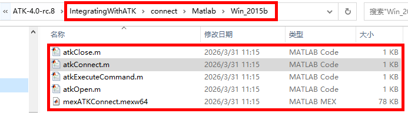

# Introduction and Configuration

## Introduction

The Matlab SDK is the Matlab communication library provided by ATK. It lets you write scripts in your own Matlab development environment and interact with ATK over a TCP network connection, enabling automated operations such as scenario building, parameter setting and simulation running.

As one of the core development methods of Connect mode, the Matlab SDK shares the same communication protocol and command format with the [Python client tool](../../2-Python客户端工具/1-简介与配置.md) built into ATK. The difference is that the Matlab SDK runs in a Matlab environment you set up yourself, which suits scenarios where you need to integrate ATK functionality into a Matlab project, or to make use of Matlab's matrix computation and visualization capabilities.

::: tip Choosing a Development Method
For a detailed comparison of the development methods, refer to the [Connect Mode Overview](../../../README.md#development-method-comparison).
:::

## Environment and Configuration

### Matlab Environment

You need to download and install Matlab yourself. The ATK communication library was developed and tested on Matlab R2015b; R2015b or later is recommended to ensure compatibility.

::: warning Note
Before sending commands with the Matlab SDK, you must open the ATK software (no scenario needs to be open). To create a new scenario, close any scenario that is already open.
:::

### Communication Library Files

ATK's Matlab communication library is shipped with the installation package and located in `IntegratingWithATK\connect\Matlab` under the installation directory:

- **Windows**: the <PathCopy :entry="matlabDir" /> folder, based on Matlab R2015b
- **Linux (Kylin)**: the <PathCopy :entry="matlabDirLinux" /> folder, based on Matlab R2021b

The following uses the Windows version as an example to describe the file composition:

- <PathCopy :entry="mexFile" />: the MEX executable, acting as the bridge between Matlab and `ATKConnectorDll64.dll` and responsible for the low-level data transfer.
- <PathCopy :entry="atkOpenFile" /> / <PathCopy :entry="atkConnectFile" /> / <PathCopy :entry="atkCloseFile" />: Matlab function-style M files that wrap the MEX function calls, used to establish a connection, send commands and close the connection respectively.

<PathViewer :relative-paths="sdkFiles" />



### Configuration Steps

Add the folder path to the Matlab search path:

```matlab
% Windows
addpath('<ATK installation directory>\IntegratingWithATK\connect\Matlab\Win_2015b')
% Linux (Kylin)
addpath('<ATK installation directory>/IntegratingWithATK/connect/Matlab/Linux_2021b')
```

Once configured, you can call the communication interface functions directly in a script or on the command line, for example:

```matlab
conID = atkOpen();
% ... send commands ...
atkClose(conID);
```

## Usage

After completing the configuration above, you can call the core APIs in your code to control ATK. The basic flow is as follows:

```matlab
% 1. Add the library file path to the Matlab search path (Windows)
addpath('<ATK installation directory>\IntegratingWithATK\connect\Matlab\Win_2015b')
% On Linux (Kylin): addpath('<ATK installation directory>/IntegratingWithATK/connect/Matlab/Linux_2021b')

% 2. Establish the connection to ATK
conID = atkOpen();

% 3. Send a command (example: create a new scenario)
atkConnect(conID, 'New', '/ Scenario MyScenario');

% 4. Close the connection
atkClose(conID);
```

Next, see [Core API](./2-核心API.md) for the interface usage, or go straight to [Complete Example](./3-完整示例.md) for a hands-on walkthrough.

<script setup>
import PathViewer from "@components/PathViewer/PathViewer.vue";
import PathCopy from "@components/PathCopy/PathCopy.vue";

const matlabDir = { path: 'IntegratingWithATK\\connect\\Matlab\\Win_2015b', name: 'Win_2015b' };
const matlabDirLinux = { path: 'IntegratingWithATK\\connect\\Matlab\\Linux_2021b', name: 'Linux_2021b' };
const mexFile = { path: 'IntegratingWithATK\\connect\\Matlab\\Win_2015b\\mexATKConnect.mexw64', name: 'mexATKConnect.mexw64' };
const atkOpenFile = { path: 'IntegratingWithATK\\connect\\Matlab\\Win_2015b\\atkOpen.m', name: 'atkOpen.m' };
const atkConnectFile = { path: 'IntegratingWithATK\\connect\\Matlab\\Win_2015b\\atkConnect.m', name: 'atkConnect.m' };
const atkCloseFile = { path: 'IntegratingWithATK\\connect\\Matlab\\Win_2015b\\atkClose.m', name: 'atkClose.m' };

const sdkFiles = [
  matlabDir,
  { path: 'IntegratingWithATK\\connect\\Matlab\\Win_2015b\\mexATKConnect.mexw64', name: 'mexATKConnect.mexw64', description: 'MEX executable; the bridge between Matlab and ATKConnectorDll64.dll' },
  { path: 'IntegratingWithATK\\connect\\Matlab\\Win_2015b\\atkOpen.m', name: 'atkOpen.m', description: 'Establishes the network connection to the ATK service' },
  { path: 'IntegratingWithATK\\connect\\Matlab\\Win_2015b\\atkConnect.m', name: 'atkConnect.m', description: 'Sends a command to ATK and gets the return value' },
  { path: 'IntegratingWithATK\\connect\\Matlab\\Win_2015b\\atkClose.m', name: 'atkClose.m', description: 'Closes the connection and releases resources' },
];
</script>
