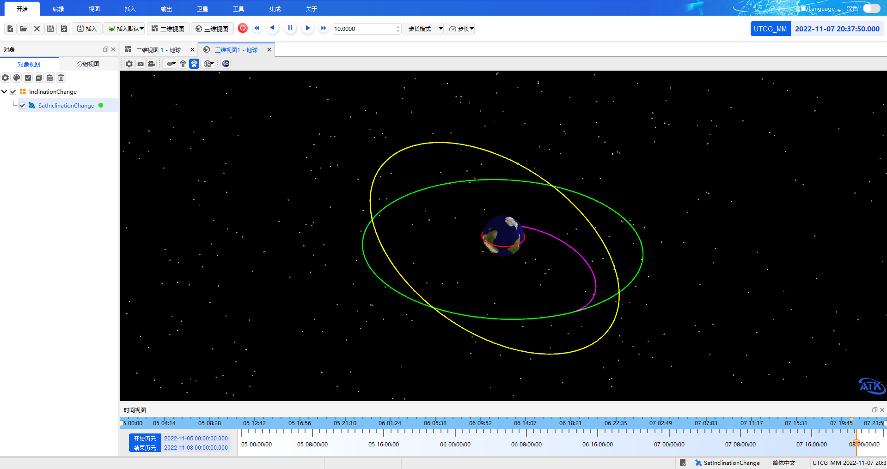
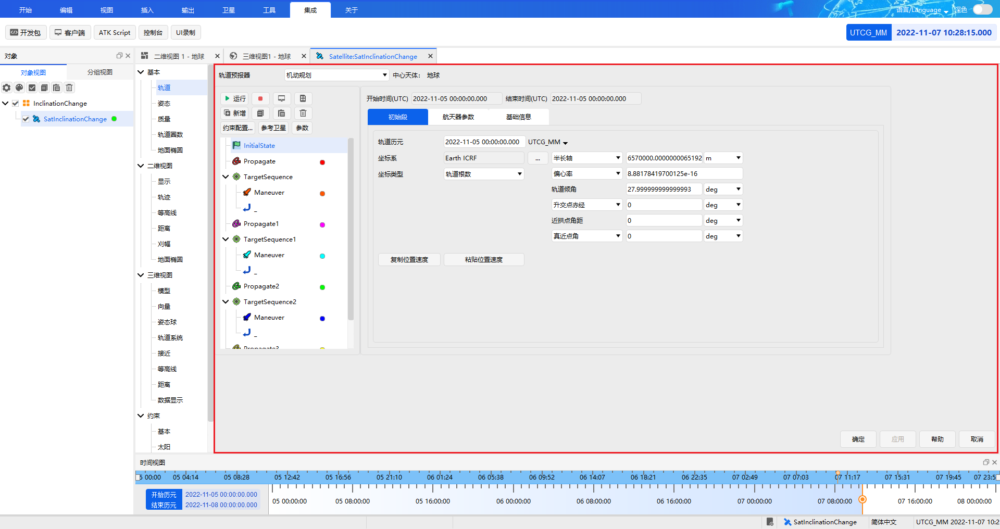

# Complete Example

## Description

The following uses the **fast orbit transfer scenario** as an example to demonstrate the complete workflow of controlling ATK with the Matlab SDK: transferring the satellite from a low Earth parking orbit (LEO) with a radius of 6700 km to a geostationary orbit (GEO) with a radius of 42164.197 km.

::: tip Example Walkthrough
This example focuses on demonstrating the usage workflow of the Matlab SDK. For more on the case principles, parameter meanings and step-by-step screenshots, refer to the [Secondary Development Case Tutorial](../../../../../02-案例教程/8-二次开发案例/).
:::

## Example Code

The complete code is published with the installation package, under `Help\Examples\08-二次开发案例\` in the ATK installation directory:

<PathViewer :relative-paths="exampleFiles" />

The code is organized around the main flow of **load the communication library → connect → create a scenario → set the initial orbit → build the maneuver-planning sequence → run the maneuver planning → view the report → save and disconnect**. Each step is separated by comments so you can understand and reuse the code section by section.

## How to Run

::: warning Prerequisites
- Before you start, make sure you have completed [Environment Configuration](./1-简介与配置.md#configuration-steps): add the Matlab communication library directory `IntegratingWithATK\connect\Matlab\Win_2015b` to the Matlab search path (`addpath`)
- Open the ATK software before running
- This example creates a new scenario with the `New` command, and ATK Connect mode supports loading only one scenario, so **do not open any existing scenario**; close it first if one is already open
:::

1. Copy the example file <PathCopy :entry="example" /> to any working directory

2. In Matlab, set that directory as the current path and run the script name (without the `.m` extension):

```matlab
ATKConnectMatlabTest
```

During the run, the ATK interface will progressively execute operations such as creating the scenario, creating the satellite, setting the orbit parameters and running the maneuver planning.

## Run Results

After a successful run, the ATK 3D window shows the satellite's complete trajectory from its initial low Earth orbit to the geostationary orbit after two orbital maneuvers:



You can right-click the satellite object in ATK and select **Properties** to check whether the parameters set by the script take effect correctly:



<script setup>
import PathViewer from "@components/PathViewer/PathViewer.vue";
import PathCopy from "@components/PathCopy/PathCopy.vue";

const exampleFiles = [
  { path: 'Help\\Examples\\08-二次开发案例\\ATKConnectMatlabTest.m', name: 'ATKConnectMatlabTest.m', description: 'Official example source code (fast orbit transfer case)' },
];
const example = exampleFiles[0];
</script>
