# Coverage Performance Analysis of a Flower Constellation

## Introduction

A satellite constellation is an integrated system composed of multiple satellites that operate in space in a specific orbital distribution and arrangement to jointly accomplish a specific mission. A Flower constellation is a constellation with the common ground track property, whose Earth-observation coverage area is more concentrated, so it is well suited to discontinuous coverage missions. The common ground track property enables the constellation to achieve better coverage with a small number of satellites.

In Earth-observation missions, it is often necessary to observe a ground target as continuously as possible. If the observation is uninterrupted, the constellation is said to provide continuous coverage of the target; otherwise, the coverage is discontinuous. When the number of satellites is small, discontinuous coverage is unavoidable, and in this case the coverage gap (that is, the revisit duration) should be as short as possible. This case builds a Flower constellation, analyzes its revisit time over five target points, and compares its discontinuous coverage performance with that of a Walker-Delta constellation with the same number of satellites.

## Flower Constellation Model

The concept of the Flower constellation was first proposed in 2003 by the team of Professor Daniele Mortari at Texas A&M University[1]. When observed in the Earth-fixed frame, the orbital shape of the constellation looks like a blooming flower, hence the name Flower constellation. The satellites of a Flower constellation have the common ground track property, and each satellite has the same number of return days and the same orbital inclination, while the right ascension of the ascending node and the phase of the satellites also have a specific relationship. According to the common ground track theory, the ground tracks formed by all the satellites of a Flower constellation on the Earth's surface coincide perfectly[2]. The relative positions and the ground tracks of the Flower constellation are shown in the figures below.

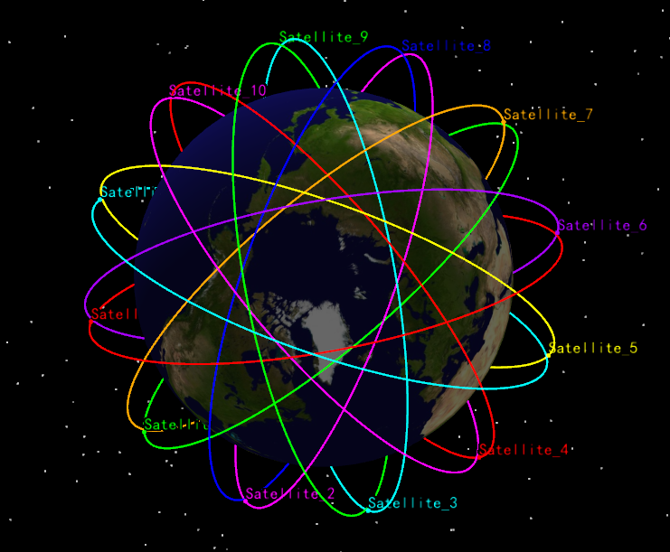

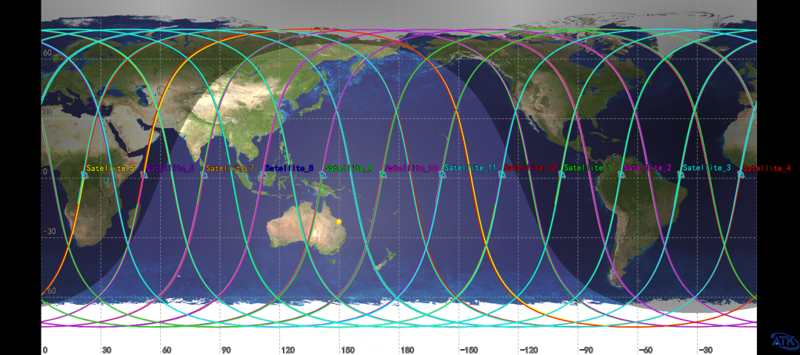

For a general symmetric Flower constellation using circular orbits, once the right ascension of the ascending node and the argument of latitude of the seed satellite, $(\Omega_{seed}, u_{seed})$, are determined, the $k$-th satellite of the constellation is determined by the following equations[3]:

$$
\left\{
\begin{aligned}
\Omega_k &= \Omega_{seed} + 2\pi p_k \\
u_k &= u_{seed} + 2\pi p_k L
\end{aligned}
\right.
\qquad (k = 1, 2, \dots, N)
$$

where $L$ is the return factor, and $\{p_1, p_2, \cdots, p_N\}$ is the set of phase parameters.

The revisit duration is the interval between two adjacent observable periods of a satellite over the same ground target. It is an important index for measuring the coverage performance of a constellation and reflects the repeated observation capability of the satellites over the target area. Here the maximum revisit time is taken as the index for evaluating the discontinuous coverage performance of the constellation; the smaller the maximum revisit time, the better the discontinuous coverage performance.

## Creating the Flower Constellation Coverage Scenario

### Creating a New Scenario

Install and run ATK.exe, and create a new scenario "Flower Constellation Coverage Performance Analysis". Set the start epoch to UTCG 2026-09-13 00:00:00.000 and the stop epoch to UTCG 2026-09-16 00:00:00.000.

### Inserting the Seed Satellite

Click <kbd>Insert</kbd> and select the【Satellite】scenario object, keep the default type, and name it "Satellite". Set the propagator to <kbd>J2 Perturbation</kbd>, and set the seed satellite parameters as follows:

- Semi-major axis: 8023209.37 m
- Eccentricity: 0
- Inclination: 74.89°
- Right ascension of the ascending node, argument of perigee, and true anomaly: all 0°

The parameter settings are shown in the figure below.

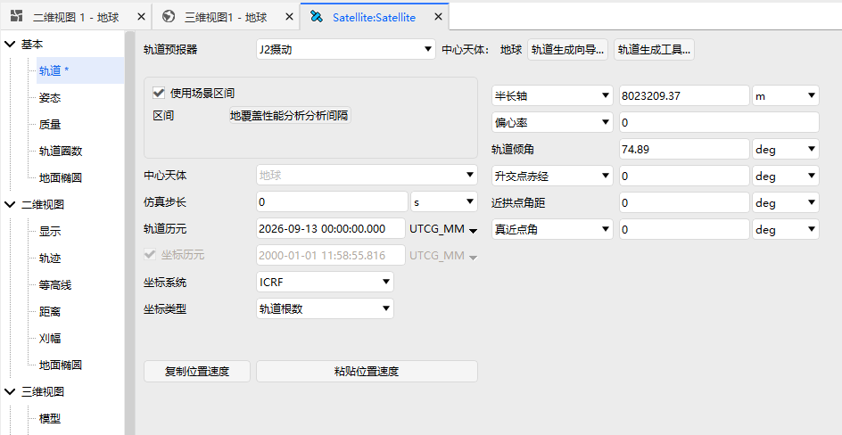

### Generating the Flower Constellation

Click the <kbd>Constellation Design</kbd> module in the【Tools】tab, and set the constellation type to【Flower】. For the seed satellite, select "Satellite", and set the constellation parameters as follows:

- Total number of satellites: 4
- Return circle: 12
- Return day: 1
- Phase density: 4
- Inter-plane phase increment: 1

Click <kbd>Compute</kbd>, and the orbital elements of each satellite are displayed in the window on the right as follows:

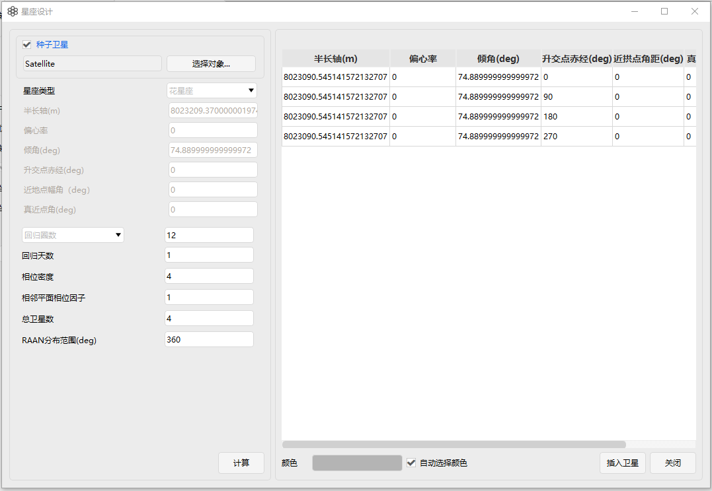

Click <kbd>Insert Satellites</kbd>, select all the satellites of the Flower constellation in the object view, right-click and choose <kbd>Batch Insert</kbd>, and select to insert a sensor. Set the sensor type to【Simple Cone】with a half-cone angle of 45°. The 2D view of the constellation is shown below:

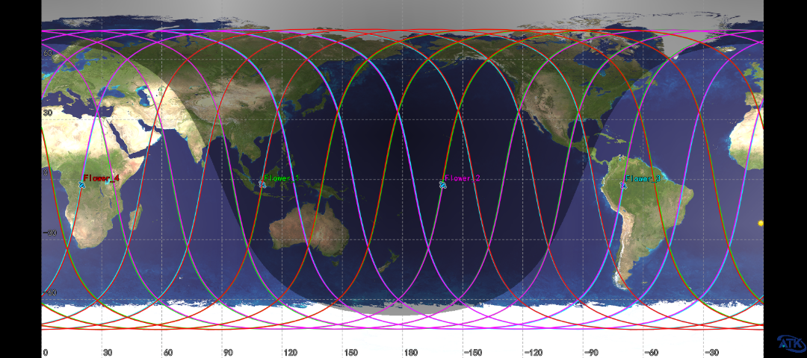

### Generating a Walker-Delta Constellation with the Same Number of Satellites

Click the <kbd>Constellation Design</kbd> module in the【Tools】tab, and set the constellation type to【Walker-Delta】. For the seed satellite, select "Satellite", and set the constellation parameters as follows:

- Total number of satellites: 4
- Number of orbital planes: 4
- Inter-plane phase increment: 1

Click <kbd>Compute</kbd>, and the orbital elements of each satellite are displayed in the window on the right as follows:

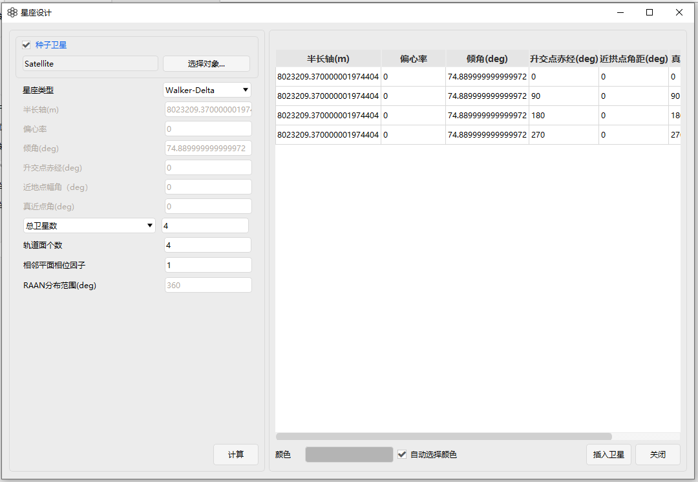

Click <kbd>Insert Satellites</kbd>, select all the satellites of the Walker-Delta constellation in the object view, right-click and choose <kbd>Batch Insert</kbd>, and select to insert a sensor. Set the sensor type to【Simple Cone】with a half-cone angle of 45°. The 2D view of the constellation is shown below:

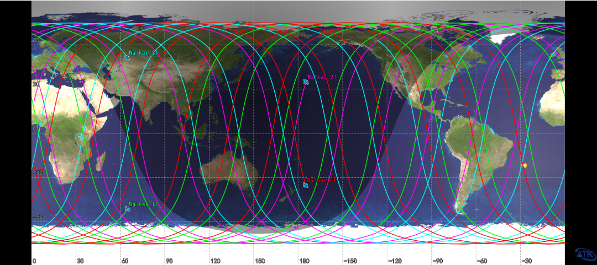

## Creating the Observation Targets

Select <kbd>Insert Object</kbd> - <kbd>Facility</kbd>, and enter the latitude and longitude of the key locations of interest. Here five key locations of interest are selected: Hawaii, Singapore, the Maldives, Jeju Island, and the Izu Peninsula. The specific coordinates of the target points are listed in the table below.

| Target point | Coordinates |
| --- | --- |
| Hawaii | (157°W, 21°N) |
| Singapore | (103.85°E, 1.3°N) |
| Maldives | (73.5°E, 4°N) |
| Jeju Island | (126.53°E, 33.38°N) |
| Izu Peninsula | (138.95°E, 34.9°N) |

The position properties of the five target points after insertion are shown in the figure below. Taking Hawaii as an example, the latitude is 21°, the longitude is -157°, and the altitude is 0 m.

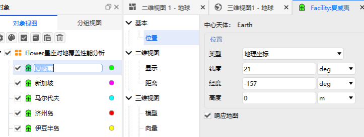

## Constellation Coverage Performance Analysis

### Coverage Analysis of the Flower Constellation over Point Targets

Right-click any target ground point and select <kbd>Coverage</kbd>. Here Hawaii is taken as an example:

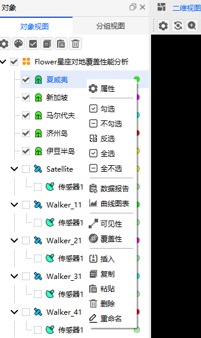

In the <kbd>Select Object</kbd> dialog, select all five target points.

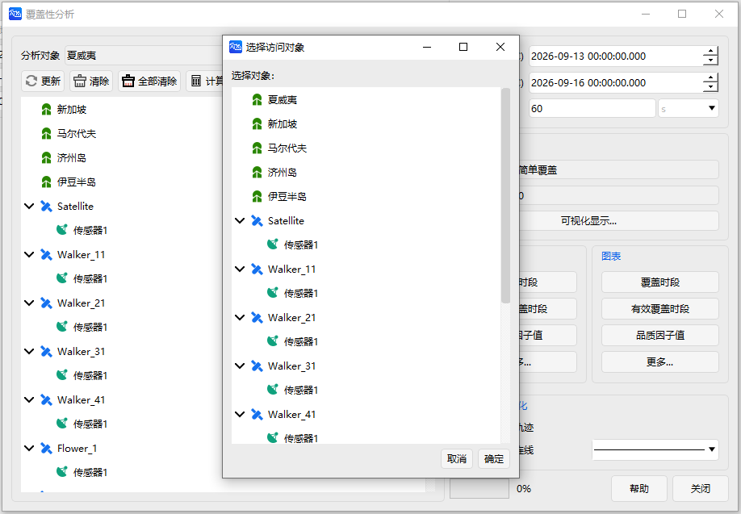

Click <kbd>Define…</kbd> in the【Quality Parameters】area on the right, set the coverage quality definition type to【Revisit Time】and the computation to【Maximum】, and keep the other settings as default.

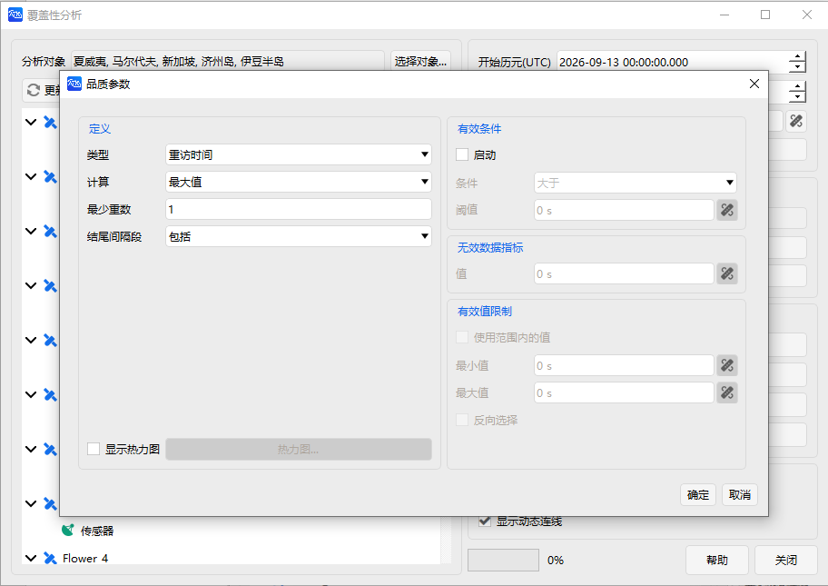

Then select the sensors of all four satellites of the Flower constellation.

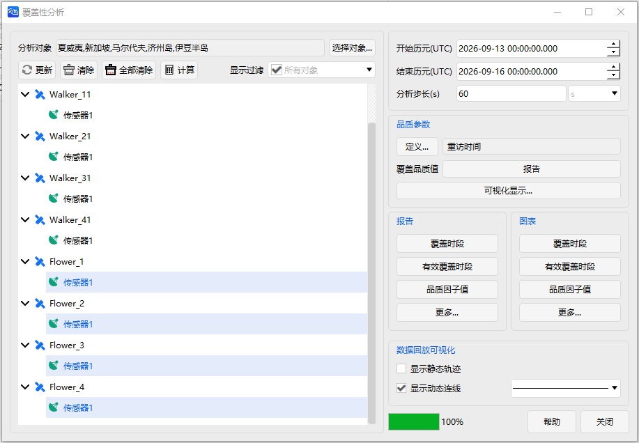

After the settings are determined, click <kbd>Compute</kbd> and then click the coverage quality value report to obtain the maximum revisit time of the constellation for the target point.

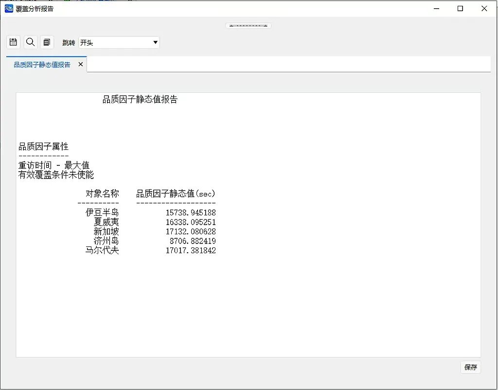

Taking Hawaii as an example, its revisit time for the Flower constellation varies with time as shown in the figure below:

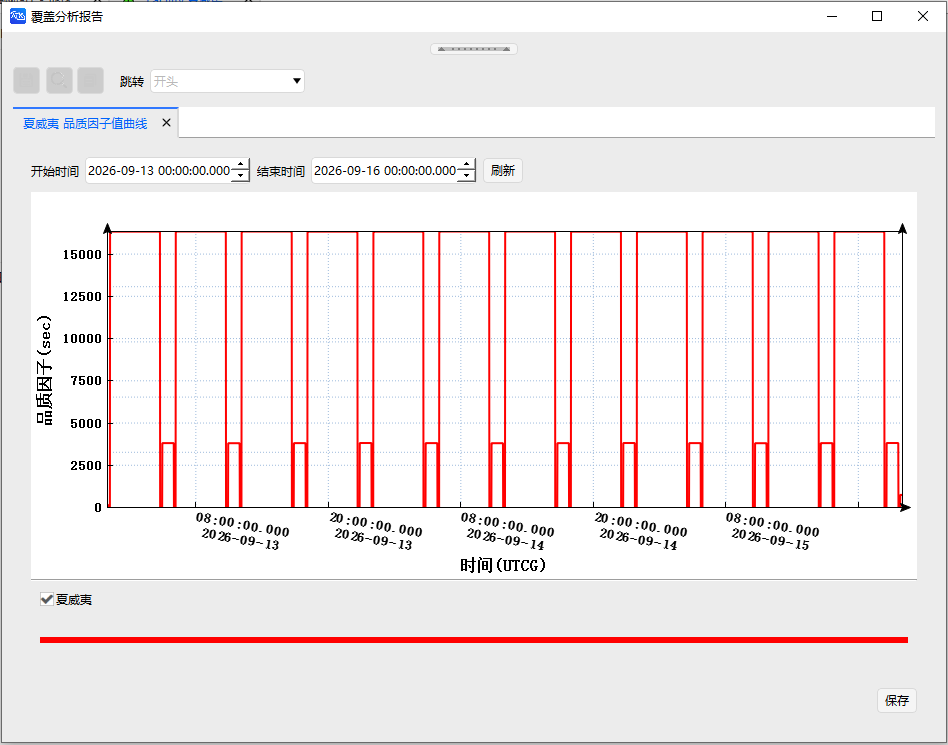

### Coverage Analysis of the Walker-Delta Constellation over Point Targets

Repeat the operations in the previous section for the Walker-Delta constellation with the same number of satellites, and the maximum revisit times of the Walker-Delta constellation for the five target points are obtained in the same way.

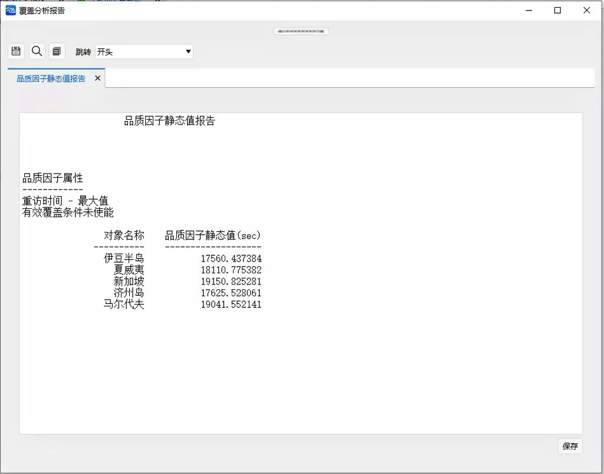

Taking Hawaii as an example, its revisit time for the Walker-Delta constellation varies with time as shown in the figure below:

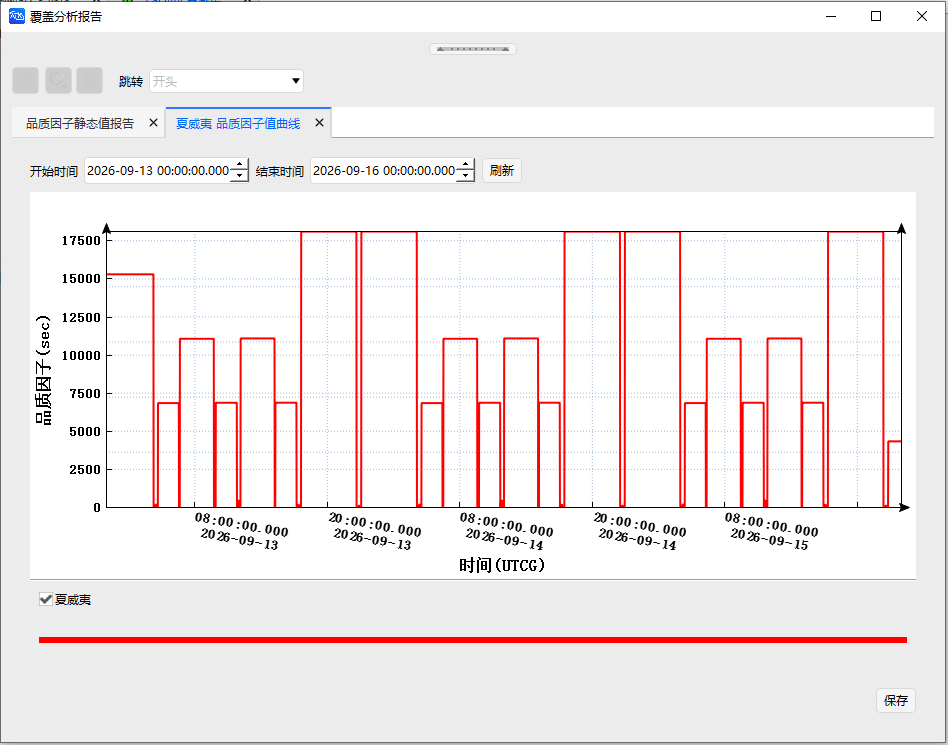

### Comparison of the Maximum Revisit Time

The maximum revisit times of the 4-satellite Flower constellation and the Walker-Delta constellation for the five target points are compared in the table below.

| Target point | Flower constellation | Walker-Delta constellation |
| --- | --- | --- |
| Hawaii | 16338.095251 s | 18110.775382 s |
| Singapore | 17132.080628 s | 19150.825281 s |
| Maldives | 17017.381842 s | 19041.552141 s |
| Jeju Island | 8706.882419 s | 17625.528061 s |
| Izu Peninsula | 15738.945188 s | 17560.437384 s |

It can be seen from the table that the maximum revisit times of the Flower constellation for all five target points are significantly smaller than those of the Walker-Delta constellation. This shows that with 4 satellites, the Flower constellation has better discontinuous coverage performance.

## References

[1] MORTARI D, WILKINS M, BRUCCOLERI C. The Flower Constellations[J]. The Journal of the Astronautical Sciences, 2004, 52: 107-127.

[2] ZHANG Yasheng, JIA Lu, YU Jinlong, LIANG Shuang. Design method of low-Earth-orbit constellation configuration with constant ground track[J]. Chinese Space Science and Technology, 2023, 43(3): 116-122.

[3] ZENG Yujiang, HU Xiulin, WANG Xianhui. Research on the design method of Flower satellite constellations[J]. Journal of Astronautics, 2007, 28(3): 659-662.
