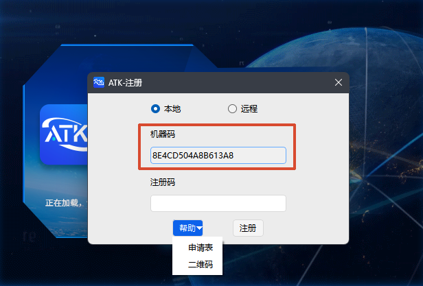

# 使用须知

请确保已完成软件安装步骤。首次启动 ATK 时，将自动弹出【ATK 注册机】界面，如下图所示：

## 机器码说明

**机器码**是 ATK 注册机自动生成的唯一标识（16 位字母数字组合，例如 `30C48ACB13924C96`），用于绑定当前设备。

**请重点记录界面中的机器码**，后续申请注册码时必须提供该信息。

::: warning 重要提醒
机器码与设备绑定，**更换电脑或重装系统后机器码会变化**，需重新申请注册码。
:::

## 注册方式

ATK 的注册按授权范围分为两种方式：

| 注册方式 | 授权范围 | 申请途径 |
| --- | --- | --- |
| 单机版注册 | 注册码与申请时提交的机器码绑定，仅该台电脑可用 | 小程序自助申请、网页在线申请、邮件申请 |
| 网络浮动注册 | 注册码可供多台电脑共享，通过局域网动态分配使用权限 | 联系官方申请 |

个人或单台电脑使用，选择单机版注册；同一局域网内的多台电脑需共用一套授权，选择网络浮动注册。

- [单机版注册](./单机版注册/README.md)：提供三种申请方式，任选其一，各申请方式页末尾附有激活步骤。

- [网络浮动注册](./网络浮动注册/README.md)：需联系官方办理，通过部署 ATK 远程服务实现多台电脑共享授权。

## 激活位置

两种注册方式的激活位置不同：

- **单机版注册**：在 ATK 注册机界面的注册码输入框中填入注册码，点击 <kbd>注册</kbd> 完成激活。

- **网络浮动注册**：服务端在启动终端中输入注册码完成注册；局域网内的客户端在注册窗口选择【远程】，填写服务器 IP 与端口后点击 <kbd>注册</kbd>。
