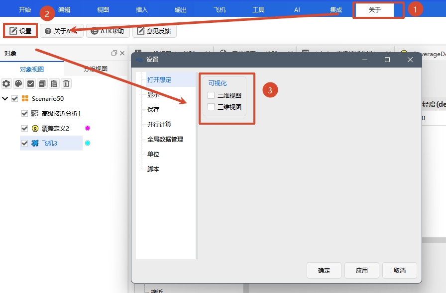

# 提示 OpenGL 版本过低

若计算机的 OpenGL 版本较低，无法支持 ATK 二、三维视图所需的库版本，软件会提示“OpenGL版本过低”错误，严重时启动即闪退。

## 关闭二三维视图功能

关闭二三维视图功能用于检验故障原因：若关闭后软件能够正常运行，即可判定为所用电脑 OpenGL 版本过低，后续通过更新显卡驱动解决。

### 方法一：通过界面设置

在菜单栏点击 <kbd>关于</kbd> 菜单，点击 <kbd>设置</kbd> 按钮打开【设置】对话框，在【打开想定】页的【可视化】分组中取消勾选 **二维视图** 和 **三维视图**，点击 <kbd>确定</kbd> 关闭对话框。

> 设置后需重新启动 ATK 才能生效。该选项控制的是打开想定时是否同时打开二三维视图，不影响当前已经打开的想定。



### 方法二：修改配置文件

1. 打开 ATK 安装目录下的配置文件 systemConfig.ini：

   ```
   <ATK 安装目录>\config\systemConfig.ini
   ```

2. 找到 **[OPEN_SETTING]** 段落中的 **Open2D**、**Open3D**，将取值改为 false 后保存。

   ```ini
   [OPEN_SETTING]
   Open2D=false
   Open3D=false
   ```

3. 重新启动 ATK。

    若软件可以正常打开，则表明故障原因为 OpenGL 版本过低。此时二三维视图处于关闭状态，如需使用，更新显卡驱动后重新勾选即可。

## 更新显卡驱动

- **Windows 系统**：
  - NVIDIA 显卡：访问 [NVIDIA 官网](https://www.nvidia.cn/drivers/) 下载对应型号驱动
  - 其他显卡：前往显卡厂商官网获取最新驱动
- **麒麟系统**：
  - 可通过 **系统设置 → 显示 → 显卡驱动** 检查更新
  - 或访问显卡厂商官网（如 NVIDIA、AMD、Intel）下载 Linux 版驱动
  - 也可使用系统包管理器更新：`sudo apt update && sudo apt upgrade`

驱动更新完成后，在【设置】对话框中重新勾选【二维视图】【三维视图】，或将配置文件中的 Open2D、Open3D 改回 true，即可恢复二三维视图。
