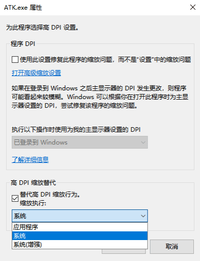

# 高分屏显示异常

::: tip 如何判断是否需要调整
若打开 ATK 后出现以下现象，请按本文档调整：
- 界面文字或图标显示模糊
- 按钮重叠或显示不全
- 窗口比例异常，部分内容被截断
:::

## 调整步骤

1. 右键单击 ATK ，选择 <kbd>属性</kbd>：通过桌面快捷方式启动的，右键单击快捷方式；绿色版解压后直接运行的，右键单击 ATK.exe；

2. 在弹出的【属性】对话框中，切换至「兼容性」选项卡；

3. 找到并点击 <kbd>更改高DPI设置</kbd>；

4. 在【高DPI设置】对话框中，勾选 **替代高DPI缩放行为**；

5. 在「缩放执行」下拉菜单中，将默认的「应用程序」改为 **系统** 或 **系统(增强)**；

6. 在【高DPI设置】对话框中点击 <kbd>确定</kbd>，再在【属性】对话框中点击 <kbd>确定</kbd> 保存设置，**重启 ATK** 生效。

## 若仍有问题

若按上述步骤调整后问题仍未解决，请尝试：

1. 将 Windows 显示缩放比例临时调整为 **100%**（系统设置 → 显示 → 缩放与布局）；
2. 重启 ATK 查看是否正常；
3. 若正常，可尝试逐步调高缩放比例，找到兼顾清晰度与可用性的平衡点；
4. 以上方法均未解决问题时，可[联系我们](../../发布说明/联系我们.md)获取技术支持。
