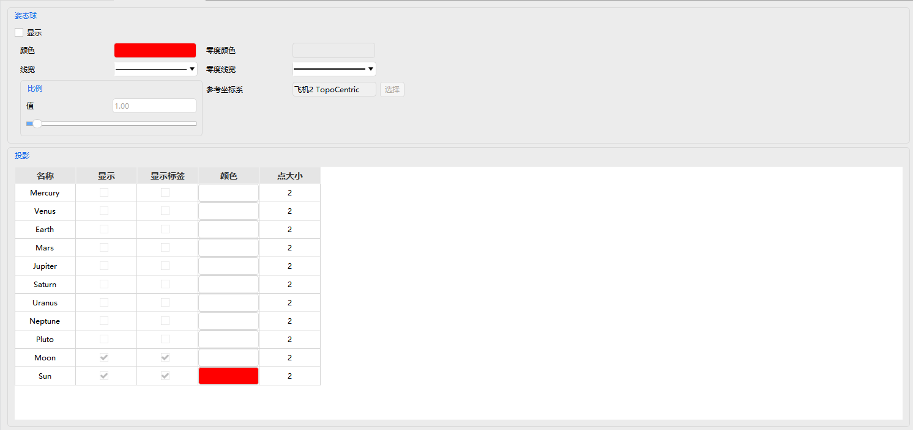

# 姿态球

## 功能说明

配置姿态球的显示及参考坐标系等参数。

## 参数说明

| 参数 | 含义 | 单位或可选项 | 缺省值与适用条件 |
| --- | --- | --- | --- |
| 待补充 | 待补充 | 待补充 | 待核实 |

<!-- 后续依据 ATK 当前实现逐项核对控件名称、取值范围、默认值及单位。 -->

## 设置界面

## 操作说明

<!-- 待补充：设置入口、操作步骤、参数联动关系。 -->

## 使用规则与注意事项

<!-- 待补充：区分仅影响显示的设置与实际影响计算的设置；说明边界情况。 -->

## 相关文档

- [返回三维视图属性总览](./index.md)
- [返回飞机对象总览](../../飞机.md)
