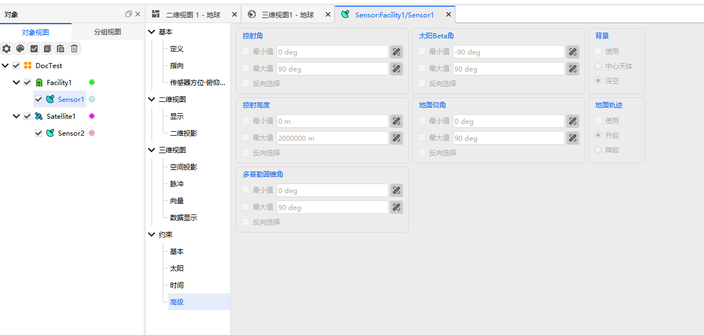

# 高级约束

## 功能说明

高级约束是一组施加在移动载体及其附属对象上的访问约束，用于按视线与天体表面的几何关系、相对运动方向以及地面轨迹走向进一步筛选访问。该页包含掠射角、掠射高度、多普勒圆锥角、太阳Beta角、地面仰角、背景与地面轨迹七组条件。

卫星、飞机、车辆、舰船、潜艇、导弹、火箭等移动对象，以及其附属的传感器、发射器、接收器，均在属性面板的【约束】节点下提供【高级】页。

::: tip 判定规则
各组条件相互独立，勾选后即参与判定。同一时刻只有全部已启用条件均满足，该时刻才被判定为满足高级约束。
:::

## 参数说明

<Entry meta="量纲：角度|单位：deg|范围：[-90°, 90°]" name="掠射角" desc="对象视线方向与中心天体表面切线方向之间的夹角。" objects="卫星,飞机,车辆,舰船,潜艇,导弹,火箭,传感器,发射器,接收器">

该角度反映视线对天体表面的贴近程度：夹角越小，视线越接近天体表面；为 0 时视线与天体表面相切；为负值时视线穿透天体表面，表示对象位于天体内部。

勾选【最小值】或【最大值】并输入角度后，仅保留掠射角落在所设范围内的访问；未勾选的一端不作限制。勾选【反向选择】后判定取反，仅保留范围之外的访问。

</Entry>

<Entry meta="量纲：长度|单位：m、km" name="掠射高度" desc="视线掠过中心天体表面时的最小离地高度。" objects="卫星,飞机,车辆,舰船,潜艇,导弹,火箭,传感器,发射器,接收器">

掠射高度取视轴上各点到中心天体表面距离的最小值。取值大于 0 表示视线从地表上方掠过；小于或等于 0 表示视线与天体表面相交，两点之间不存在直接视距。

缺省范围为 0 m 至 2000000 m。勾选【最小值】或【最大值】并输入高度后参与判定，勾选【反向选择】后判定取反。

</Entry>

<Entry meta="量纲：角度|单位：deg|范围：[0°, 90°]" name="多普勒圆锥角" desc="分析对象与关联对象的相对速度矢量与视线矢量之间的夹角。" objects="卫星,飞机,车辆,舰船,潜艇,导弹,火箭,传感器,发射器,接收器">

夹角以视线矢量为轴度量相对速度方向：夹角为 0° 时目标沿视线方向运动，为 90° 时目标垂直于视线运动。

勾选【最小值】或【最大值】并输入角度后参与判定，勾选【反向选择】后判定取反。

</Entry>

<Entry meta="量纲：角度|单位：deg|范围：[-90°, 90°]" name="太阳Beta角" desc="分析对象指向太阳的矢量与轨道平面之间的夹角。" objects="卫星,飞机,车辆,舰船,潜艇,导弹,火箭,传感器,发射器,接收器">

Beta 角由太阳矢量与轨道平面法向之间的夹角取余角得到，等价于太阳矢量相对轨道平面的仰角。Beta 角为 0° 时太阳矢量位于轨道平面内；绝对值为 90° 时太阳矢量沿轨道面法向。

勾选【最小值】或【最大值】并输入角度后参与判定，勾选【反向选择】后判定取反。

</Entry>

<Entry meta="量纲：角度|单位：deg|范围：[0°, 90°]" name="地面仰角" desc="空间目标相对于天体表面对象的仰角。" objects="卫星,飞机,车辆,舰船,潜艇,导弹,火箭,传感器,发射器,接收器">

对地面站等单点对象，地面仰角为视线与过该点的地表切平面之间的夹角；对区域目标，取区域内任意一点能够观测到该目标的最大仰角。

勾选【最小值】或【最大值】并输入角度后参与判定，勾选【反向选择】后判定取反。

</Entry>

<Entry name="背景" desc="约束访问视线方向与中心天体之间的相对关系，限定观测背景为深空或中心天体时才可访问。" objects="卫星,飞机,车辆,舰船,潜艇,导弹,火箭,传感器,发射器,接收器">

勾选本组的【使用】后，在【深空】与【中心天体】中二选一：

| 选项 | 含义 |
|---|---|
| 深空 | 观测背景为深空时可访问。适用于需要避免天体背景干扰的场景，如深空观测、星际通信、雷达遥感。 |
| 中心天体 | 观测背景为中心天体时可访问。适用于以该天体作为背景参考的任务，如对地观测、地面站通信、光学遥感。 |

</Entry>

<Entry name="地面轨迹" desc="约束对象地面轨迹纬度的变化方向。" objects="卫星,飞机,车辆,舰船,潜艇,导弹,火箭,传感器,发射器,接收器">

勾选本组的【使用】后，在【升段】与【降段】中二选一：

| 选项 | 含义 |
|---|---|
| 升段 | 仅保留地面轨迹由南向北、目标纬度增加的时段。 |
| 降段 | 仅保留地面轨迹由北向南、目标纬度减小的时段。 |

</Entry>

## 补充说明

- 掠射角、掠射高度、多普勒圆锥角、太阳Beta角、地面仰角均提供【反向选择】。勾选后落在所设范围内的访问被剔除，仅保留范围之外的访问。

- 背景与地面轨迹为组类条件，需先勾选该组的【使用】，组内的选项才生效。
