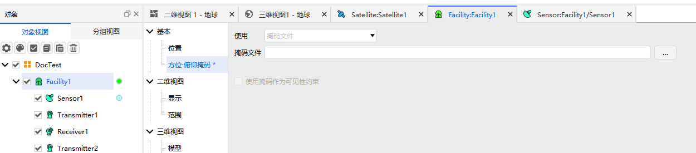
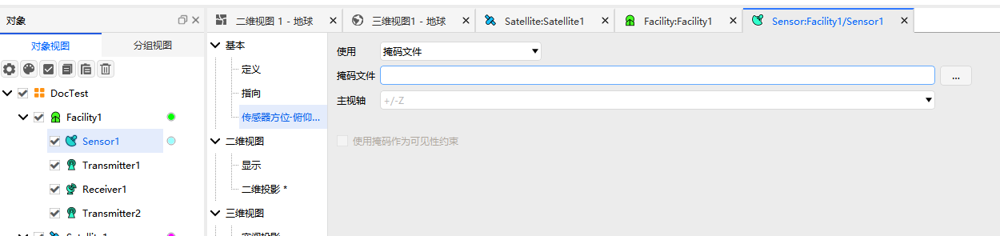

# 方位-俯仰掩码

## 功能说明

方位-俯仰掩码（Azimuth-Elevation Mask，简称 AzEl Mask）是一种基于预定义掩码数据的视线遮挡约束，用于模拟建筑物、地形或其他障碍物对地面站、传感器与目标之间视线的遮挡。

掩码文件通过方位角、仰角等数据描述观测点周围的遮挡情况。在可见性分析中，软件根据观测点指向目标的视线方向，查询对应的掩码数据，判断该方向是否满足通视条件。

对于常规方位-俯仰掩码，可以通过不同方位角对应的最低可见仰角描述遮挡边界；对于距离依赖掩码，还可以考虑目标距离对遮挡判断的影响。

启用 AzEl Mask 约束后，软件在涉及该对象的相关访问计算中增加掩码判断。只有满足掩码约束及其他已启用可见性约束的时间区间，才可能形成有效访问。

地面站与传感器均支持配置方位-俯仰掩码，但可使用的掩码文件类型有所不同：

- **地面站方位-俯仰掩码**：主要用于描述地面站周围地形、建筑等障碍物造成的视线遮挡，使用 `.aem` 文件。
- **传感器方位-俯仰掩码**：用于描述传感器观测方向上的遮挡限制，支持 `.aem` 和 `.bmsk` 文件。

## 配置入口

- **地面站**：在对象属性面板中依次展开【基本】，点击【方位-俯仰掩码】。

  

- **传感器**：在对象属性面板中依次展开【基本】，点击【传感器方位-俯仰掩码】。

  

## 参数说明

| 参数 | 适用对象 | 说明 |
|---|---|---|
| 使用 | 地面站、传感器 | 选择掩码数据的使用方式。可选【无】或【掩码文件】。选择【无】时不加载掩码；选择【掩码文件】时，从指定文件读取掩码数据。缺省为【无】。 |
| 掩码文件 | 地面站、传感器 | 指定外部掩码文件的路径，可通过右侧浏览按钮选择。地面站支持 `.aem` 文件，传感器支持 `.aem` 和 `.bmsk` 文件。 |
| 主轴 | 传感器 | 指定掩码角度数据所参考的主轴方向，可选择 X、Y 或 Z 轴。不同主轴对应不同的方位角、仰角参考定义，应根据掩码数据使用的坐标轴选择。 |
| 使用掩码作为可见性约束 | 地面站、传感器 | 控制是否将已配置的掩码应用于访问计算。勾选后，掩码参与可见性判定；未勾选时，掩码配置不作为访问约束生效。 |

::: tip 生效条件
掩码约束是否生效，由【使用】和【使用掩码作为可见性约束】共同决定：

1. 在【使用】中选择【掩码文件】，并加载相应的文件。
2. 勾选【使用掩码作为可见性约束】。

完成上述设置后，掩码才会作为已启用的约束参与相关访问计算。
:::

## 掩码文件格式（.aem）

方位-俯仰掩码通过外部文件提供遮挡数据，支持的文件类型包括 `.aem` 和 `.bmsk`。

掩码文件为文本文件，按方位角逐组给出仰角阈值

- **方位角（Azimuth）**：单位为度（°），数据按方位角顺序排列。从 0° 开始，到 360° 结束。
- **仰角（Elevation）**：单位为度（°），取值范围为 -90°～90°，表示对应方位上的遮挡仰角阈值。

| 文件类型 | 文件含义 | 适用对象 | 数据特点 |
|---|---|---|---|
| `.aem` | 方位-俯仰掩码文件（Azimuth-Elevation Mask） | 地面站、传感器 | 通过方位角、仰角及可选的距离数据描述遮挡条件。 |
| `.bmsk` | 本体掩码文件（Body Mask） | 传感器 | 通过角度轮廓描述传感器周围的包含区域与排除区域。 |

其中，`.aem` 文件按照数据组织方式，可以分为通用掩码和距离依赖掩码两类。

### 通用掩码（.aem）

通用方位-俯仰掩码通过一组方位角与仰角数据，描述观测点在不同方位上的遮挡边界。

每个方位角对应一个仰角阈值。对于给定方向，当目标仰角低于该方向的遮挡阈值时，该视线不满足掩码约束。

| 关键字 | 说明 |
|---|---|
| BEGIN AzElMask / END AzElMask | 标记方位-俯仰数据段的起始与结束。 |
| NumberOfPoints | 方位-俯仰数据对的数量。 |
| BEGIN AzElMaskData | 标记方位-俯仰数据对的起始。 |

数据段中每行给出一个方位角及其仰角阈值：

```
BEGIN AzElMask
NumberOfPoints 360
BEGIN AzElMaskData
0.000000 1.043000
1.000000 1.058000
...
359.000000 1.058000
END AzElMask
```

### 距离依赖掩码

距离依赖掩码（Range-dependent Azimuth-Elevation Mask）在通用方位-俯仰掩码的基础上，增加了距离信息，用于描述同一方位角下，遮挡条件随观测距离变化的情况。

| 关键字 | 说明 |
|---|---|
| FullMask | 标识该文件包含随距离变化的掩码定义。 |
| NumPoints | 方位角分组数。 |
| MaxRange | 掩码原点到遮挡体仰角升起处的最大距离。 |
| Latitude / Longitude / Altitude | 掩码原点的纬度、经度与高度。 |
| MeasureAzOnSurface | 规定目标对象的方位角按目标对象星下点的方位角度量。 |

距离依赖掩码按方位角分组记录数据。

每个方位角数据组由一行标题和若干行仰角—距离数据组成。

**1. 方位角数据组标题**

每组第一行包含三个数据：

`方位角  最大遮挡仰角  数据行数`

| 数据列 | 说明 |
|---|---|
| 第 1 列 | 方位角，单位为度（°）。 |
| 第 2 列 | 该方位角方向上为避免遮挡所需的最大仰角，单位为度（°）。 |
| 第 3 列 | 当前方位角数据组后续的仰角—距离数据行数。 |

**2. 仰角—距离数据**

标题行之后的每一行包含两个数据：

`仰角  斜距`

| 数据列 | 说明 |
|---|---|
| 第 1 列 | 对应距离节点处的遮挡仰角，单位为度（°）。 |
| 第 2 列 | 从掩码原点至对应距离节点的距离，单位为米（m）。 |

某个仰角—距离数据对表示：沿当前方位角，当考虑的距离超过该节点距离时，需要采用相应的遮挡仰角进行判断。

距离依赖掩码还具有以下边界处理规则：

- 每个方位角数据组的最大遮挡仰角应在最后一条仰角—距离记录中重复出现。
- 当考虑的距离大于 `MaxRange` 时，使用该方向的最大遮挡仰角。
- 在掩码原点与第一个距离节点之间，使用的仰角为 0° 或 -90°，取决于第一个仰角值的符号。距离依赖掩码按方位角分组记录数据。

```
FullMask
NumPoints 360
MaxRange 167577.16
Latitude 37.14888883
Longitude 127.07527765
Altitude 41.514
MeasureAzOnSurface Yes
Begin AzElMaskData
0.000000 1.043000 7
-0.006000 9.400000
0.257000 1232.450000
0.620000 1538.290000
0.862000 1844.170000
0.971000 2150.040000
1.011000 2455.880000
1.043000 2761.720000
...
359.000000 1.058000 7
-0.015000 9.400000
0.261000 1232.450000
0.636000 1538.300000
0.881000 1844.180000
0.988000 2150.050000
1.027000 2455.890000
1.058000 2761.730000
```

其中，最大仰角在考虑的距离大于 MaxRange 时使用，该数据作为该方位角分组的最后一个仰角-斜距对重复出现；原点与第一个斜距值之间采用的仰角为 0°，或按第一个仰角的符号取 -90°。

### 本体掩码（.bmsk）

本体掩码（Body Mask）主要用于描述传感器周围物体对观测方向造成的遮挡。

与 `.aem` 文件主要通过方位角、仰角及距离描述遮挡条件不同，`.bmsk` 文件通过方向轮廓定义允许观测的区域或需要排除的区域。

例如，当传感器安装在卫星、飞机、舰船等平台上时，平台本体、支架或其他设备可能遮挡部分观测方向。此时可以利用本体掩码描述这些方向上的遮挡限制。

`.bmsk` 文件可以包含以下两类区域：

- **包含区域（Inclusion）**：表示定义为允许观测的方向区域。
- **排除区域（Exclusion）**：表示需要从可观测方向中排除的区域。

这些区域由方位角和仰角轮廓描述，并可包含相应的坐标轴定义。

因此，`.bmsk` 与 `.aem` 虽然都用于限制可见性，但两者的数据组织方式不同，不能将 `.bmsk` 简单理解为普通方位角—最低仰角数据表。

## 补充说明

- 掩码只改变访问判定中的可见性，不改变传感器视场本身的几何形状。
- 掩码描述的是相对站点位置的遮挡轮廓，站点位置或周围障碍物发生变化后，应同步更新掩码文件。
