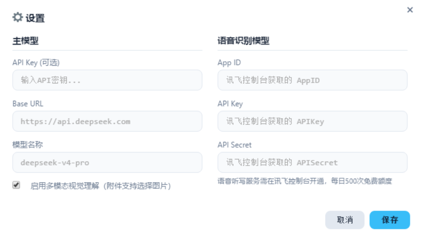

# 使用说明

ATK 智能体以自然语言与多模态大模型驱动 ATK 的工具计算、数据组织与可视化展示，支持通过自然语言文本、语音、图片、表格、技术报告与学术论文等多种形式描述需求，完成 ATK 场景的设计、生成、修改与分析，无需编写代码或记忆 Connect 命令格式。

用户只需表述任务目标，例如轨道类型、载荷参数与仿真时段，智能体即可完成对象创建、参数赋值、仿真推演与数据后处理等完整流程。

## 首次启动

首次启动软件时自动弹出新手引导，按引导完成初始配置即可开始使用。此后可随时点击左下角的「新手引导」重新查看。

## 模型接入与配置

所有模型配置均在左下角「参数设置」中完成，包括主模型与语音识别模型两项。

### 主模型

主模型是软件的核心组件，未配置则无法对话。在主模型栏填写服务商提供的 API Key、Base URL 与模型名称，支持任何兼容 OpenAI API 规范的大模型服务，例如 DeepSeek、千问、GLM。

| 配置项 | 说明 |
|--------|------|
| API Key | 服务商提供的接口密钥，使用本地 Ollama 等无需鉴权的服务时可留空 |
| Base URL | 模型服务的端点地址 |
| 模型名称 | 调用的模型名称 |

以 DeepSeek 为例，Base URL 填 https://api.deepseek.com，模型名称填 deepseek-v4-pro，具体取值参见 [DeepSeek 官方文档](https://api-docs.deepseek.com/zh-cn/)。

智能体同样支持本地部署的模型。以 Ollama 为例，Base URL 填 http://localhost:11434/v1，具体用法参见 [Ollama API 文档](https://docs.ollama.com/api/introduction)。

### 多模态视觉理解

勾选「启用多模态视觉理解」后，对话附件支持选择图片，前提是所配置的大模型具备多模态视觉理解能力。

### 语音识别模型

语音识别模型为可选项。如需语音输入，在语音识别模型栏填写讯飞控制台获取的 App ID、API Key 与 API Secret。

语音听写服务需先在讯飞控制台开通，每日 500 次免费额度。不配置不影响文字对话。

## 后续阅读

- [界面与基本使用](./02-界面与基本使用.md)
- [当前适用范围](./03-当前适用范围.md)
- [输入示例](./04-输入示例.md)
