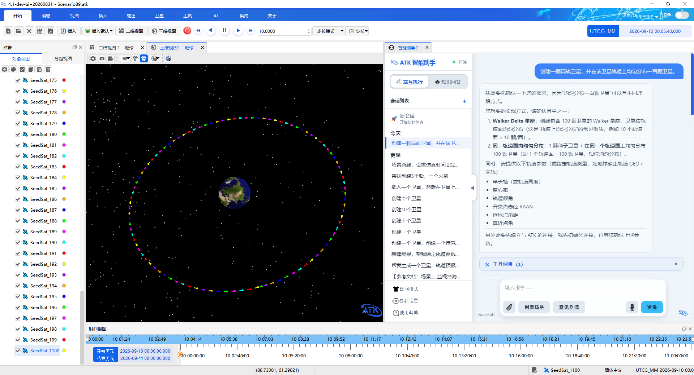
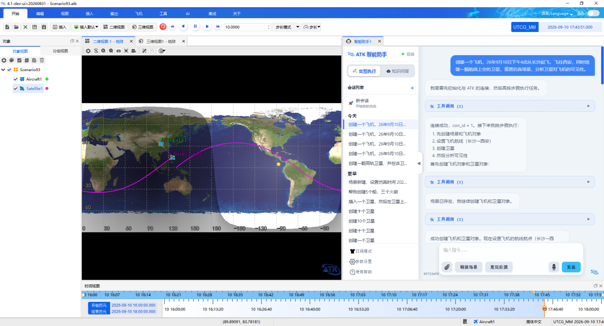
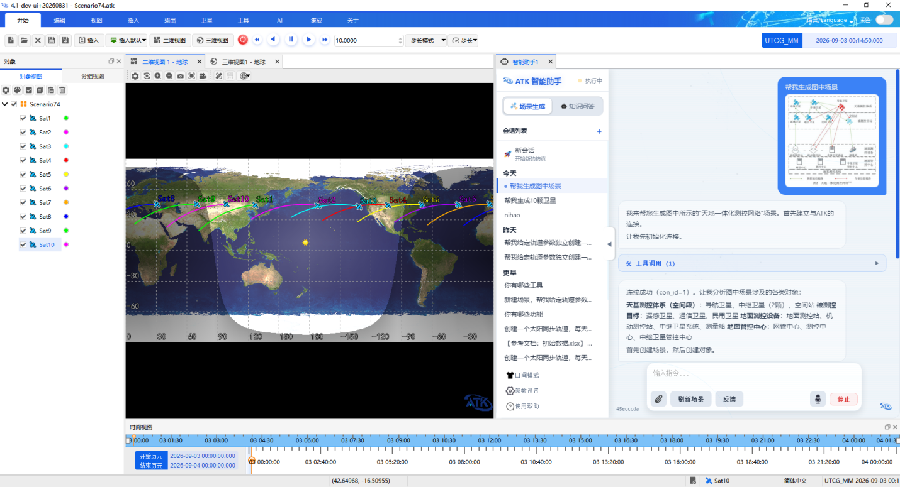
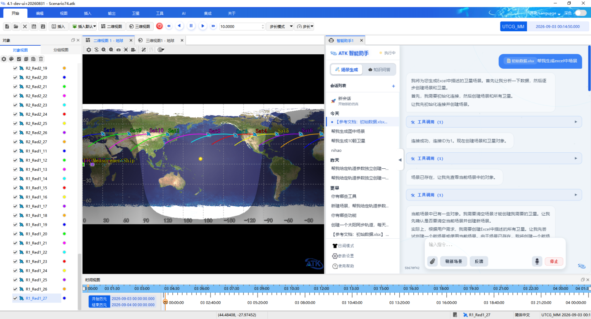
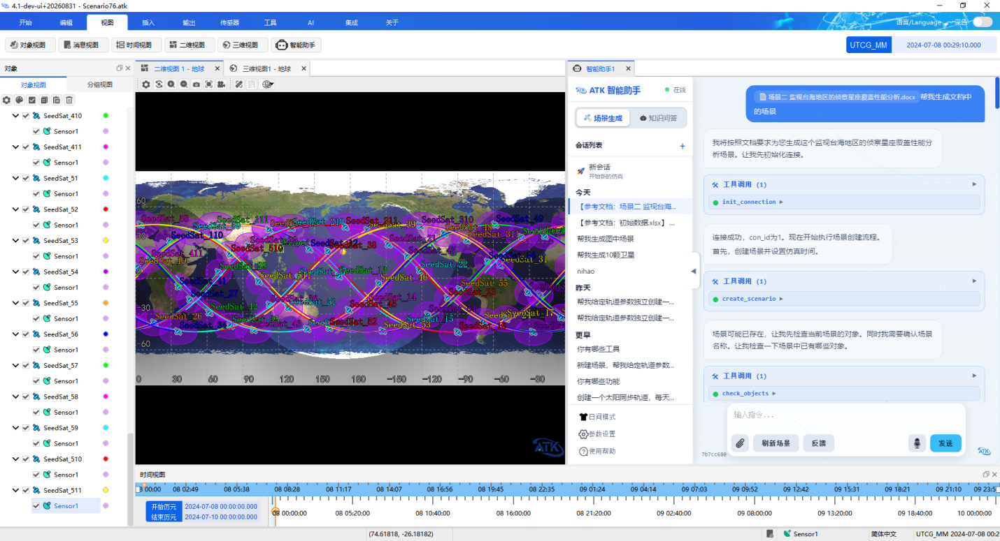

# 输入示例

ATK 智能体支持自然语言文本、语音、图片、Excel 表格与技术文档等多种输入形式。以下示例覆盖对象基本操作、各类输入方式，以及机动规划与可见性分析等完整场景的生成过程。

## 场景与对象基本操作

包括场景和对象的新建、删除、重命名与查询。

::: details open **批量创建对象**

```
帮我创建 20 个卫星、10 个火箭、5 个导弹。
```

:::

::: details open **按类型删除**

```
帮我删除所有导弹。
```

:::

::: details open **批量重命名**

```
帮我将 sat1-5 重命名为 satellite1-5。
```

:::

::: details open **查询当前场景状态**

```
帮我总结当前场景信息。
```

:::

## 自然语言文本输入

用自然语言描述任务目标即可，智能体会将其解析为具体的操作指令序列并执行。对于存在多种实现方式的需求，智能体会先给出可选方案并确认轨道参数，再按确认结果执行。

::: details open **高轨卫星与轨道面均匀分布**

```
帮我创建一颗高轨卫星，并在该卫星轨道上均匀分布一百颗卫星。
```

:::



## 语音输入

配置语音识别模型后，点击输入框右侧的麦克风按钮即可开始语音输入，说话内容实时转为文字写入输入框。

::: details open **飞机航线与卫星可见性分析**

```
创建一个飞机，26 年 9 月 10 日下午 4 点从长沙起飞，飞往西安，同时创建一颗航线上空的卫星，分析卫星对飞机的可见性。
```

:::



## 图片输入

在参数设置中勾选「启用多模态视觉理解」并接入支持视觉理解的大模型后，可上传图片并附文字说明，由智能体解析图中的场景结构。

::: details open **按图片生成场景**

```
帮我生成图中场景。
```

:::



## Excel 输入

智能体支持解析 Excel 中的表格数据，例如卫星及其轨道根数数据列表。上传 Excel 文档并附上文字说明即可。

::: details open **按 Excel 表格生成场景**

```
帮我生成 Excel 中的仿真场景。
```

:::



## Word 文档输入

智能体支持解析技术文档、公众号案例等 Word 文档，从中提取对象与参数信息并生成对应场景。

::: details open **按 Word 文档生成场景**

```
帮我生成文档中的仿真场景。
```

:::



## 机动规划快速转移案例

该案例由创建场景、设置初始段、两段预报与两次瞄准修正组成，最终完成从初始轨道到目标轨道的快速转移。

::: details open **快速转移机动规划**

创建场景，仿真时间为 2022 年 11 月 5 日至 2022 年 11 月 7 日。插入卫星，设置轨道预报器为机动规划，初始段坐标系为地球、坐标系为 J2000，坐标类型为轨道根数（半长轴 6700000 m，偏心率 0，轨道倾角 0°，升交点赤经 0°，近拱点角距 0°，真近点角 0°）。

插入预报段，设置引力模型为 JGM3，三体引力勾选太阳，停止条件设置为 duration，触发值 7200 秒。勾选大气阻力摄动与太阳光压，三体引力勾选月球，插入瞄准序列段。在该瞄准序列段下插入机动段，设置约束配置为远拱点半径，推力坐标轴为 VNC，设置速度增量 Vx 为设计变量；设置瞄准序列段的微分修正，勾选 Vx 和远拱点半径，远拱点半径触发值为 84328394 m。

在瞄准序列后继续插入预报段，设置与之前一致，停止条件为与中心天体距离，触发值为 42164197 m。再插入瞄准序列段，在该序列段下创建机动段，设置约束配置为偏心率，推力坐标轴为 VNC，勾选 Vx 和 Vz 为设计变量。设置瞄准序列段的微分修正，勾选控制变量 Vx 和 Vz，最大步长均改为 300，勾选约束偏心率，收敛误差为 0.001。在该瞄准序列段后插入预报段，停止条件为 duration，触发值为 172800。

最后运行机动规划。

:::


## 可见性场景生成案例

该案例覆盖地面站与覆盖定义创建、传感器配置、星座构型生成以及仿真状态重置，可用于构建区域可见性与覆盖分析场景。

::: details open **区域可见性与覆盖场景**

新建场景，设置仿真时间 2024-07-08 00:00:00.000 至 2024-07-10 00:00:00.000。插入台北地面站（纬度 25.05，经度 121.5）。插入台海地区覆盖定义（经度范围 117.5 至 122，纬度 22 至 26.5），插入马六甲地区覆盖定义（经度 95 至 104.5，纬度 1.3 至 5.5）和五大湖区域覆盖定义（经度 -92 至 -76，纬度 41 至 49）。创建一个卫星，用轨道向导设置为回归轨道，高度约 412400 m，倾角 45°，回归圈数 15.537，首个升交点经度为 0。在该卫星下创建一个半角 63° 的圆锥传感器。以该卫星为种子卫星创建星座，轨道面 5 个，每个面 11 颗卫星，面间相位增量为 4。最后重置场景仿真状态。

:::


