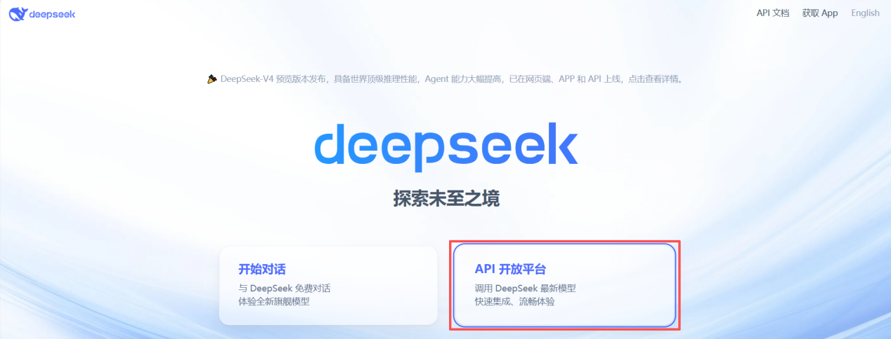
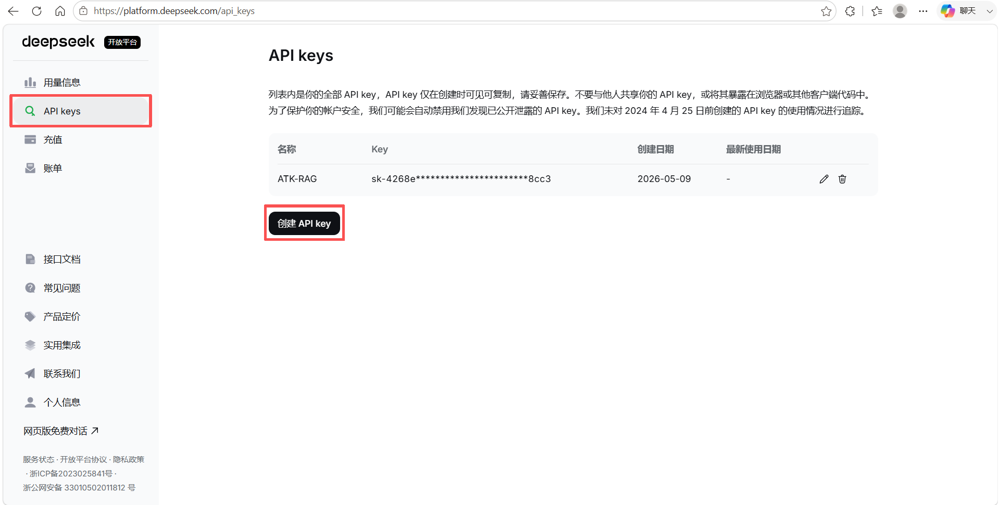
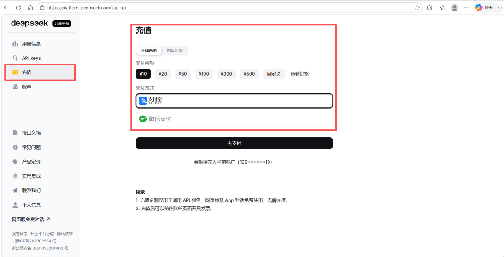
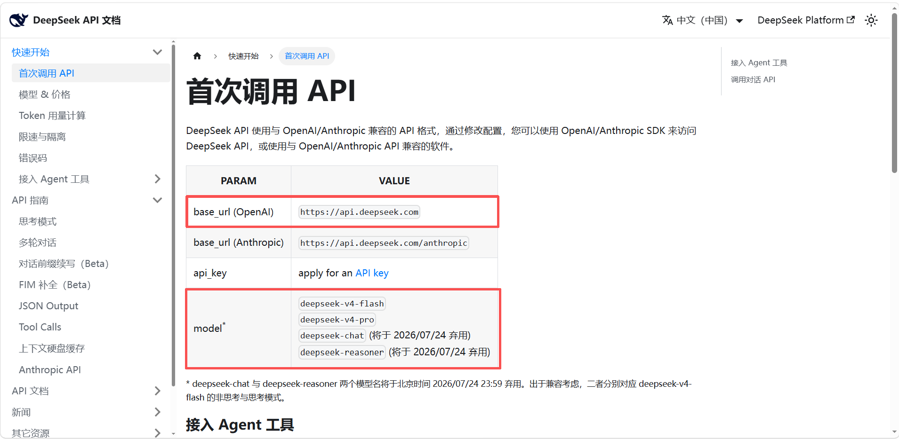
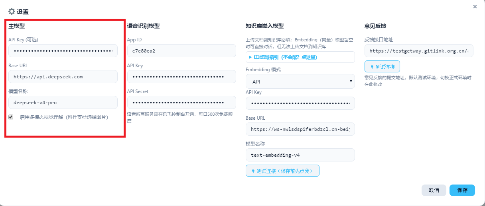
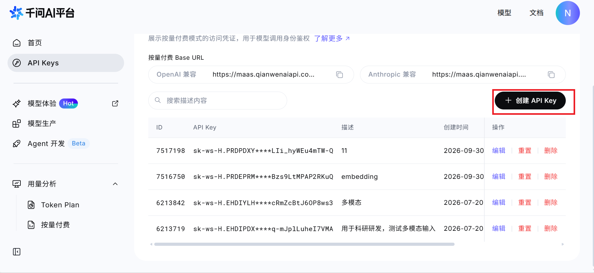
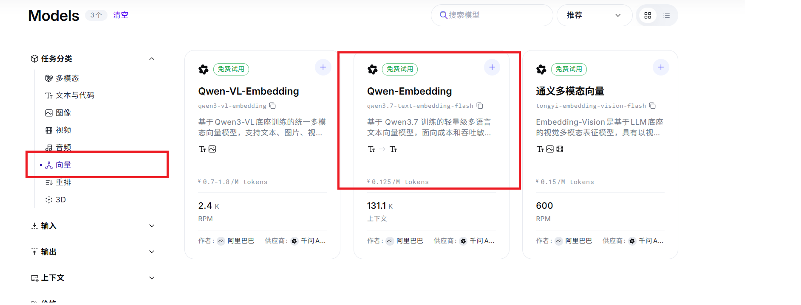
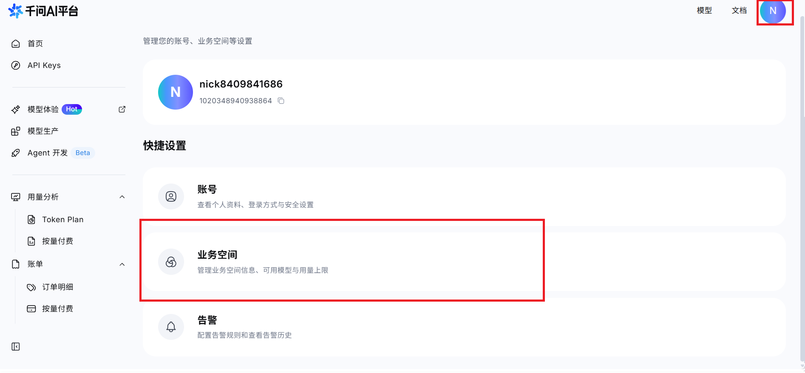
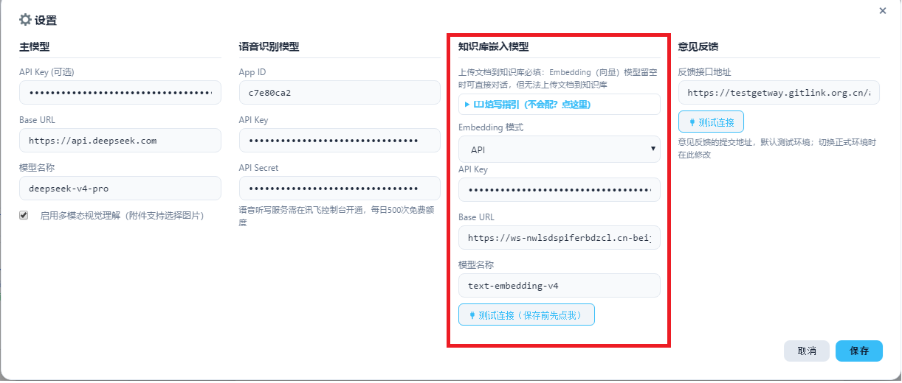

# API 模型配置

无需本地 GPU，通过云服务商提供的 API 接口调用模型。问答模型与嵌入模型分别填写对应的 API Key、Base URL 与模型名称。

## 问答模型配置

以 **DeepSeek** 为例。

### 获取 API Key

进入 [DeepSeek 官网](https://www.deepseek.com/)，点击 **API 开发平台**。



在 **API keys** 页面创建 API key。



::: warning 使用前注意
API 服务按量计费，使用前需先充值。


:::

### 获取 Base URL 和模型名称

点击 **接口文档**，可查看 base_url 和 model 参数。



### 填写模型配置

在「参数设置」的主模型栏中依次填入 API Key、Base URL 与模型名称。以 DeepSeek 为例，Base URL 为 https://api.deepseek.com，模型名称如 deepseek-v4-pro。



## 嵌入模型配置

以千问 AI 平台的 **text-embedding-v4** 为例。

### 获取 API Key

访问 [千问 AI 平台](https://www.qianwenai.com/)，在左侧进入 **API Keys** 页面，点击 **创建 API Key**。该服务需完成实名认证后使用。



### 选择模型

在模型列表中按 **向量** 分类筛选，选择 Qwen-Embedding 系列模型。



### 获取业务空间与 Base URL

点击右上角头像进入账号设置，在 **业务空间** 中查看业务空间 id。



嵌入模型的 Base URL 使用以下格式，将业务空间 id 替换为实际值：

```text
https://{业务空间id}.cn-beijing.maas.aliyuncs.com/compatible-mode/v1
```

### 填写模型配置

在「参数设置」的知识库嵌入模型栏中，Embedding 模式选择 **API**，依次填入 API Key、Base URL 与模型名称 text-embedding-v4，点击「测试连接」，连接通过后保存。


