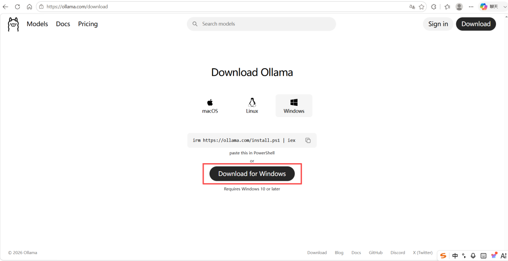
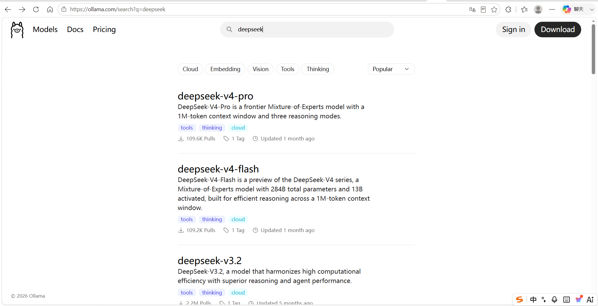
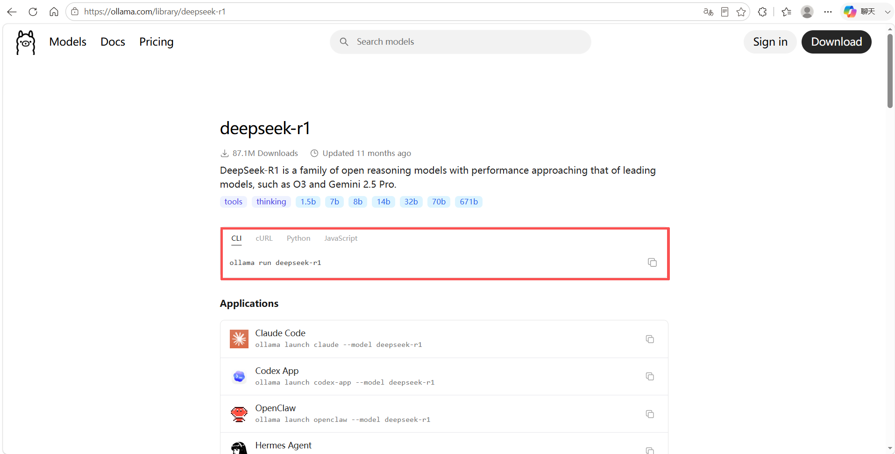
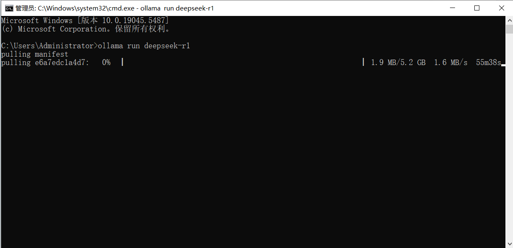
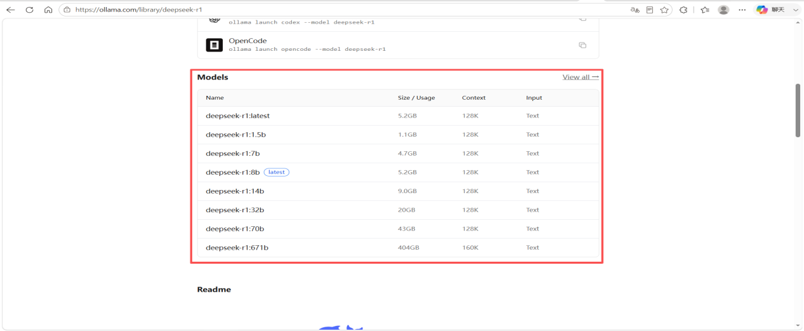
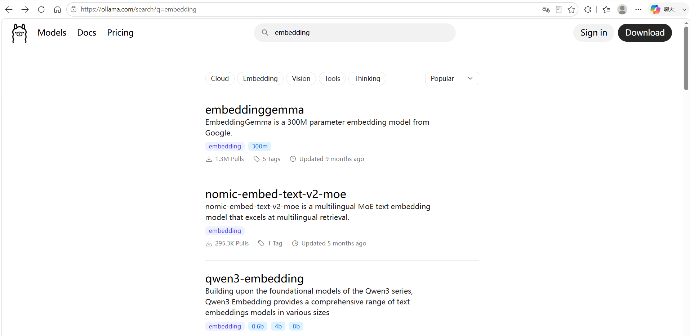
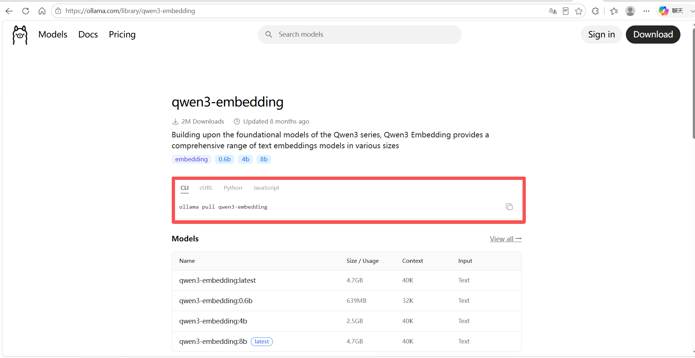
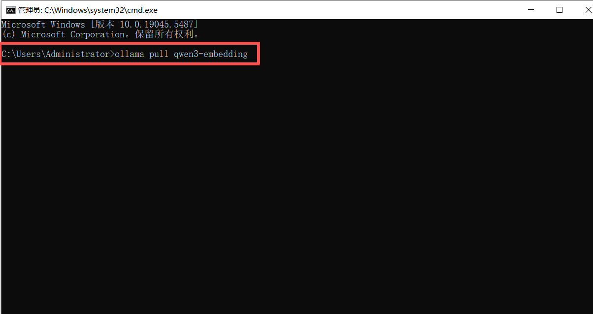
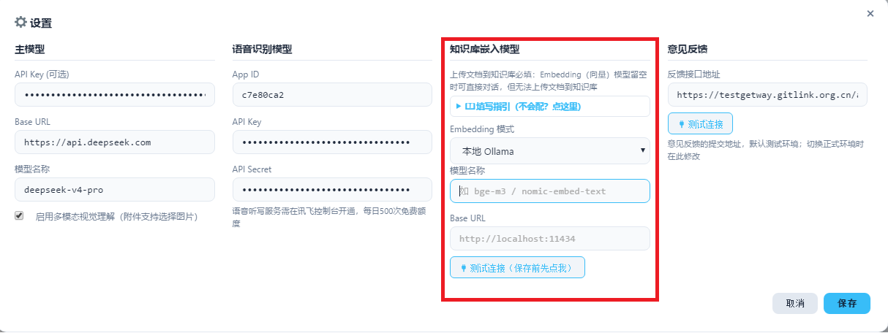

# 本地模型配置

本地部署使用 [Ollama](https://ollama.com/) 在本地运行模型，问答模型与嵌入模型的操作流程一致：先安装 Ollama，再下载对应模型，最后在「参数设置」中填写配置。

## 安装 Ollama

访问 [Ollama 官网](https://ollama.com/) 下载并安装 Ollama。



## 问答模型

以 DeepSeek-R1 为例。

### 下载模型

在 [Ollama](https://ollama.com/) 的模型库中搜索需要的模型，点击模型即可看到下载命令。





使用 <kbd>Win + R</kbd> 打开运行窗口，粘贴命令后回车开始下载。例如下载 deepseek-r1：

```bash
ollama run deepseek-r1
```



::: tip 选择不同参数规模
下载时可在模型名后追加标签指定参数规模，例如 ollama run deepseek-r1:8b。


:::

### 填写模型配置

在「参数设置」的主模型栏中填写：

| 配置项 | 取值 |
|--------|------|
| Base URL | http://localhost:11434/v1 |
| 模型名称 | 已下载的模型名，例如 deepseek-r1:8b |
| API Key | 本地服务无需鉴权，可留空 |

## 嵌入模型

以 Qwen3-Embedding 为例。

### 下载模型

在 [Ollama](https://ollama.com/) 的模型库中搜索嵌入模型，例如 qwen3-embedding，下载方式与问答模型相同。





在命令行中执行下载命令：

```bash
ollama pull qwen3-embedding
```



### 填写模型配置

在「参数设置」的知识库嵌入模型栏中填写：

| 配置项 | 取值 |
|--------|------|
| Embedding 模式 | 本地 Ollama |
| 模型名称 | 已下载的模型名，例如 qwen3-embedding:4b |
| Base URL | http://localhost:11434 |

填写完成后点击「测试连接」，连接通过后保存。


