# Flower星座对地覆盖性能分析

## 内容简介

卫星星座是由多颗卫星组成的一个整体系统，这些卫星在空间中按照特定的轨道分布和排列方式运行，共同完成特定的任务。**Flower 星座是一种具有共地面轨迹特性的星座**，其对地观测覆盖区域更加集中，对于不连续覆盖任务有较强的适用性。**共地面轨迹的特性可以使星座在卫星数较小的情况下达到更好的覆盖效果**。

在对地观测任务中，经常需要对某地面目标保持尽量持续观测，如果观测能不间断，则称星座对目标连续覆盖；否则，为不连续覆盖。当星座卫星数较少时，不连续覆盖不可避免，这时**覆盖间隔（即重访时长）越短越好**。本案例构建了一个 Flower 星座，分析了其对五个目标点的重访时长，并对比了同卫星数的 Walker-Delta 星座的不连续覆盖性能。

## Flower 星座模型简介

Flower 星座这一概念最早于 2003 年由德州 A&M 大学 Daniele Mortari 教授团队提出[1]。因为在地固系中观察时，该星座的轨道形状犹如盛开的花，所以其被称为 Flower 星座。**Flower 星座的卫星具有共地面轨迹特性**，且每颗卫星具有相同的回归天数和轨道倾角，卫星之间的升交点赤经和相位还具有特定的关系。根据共地面轨迹理论，**Flower 星座的所有卫星在地球表面形成的星下点轨迹完美重合**[2]。Flower 星座的相对位置关系与星下点轨迹分别如下图所示。

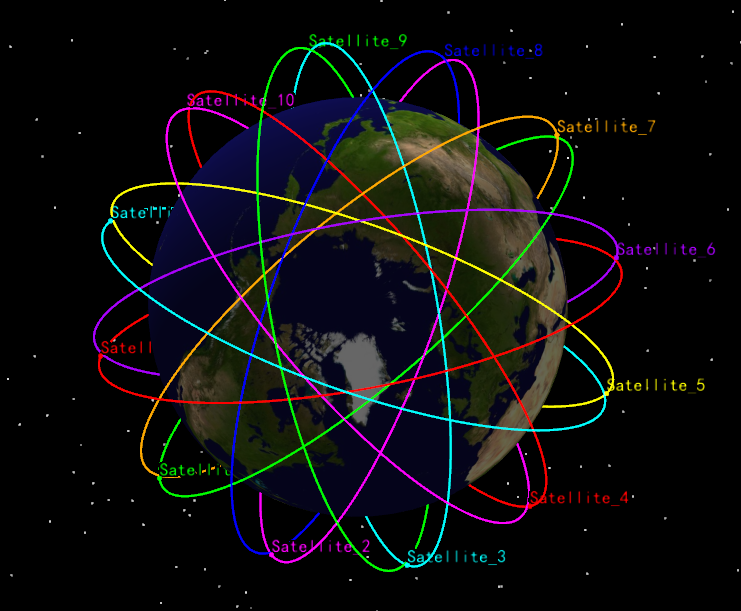

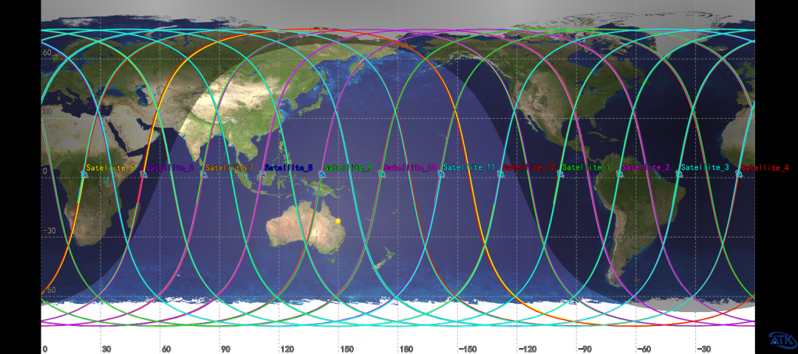

对于采用圆轨道的一般对称 Flower 星座构型而言，在基准卫星的升交点赤经和纬度幅角参数 $(\Omega_{seed}, u_{seed})$ 确定后，星座中第 $k$ 颗卫星可由下式确定[3]：

$$
\left\{
\begin{aligned}
\Omega_k &= \Omega_{seed} + 2\pi p_k \\
u_k &= u_{seed} + 2\pi p_k L
\end{aligned}
\right.
\qquad (k = 1, 2, \dots, N)
$$

式中 $L$ 为回归因子，$\{p_1, p_2, \cdots, p_N\}$ 为相位参数。

**重访时长**是指卫星对同一地面目标相邻两次可观测时间之间的间隔。它是衡量星座覆盖性能的重要指标，反映了卫星对目标区域的重复观测能力，这里取最大重访时间作为评价星座不连续覆盖性能的指标，**最大重访时间越小说明不连续覆盖性能越好**。

## Flower 星座对地覆盖场景创建

### 新建想定

安装并运行 ATK.exe，新建一个想定"Flower星座对地覆盖性能分析"。设置开始历元为 UTCG 2026-09-13 00:00:00.000，结束历元为 UTCG 2026-09-16 00:00:00.000。

### 插入种子卫星

点击 <kbd>插入</kbd> 中的【卫星】想定对象，选择默认类型，命名为"Satellite"；设置轨道预报器为 <kbd>J2摄动</kbd>；设置种子卫星参数：

- 半长轴：8023209.37 m
- 偏心率：0
- 倾角：74.89°
- 升交点赤经、近地点幅角、真近点角均为 0°

参数设置如下图所示。

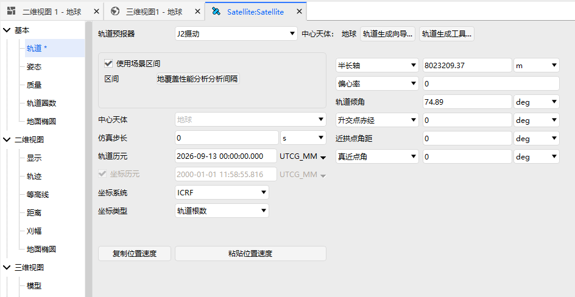

### 生成 Flower 星座

点击【工具】选项卡的 <kbd>星座设计</kbd> 模块，星座类型选择为【花星座】；设置种子卫星，选择"Satellite"为种子卫星；设置星座参数：

- 总卫星数：4 颗
- 回归圈数：12
- 回归天数：1
- 相位密度：4
- 相邻平面相位因子：1

点击 <kbd>计算</kbd>，在右侧窗口中显示每颗卫星的轨道根数如下：

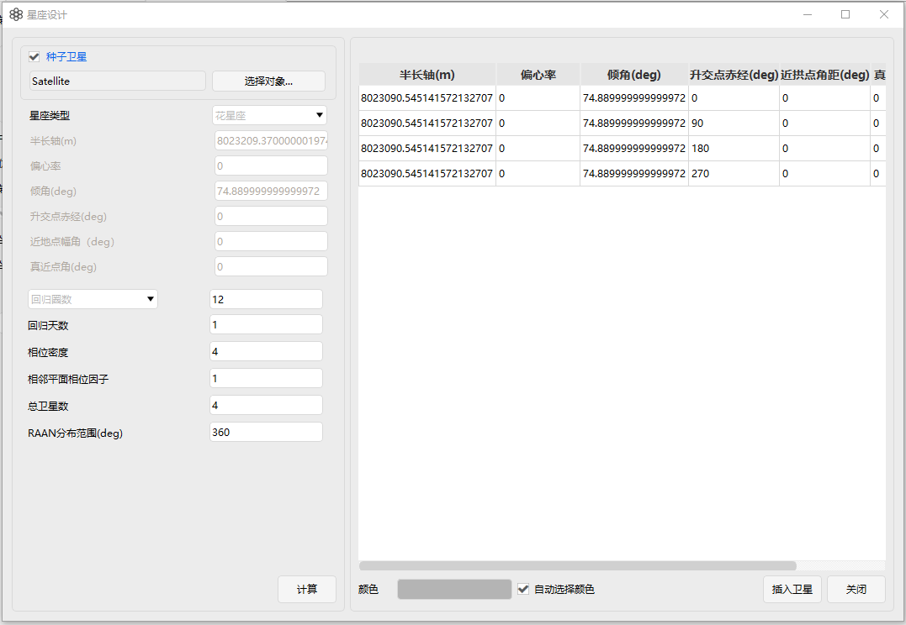

点击 <kbd>插入星座</kbd>，在对象视图中全选所有 Flower 星座的卫星，右键选择 <kbd>批量插入</kbd>，选择插入传感器，设置传感器参数为【圆锥】，半锥角为 45°。星座的二维视图如下：

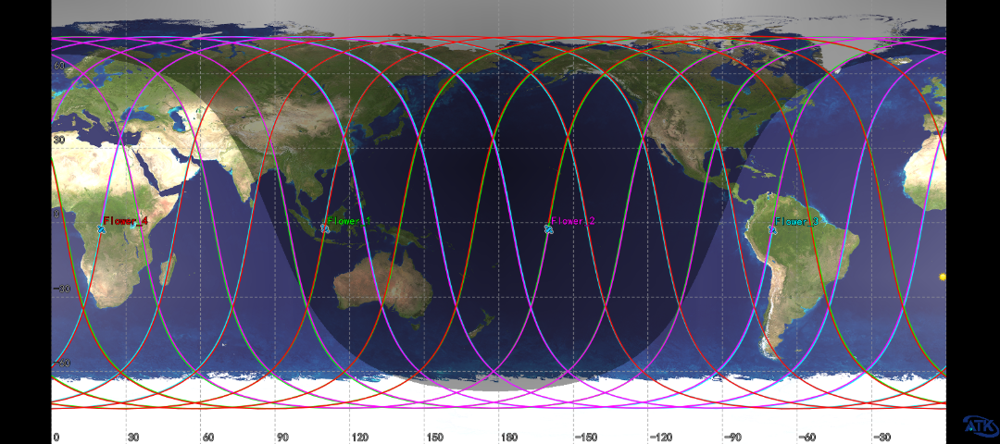

### 生成同卫星数的 Walker-Delta 星座

点击【工具】选项卡的 <kbd>星座设计</kbd> 模块，星座类型选择为【Walker-Delta】星座；设置种子卫星，选择"Satellite"为种子卫星；设置星座参数：

- 总卫星数：4 颗
- 轨道面个数：4
- 相邻平面相位因子：1

点击 <kbd>计算</kbd>，在右侧窗口中显示每颗卫星的轨道根数如下：

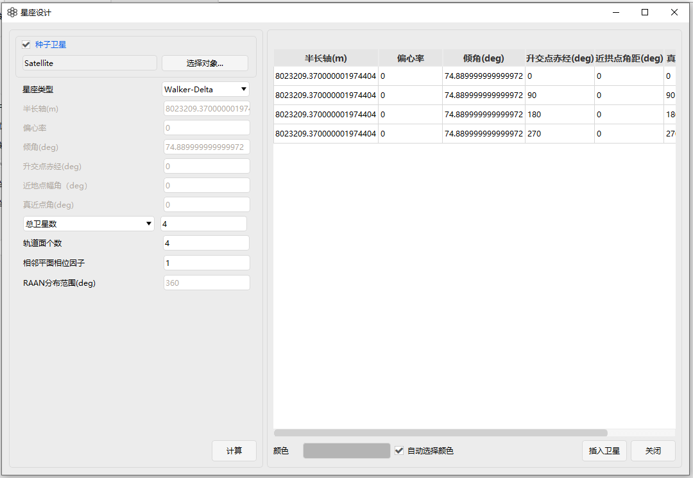

点击 <kbd>插入星座</kbd>，在对象视图中全选所有 Walker-Delta 星座的卫星，右键选择 <kbd>批量插入</kbd>，选择插入传感器，设置传感器参数为【圆锥】，半锥角为 45°。星座的二维视图如下：

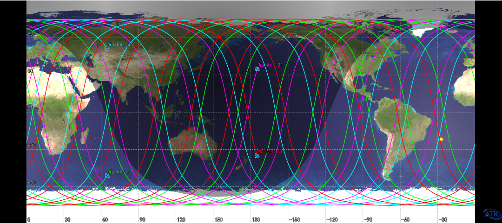

## 观测目标创建

选择 <kbd>插入对象</kbd> —— <kbd>地面站</kbd>，将重点关注地点的经纬度输入。此处选择夏威夷、新加坡、马尔代夫、济州岛、伊豆半岛等五个重点关注地点，各目标点的具体坐标如下表所示。

| 目标点 | 坐标 |
| --- | --- |
| 夏威夷 | (157°W, 21°N) |
| 新加坡 | (103.85°E, 1.3°N) |
| 马尔代夫 | (73.5°E, 4°N) |
| 济州岛 | (126.53°E, 33.38°N) |
| 伊豆半岛 | (138.95°E, 34.9°N) |

五个目标点插入后的位置属性如下图所示，以夏威夷为例，纬度为 21°、经度为 -157°、高度为 0 m。

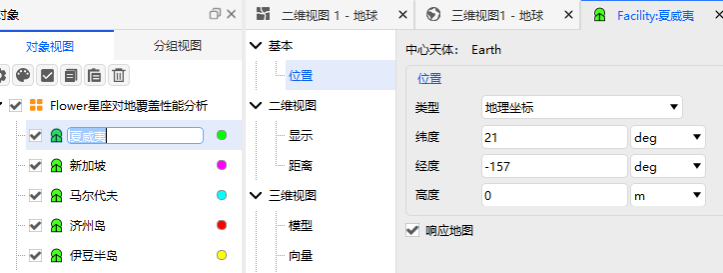

## 星座覆盖性能分析

### Flower 星座对点目标覆盖分析

右键点击任意一个目标地面点，选择 <kbd>覆盖性</kbd>，此处以夏威夷为例：

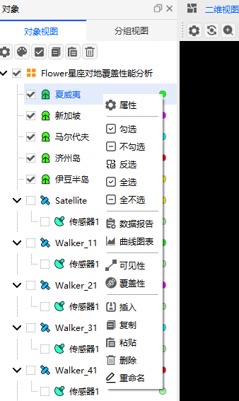

在<kbd>选择对象</kbd>对话框中，将五个目标点全部选中。

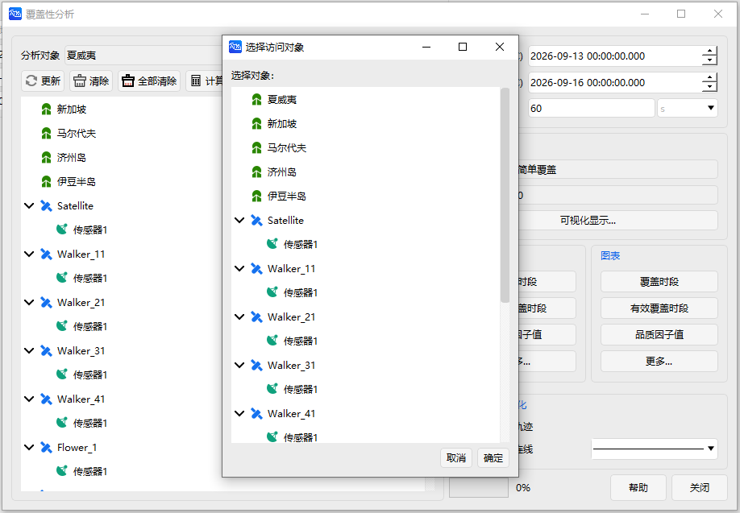

点击右侧【品质参数】区域的 <kbd>定义...</kbd>，选择覆盖品质定义类型为【重访时间】，计算设置为【最大值】，其余保持默认。

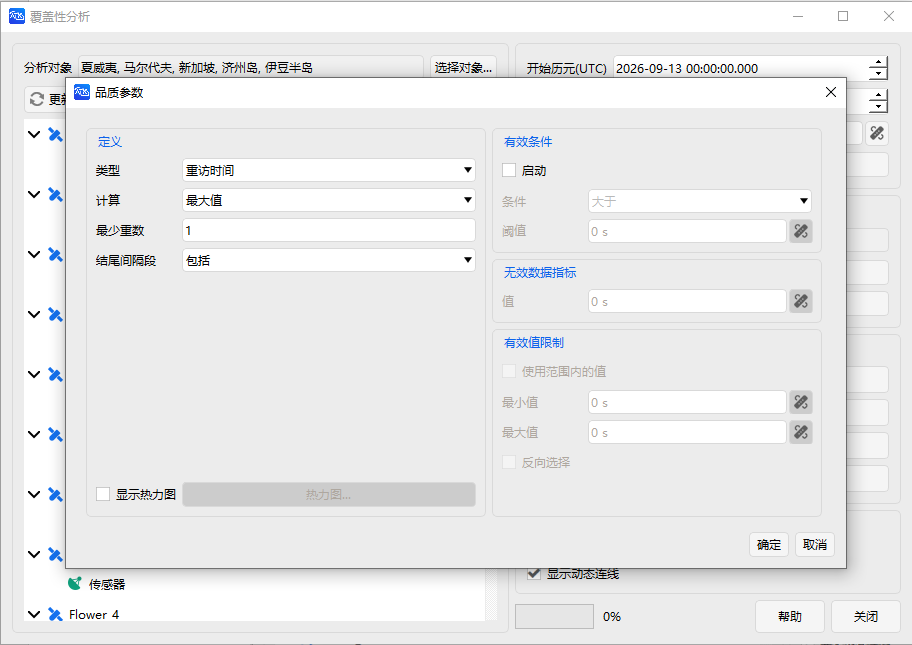

然后选择 Flower 星座所有 4 颗卫星的传感器。

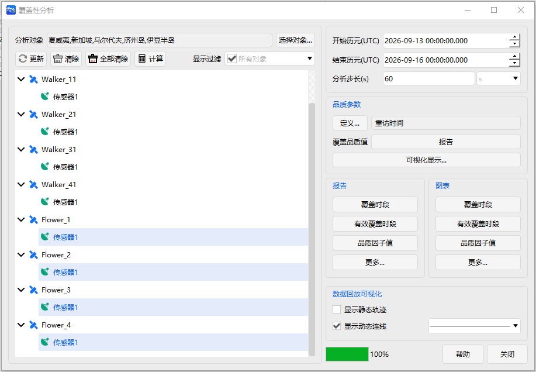

设置完毕后点击 <kbd>计算</kbd>，再点击覆盖品质值报告，即可得到星座对该目标点的最大重访时长。

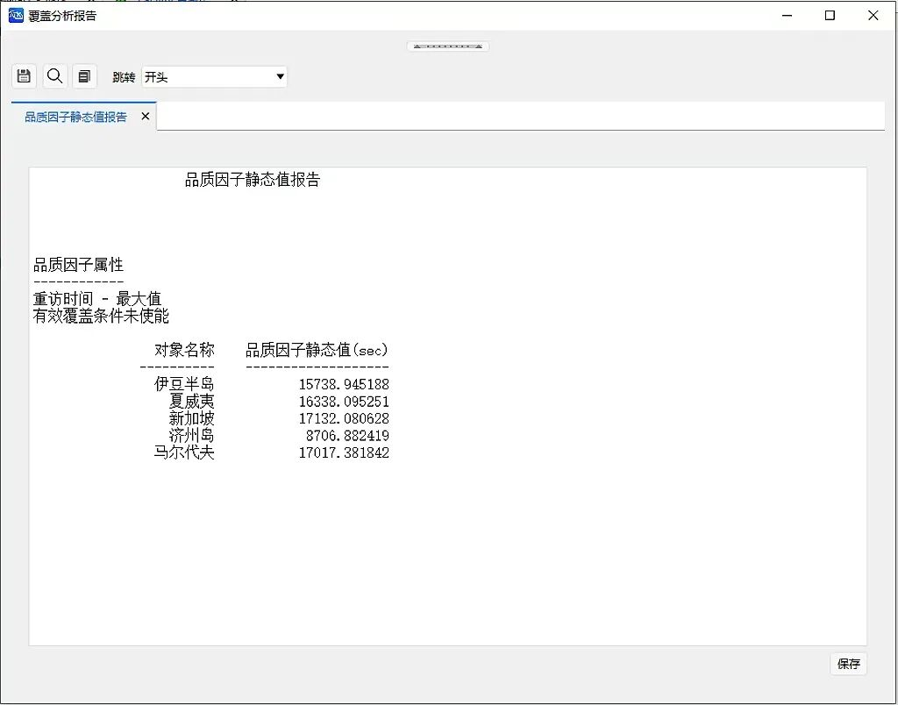

以夏威夷为例，其对 Flower 星座的重访时间随时间变化如下图所示：

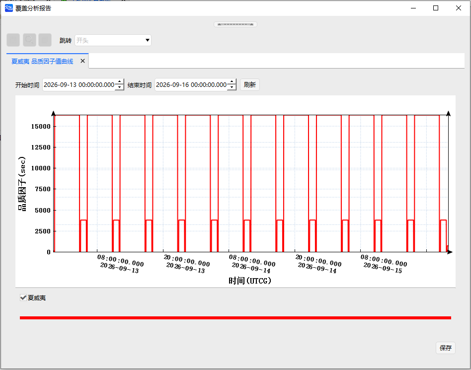

### Walker-Delta 星座对点目标覆盖分析

对同卫星数的 Walker-Delta 星座重复上一部分的操作，同理可以得到 Walker-Delta 星座对五个目标点的最大重访时长。

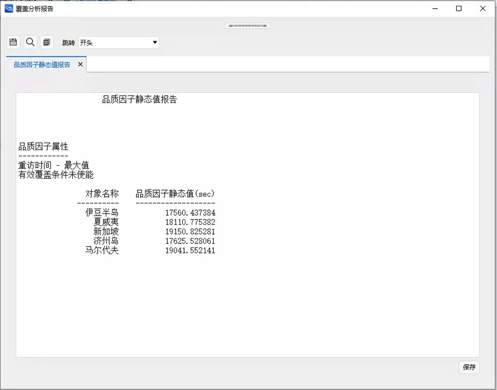

以夏威夷为例，其对 Walker-Delta 星座的重访时间随时间变化如下图所示：

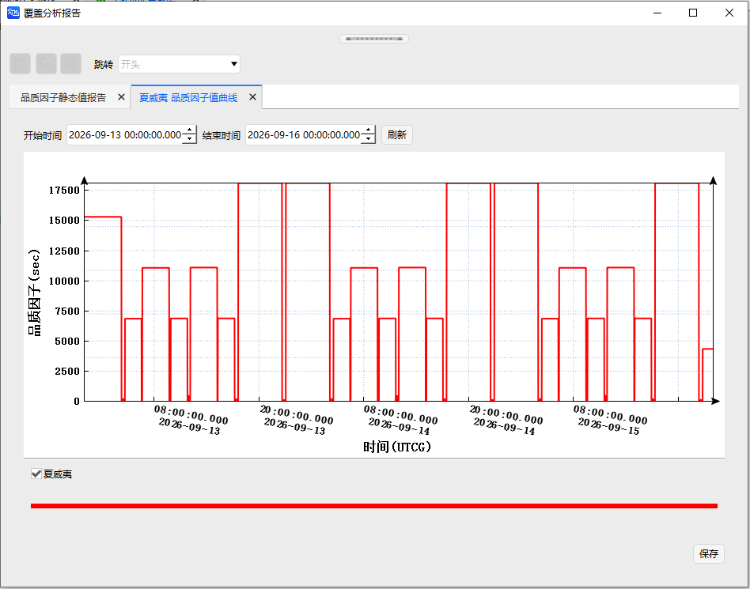

### 最大重访时间对比

4 颗卫星的 Flower 星座与 Walker-Delta 星座对五个目标点的最大重访时间对比如下表所示。

| 目标点 | Flower 星座 | Walker-Delta 星座 |
| --- | --- | --- |
| 夏威夷 | 16338.095251 s | 18110.775382 s |
| 新加坡 | 17132.080628 s | 19150.825281 s |
| 马尔代夫 | 17017.381842 s | 19041.552141 s |
| 济州岛 | 8706.882419 s | 17625.528061 s |
| 伊豆半岛 | 15738.945188 s | 17560.437384 s |

从表中可以看出，Flower 星座对五个目标点的最大重访时间均明显小于 Walker-Delta 星座。这说明**在卫星数为 4 时，Flower 星座的不连续覆盖性能更优**。

## 参考文献

[1] Mortari D, Wilkins M, Bruccoleri C. The Flower Constellations[J]. The Journal of the Astronautical Sciences, 2004, 52: 107-127.

[2] 张雅声, 贾璐, 于金龙, 梁爽. 星下点轨迹恒定的低轨星座构型设计方法[J]. 中国空间科学技术, 2023, 43(3): 116-122.

[3] 曾喻江, 胡修林, 王贤辉. Flower 卫星星座设计方法研究[J]. 宇航学报, 2007, 28(3): 659-662.
