# 解体卫星碎片清除方案设计

## 问题描述

针对卫星解体形成的 345 颗空间碎片，本任务需**为三艘母航天器规划 86400 s 任务窗口内的协同清除方案**。方案以母航天器的初始轨道及不超过 6 次的脉冲机动为设计变量，使尽可能多的目标碎片在任务窗口内同时满足**相对距离小于 30 km、相对速度小于 150 m/s** 的清除条件，并在不重复清除的前提下使有效清除目标数量最大化。

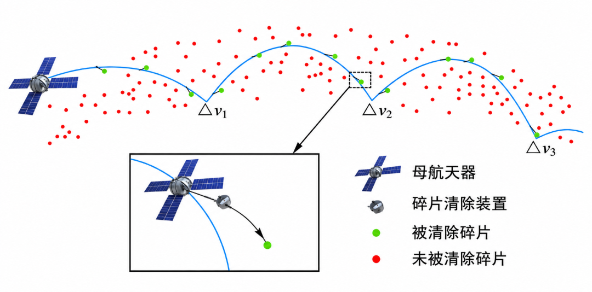

## 基于 ATK 的总体求解流程

本方案利用 ATK 建立空间碎片清除任务的轨道仿真场景，**采用手动建模与二次开发相结合的方式求解**。手动建模部分完成文件加载、母航天器创建、轨道预报器配置、初始轨道六根数设置以及脉冲机动段和预报段的添加，并通过高级接近分析工具验证单个清除方案的可行性。

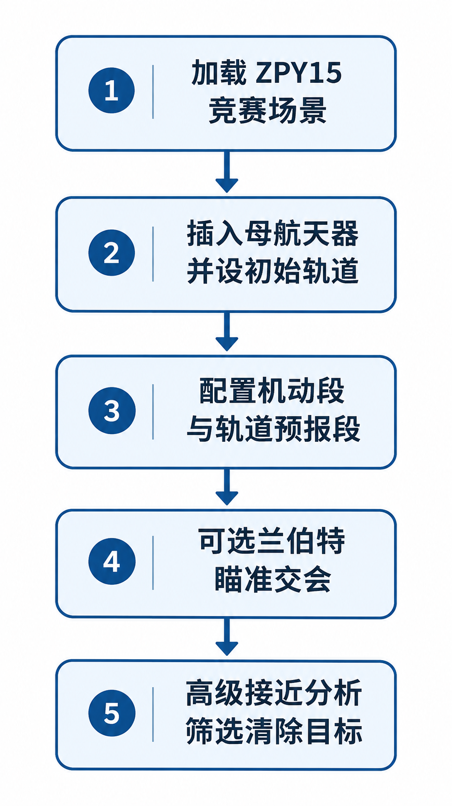

在此基础上，利用 **Python 二次开发接口**对初始轨道、预报时间和脉冲速度增量进行批量搜索，依据相对距离小于 30 km、相对速度小于 150 m/s 的清除判据筛选有效目标，最终获得三艘母航天器的协同清除方案。

### 加载场景并插入母航天器

打开 ATK 后加载初始场景文件，场景中已包含 345 颗碎片。在<kbd>开始—插入</kbd>中选择<kbd>卫星</kbd>，插入默认卫星对象，将其分别命名为 **"Mother1"、"Mother2"、"Mother3"**，作为三艘母航天器。

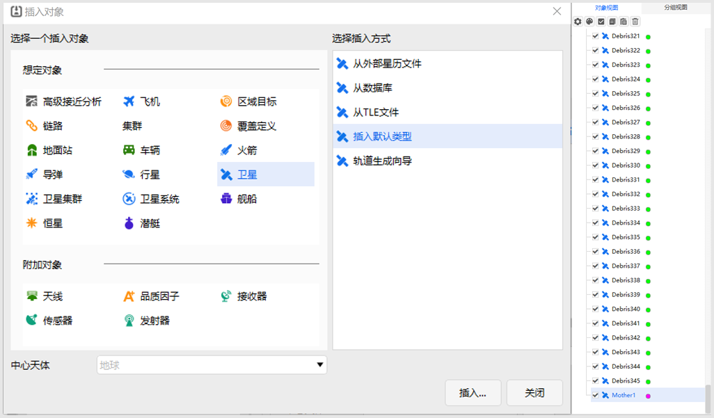

### 设置初始轨道六根数

1. **选择轨道预报器**

    双击母航天器，或右键选择<kbd>属性</kbd>进入属性设置界面，在【轨道预报器】中选择<kbd>机动规划</kbd>。

    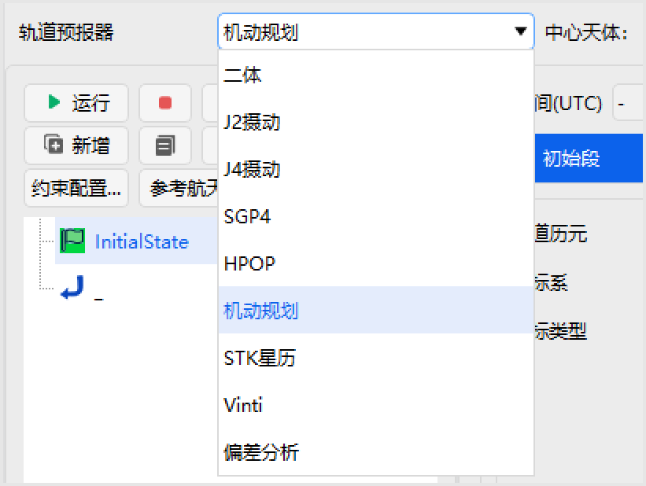

2. **设置初始段坐标系**

    在初始段坐标系设置处点击【…】按钮，中心天体选择<kbd>地球</kbd>，坐标轴选择<kbd>J2000</kbd>。

    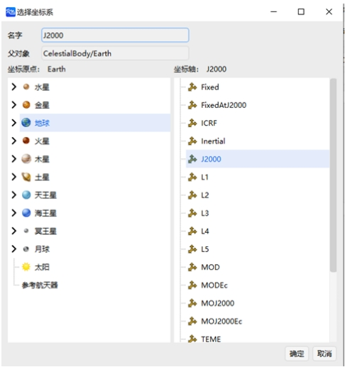

3. **输入轨道根数**

    坐标类型选择<kbd>轨道根数</kbd>，输入**半长轴 $a$、偏心率 $e$、轨道倾角 $i$、升交点赤经 $\Omega$、近拱点角距 $\omega$ 和真近点角 $f$**，点击<kbd>应用</kbd>完成设置，具体参数见下图。

    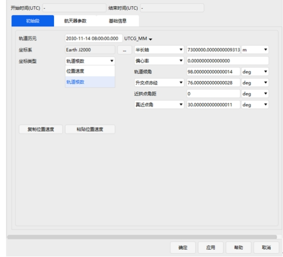

### 添加脉冲机动段与预报段

1. **添加机动段**

    在【机动规划】界面点击<kbd>新增</kbd>，选择<kbd>机动段</kbd>，将机动类型设为<kbd>脉冲</kbd>，坐标系设为 VVLH，输入三个方向的速度增量。

    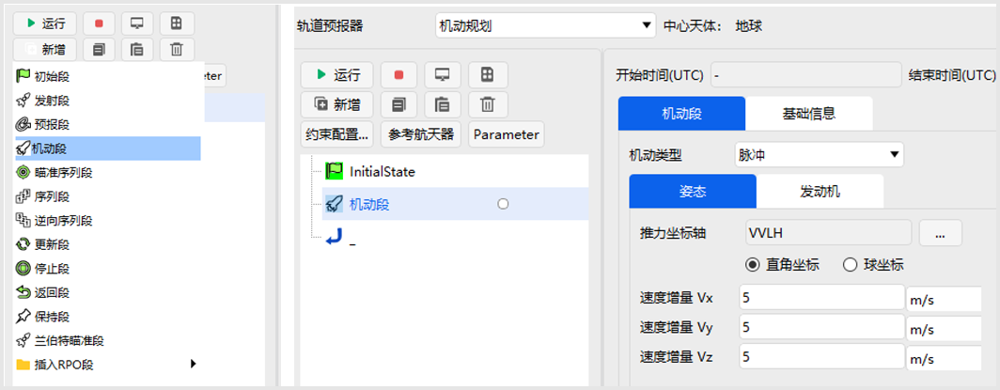

2. **添加预报段**

    新增<kbd>预报段</kbd>，将停止条件设为 Duration 并输入预报时长，点击<kbd>运行</kbd>生成轨道星历。

    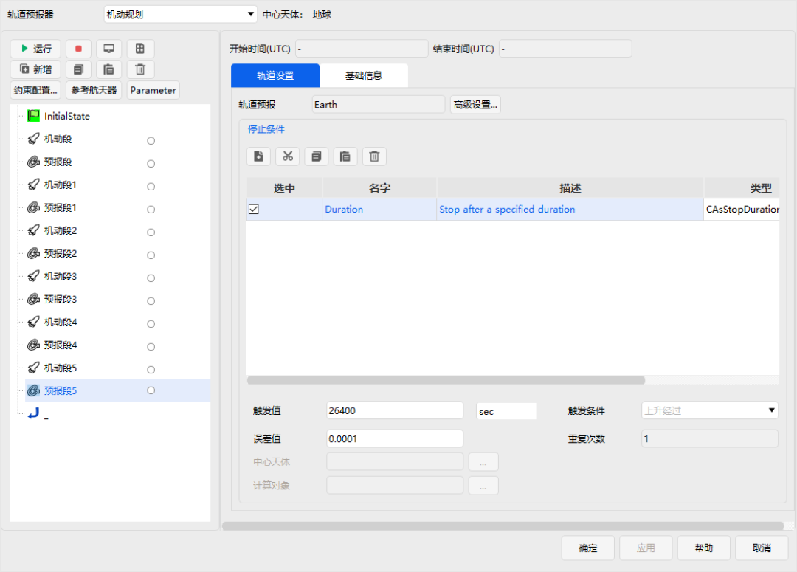

3. **形成完整轨道方案**

    重复上述操作，最终形成 **7 个预报段与 6 个机动段交替**的轨道方案。

### 兰伯特瞄准段

兰伯特瞄准段根据母航天器当前位置、目标碎片位置和转移时间求解交会轨道，可用于**指定目标的交会验证，也可与自由脉冲方案进行对照**。

1. **选择参考碎片**

    先在二维或三维视图中选取一颗距离 "Mother2" 较近的碎片，例如 "Debris32"。

    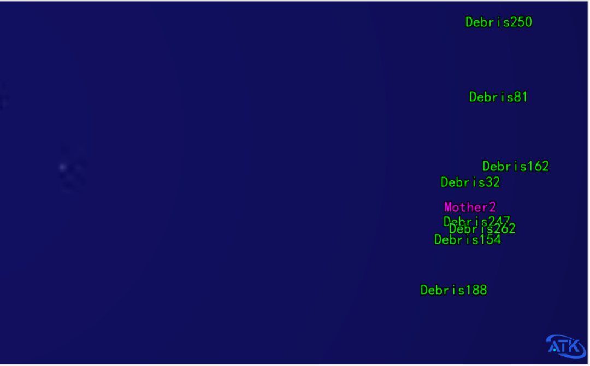

2. **指定参考航天器**

    进入 "Mother2" 属性界面，在【参考航天器】中选择该碎片。

    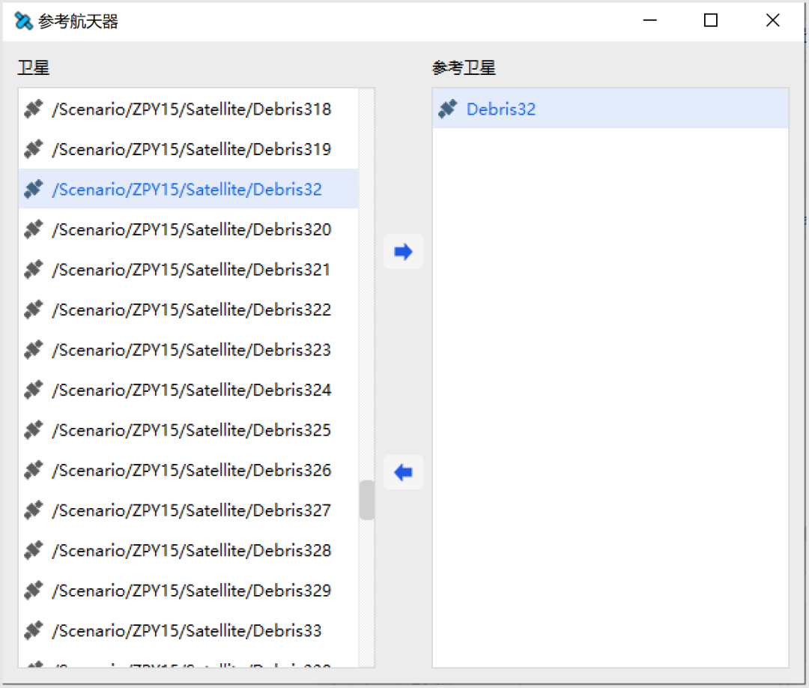

3. **添加兰伯特瞄准段**

    点击<kbd>新增</kbd>，选择<kbd>兰伯特瞄准段</kbd>，在【轨道设置】中按任务要求设置引力场模型和 Duration 转移时间。

    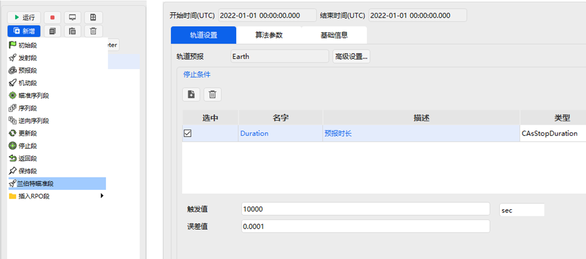

4. **设置算法参数**

    在【算法参数】页面，将坐标原点设为参考碎片 "Debris32"，坐标轴设为 J2000，坐标类型选择<kbd>位置/速度</kbd>，将目标位置和速度的六个分量设为 0，点击<kbd>应用</kbd>和<kbd>运行</kbd>。

    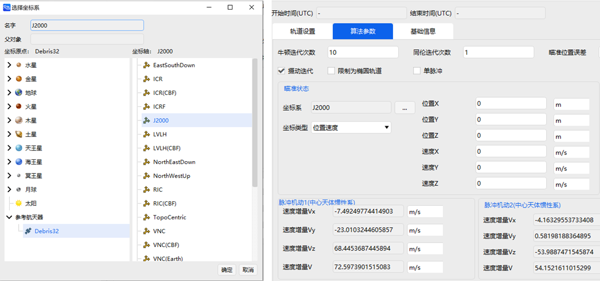

未勾选<kbd>单脉冲</kbd>时，一个兰伯特瞄准段包含两次脉冲，占用两个脉冲位置。本文将兰伯特瞄准段作为**可选对照方法**，最终参数搜索以自由脉冲方案为主，以保留更大的速度和时刻搜索自由度。

### 高级接近分析与有效清除判定

1. **插入高级接近分析对象**

    在 ATK 顶部选择<kbd>开始—插入—高级接近分析</kbd>，添加高级接近分析对象。

    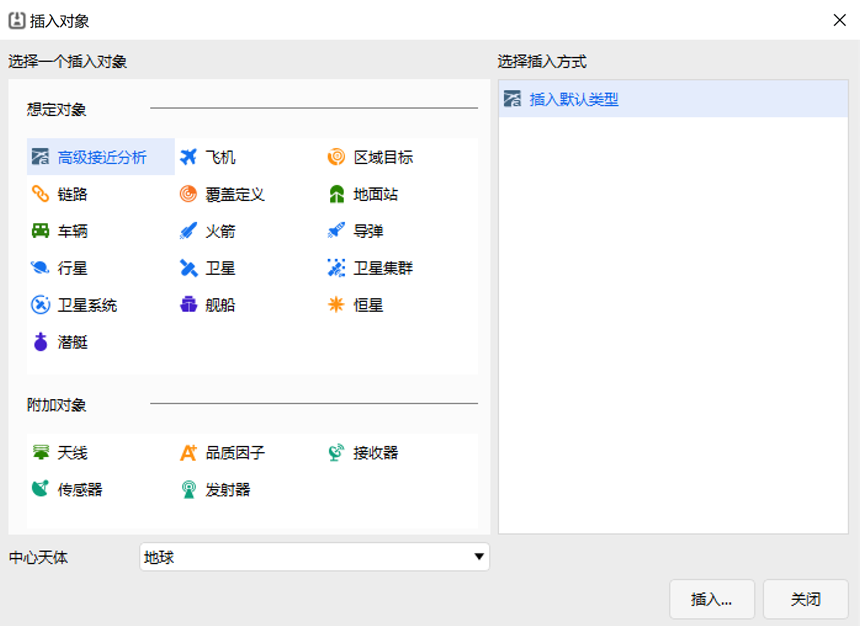

2. **设置主次目标与距离阈值**

    双击该对象进入属性界面，选择<kbd>使用场景区间</kbd>，勾选<kbd>使用距离测量</kbd>，将距离阈值设为 **30000 m**。随后将 "Mother1"、"Mother2"、"Mother3" 设为主目标，将 345 颗碎片批量设为次目标，点击<kbd>应用</kbd>和<kbd>计算</kbd>。

    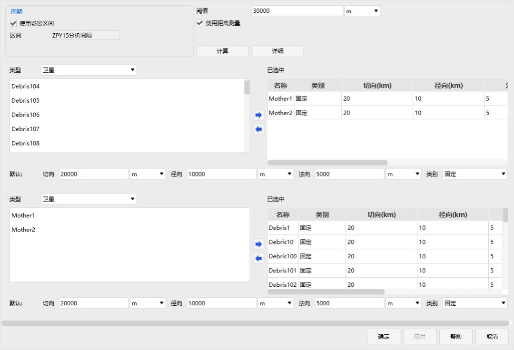

3. **筛选有效目标**

    计算完成后通过<kbd>详细</kbd>或<kbd>数据报告</kbd>查看接近事件，并根据 **150 m/s 的相对速度阈值**筛选有效目标。

    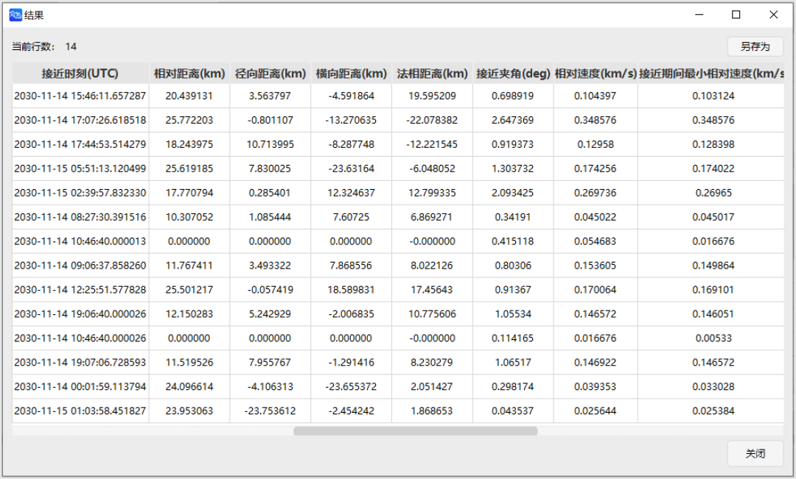

## 基于 Connect 模式的二次开发求解流程

采用 ATK 的 Connect 模式进行二次开发，通过 Python 脚本连接 ATK，批量写入母航天器初始轨道、机动速度和预报时间，并自动运行轨道预报与接近分析。

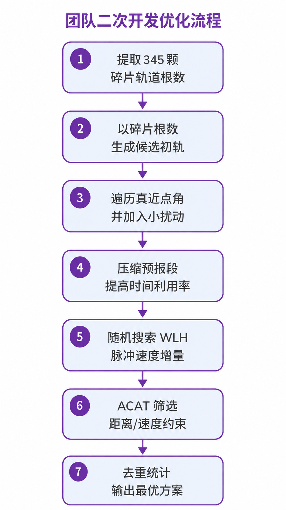

### 脚本连接与批量计算

Connect 模式通过脚本向 ATK 发送操作命令。将 ATK 提供的 Python 接口文件复制到工作目录。

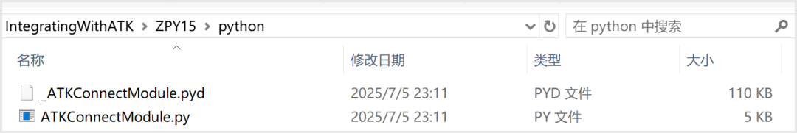

在 Test.py 中完成母航天器创建、轨道参数修改、机动规划运行、高级接近分析执行以及结果读取等操作。相比逐项手动设置，**脚本化流程能够快速测试大量候选初始轨道和脉冲参数**，从而提高方案搜索与优化效率。运行结果见下图。

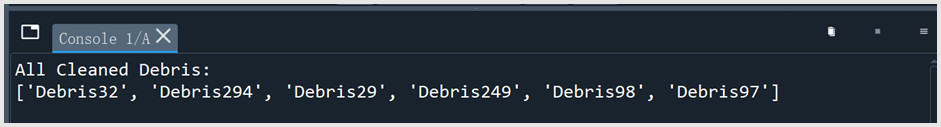

### 初始轨道筛选

初始轨道直接影响后续清除效率。先提取 345 颗碎片在初始时刻的轨道六根数，将其中的候选轨道作为母航天器初始轨道；随后固定半长轴、偏心率、倾角、升交点赤经和近拱点角距，重点遍历真近点角并叠加小扰动，筛选出自然预报阶段即可接近较多碎片的初始位置。

### 脉冲时刻与速度搜索

确定较优初始轨道后，进一步压缩各预报段时间，释放原本无新增清除结果的预报时间用于后续阶段。脉冲速度在 VVLH 坐标系下按 $V_x$、$V_y$、$V_z$ 三个方向搜索，**前几段采用较小速度范围，后几段适当扩大搜索范围**，以提高接近更多碎片的概率。

## 结果与方案总结

经过多轮参数搜索，最终确定三艘母航天器的协同清除方案。每艘母航天器由 7 个预报段和 6 个机动段构成，覆盖 86400 s 任务窗口。三艘母航天器分别获得 **33 颗、34 颗和 31 颗**满足清除条件的碎片记录，累计 98 颗；去除重复碎片后，**共有 95 颗不同碎片满足清除条件，占 345 颗碎片总数的约 27.5%**。

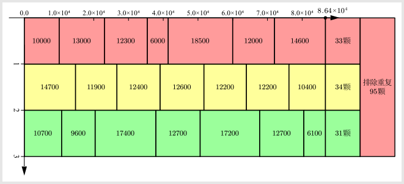

方案运行结果如下图所示。

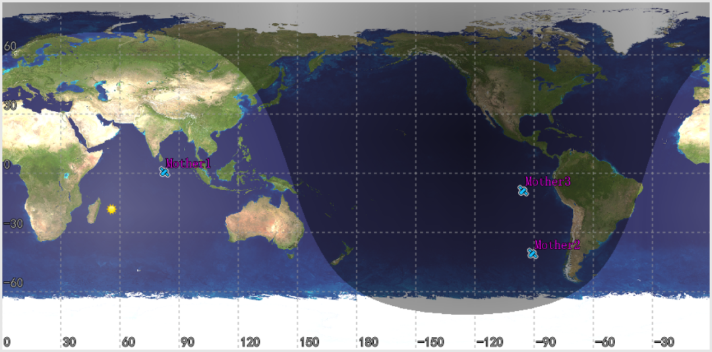

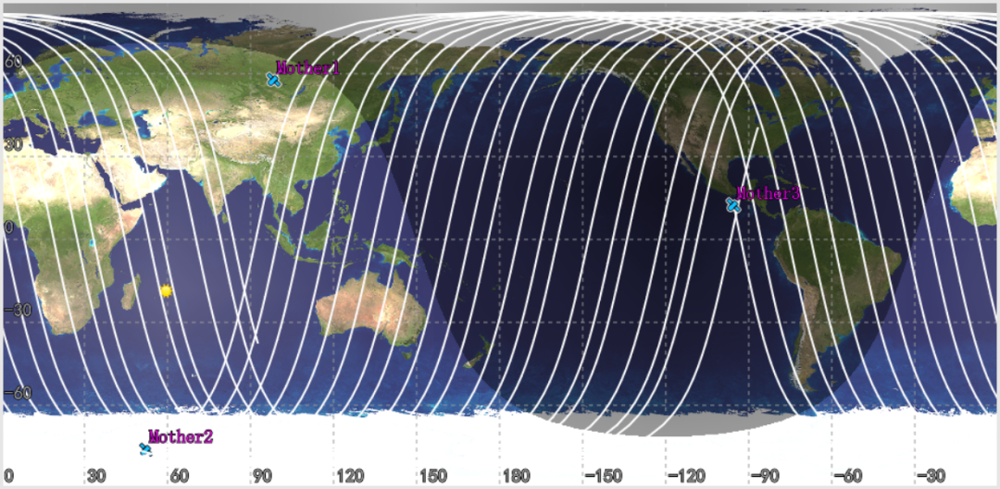

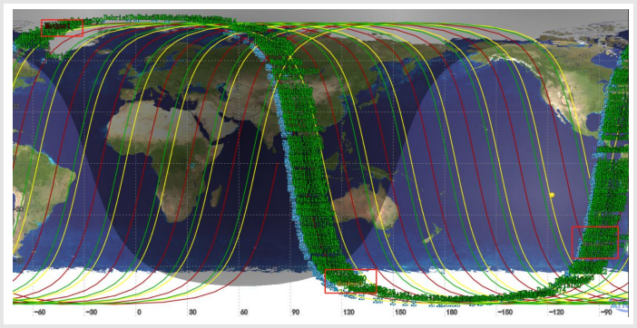

## 致谢

本次竞赛任务在河南理工大学力学系沈玲燕老师、刘永贵老师的指导下顺利完成。两位老师在任务分析、技术方案设计与实施过程中给予了悉心指导，并对本文的内容组织、技术分析及撰写修改提出了宝贵意见。
