# 铱星星座星间微波通信日凌分析

## 内容简介

在卫星星间微波通信中，**日凌是一个不可忽视的现象**。太阳是宇宙空间中最强的电磁噪声源之一，其辐射宽频且近似全向。当太阳方向进入接收天线波束时，天线噪声温度急剧升高，足以淹没来自对端卫星的微弱信号，**轻则链路质量恶化，重则通信中断**，这一现象称为日凌。当太阳方向接近卫星 A、卫星 B 的星间链路接收视轴时，太阳发出的强烈电磁辐射会直接干扰两颗卫星之间的正常通信信号，甚至导致通信中断。

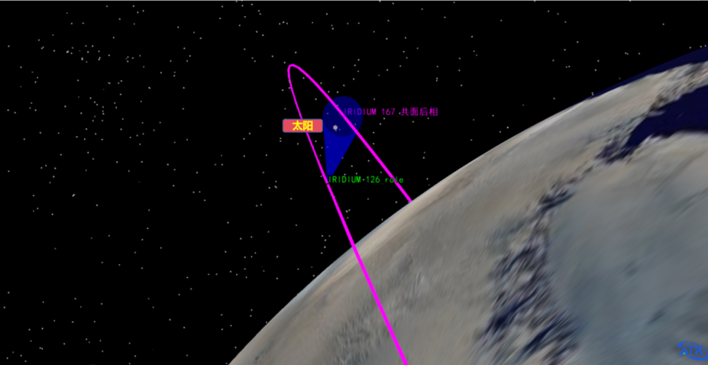

铱星（Iridium）系统是全球**首个采用星间链路技术的低轨卫星通信系统**，自 1998 年投入商业运营以来，一直是星间通信领域的标杆之一。铱星星座由 66 颗在轨卫星组成，分为 6 个轨道面，每个轨道面分布 11 颗卫星，运行在高度 780 km、倾角 86.4° 的低轨道上。每颗卫星配备 4 条 Ka 波段微波星间链路，通过星间链路形成网状网络，实现全球覆盖且无需依赖地面站中转。

本案例基于**国产航天任务分析软件 ATK（Aerospace Tool Kit）**，以铱星星座为对象建立星座模型，分析共面与异面星间链路日凌发生的频次、时长与时空分布规律，并从真实空间三维几何的角度揭示特定链路日凌季节性集中的机理，为低轨卫星通信系统的设计与运维提供参考。

## 基本原理

### 铱星星间链路与日凌现象

本案例的分析对象铱星星座由分布于 6 个轨道面的 66 颗卫星构成，每颗卫星通过 4 条 Ka 频段星间链路与同轨道面前、后卫星及左、右相邻轨道面卫星相连，形成无需地面站中转的网状网络。对这样一个**高度依赖星间链路的系统**而言，日凌风险并非全网一致：各链路的视轴在空间中的取向互不相同，与太阳周年视运动的相对几何亦各不相同，因而**日凌的发生频次、持续时长与季节分布因链路而异**。

因此，本案例从链路几何出发构建日凌分析框架：**先按所处轨道面与相位关系对星间链路分类，确定分析对象；再确定太阳进入天线波束到何种程度才构成实质性干扰，即日凌风险角，作为后续仿真中判定日凌发生的统一准则**。

### 星间链路分类

铱星星座中，每颗卫星与同轨道面及相邻轨道面的卫星建立星间链路。本案例以 Iridium 126 为例，按所处轨道面与相位关系，选取 6 条典型星间链路进行日凌分析，分类结果如下表所示。

| 类别 | 链路 | 卫星对 | 物理含义 |
| ---- | ---- | ------ | -------- |
| 共面 | 共面后相 | 126→167 | 同轨道面内后方卫星 |
| 共面 | 共面前相 | 126→123 | 同轨道面内前方卫星 |
| 异面 | 左邻后相 | 126→135 | 左邻轨道面后相卫星 |
| 异面 | 左邻前相 | 126→116 | 左邻轨道面前相卫星 |
| 异面 | 右邻后相 | 126→132 | 右邻轨道面后相卫星 |
| 异面 | 右邻前相 | 126→107 | 右邻轨道面前相卫星 |

### 日凌风险角的确定

日凌风险角的计算是日凌分析的前提。不同卫星系统、不同通信频率、不同太阳活动周期，甚至不同天线口径，都会影响日凌的实际干扰程度，**因此日凌风险角的计算需结合具体情况分析**，具体步骤如下。

1. **评估太阳噪声温度**

   太阳噪声与太阳活跃程度及通信频率密切相关，粗略估算公式为

   $$
   T_s = 120000 \times f^{-0.75}
   $$

   式中，$f$ 为通信频率，单位为 GHz。铱星 Ka 波段取 23 GHz。

2. **分析天线噪声温度随偏离角的变化**

   偏离角 $\omega$ 定义为天线法向与太阳方向之间的夹角。根据天线口径 $D$ 和该频段的太阳噪声温度 $T_s$，可以分别得到天线主瓣角度内、外天线噪声温度随偏离角变化的曲线。日凌时天线噪声温度增益与偏离角的计算关系为

   $$
   T_a(\omega) = T_s \exp\left( -\frac{4\ln 2 \cdot \omega^2}{\theta_{3dB}^2 + \theta_{\odot}^2} \right)
   $$

   式中，$\theta_{\odot}$ 为太阳的角径，取 0.5°；$\theta_{3dB}$ 为天线波束宽度，

   $$
   \theta_{3dB} \approx \frac{21000}{f D} \times 10^{-3}
   $$

   $D$ 为天线口径，取 Ka 频段星间定向天线的典型口径量级 0.5 m。根据上式，日凌时天线噪声温度增益的总体趋势为：随着偏离角增大，天线噪声呈指数级下降。

3. **确定日凌风险角**

   为保证通信质量，卫星通信过程中需要留足链路余量。链路余量 $M$ 定义为接收系统的 G/T 值恶化的量。G/T 值定义为

   $$
   G/T = G - 10\log_{10}(T_{total})
   $$

   G/T 值的恶化量为

   $$
   \Delta (G/T) = 10\log_{10}\left( \frac{T_{total}}{T_{sys}} \right)
   $$

   因此在保证链路余量的前提下，允许的最大总噪声温度为

   $$
   T'_{total} = T_{sys} \times 10^{M/10}
   $$

   允许的最大天线噪声温度为

   $$
   T'_a = T'_{total} - T_{other}
   $$

   式中，$T_{other}$ 为接收机、馈源等固有噪声温度。未发生日凌时，星间链路天线指向冷空背景，天线噪声温度很低，接收系统原有的等效噪声温度近似由接收机、馈源等固有噪声温度构成，即 $T_{sys} \approx T_{other}$。

   假设星间链路的链路余量为 5 dB，即允许接收系统的 G/T 值恶化不超过 5 dB。取 Ka 频段接收系统的典型量级 $T_{other} = 350$ K，可计算出允许的天线噪声温度最大值 $T'_a$。将计算结果 $T'_a$ 代入 $T_a(\omega)$，计算可得日凌边界角度 $\theta \approx 1.9^{\circ}$。为留有适度裕量，本案例取传感器半锥角 2° 作为日凌风险角进行分析。

## 创建日凌分析场景与对象

[安装](https://gitlink.org.cn/zone/atk)并运行 ATK.exe，新建一个想定，命名为 "Iridium_SunOutage_Analysis"。

### 仿真场景设置

设置开始历元为 2026-05-01 00:00:00.000，结束历元为 2027-05-01 00:00:00.000。仿真时长设置为 1 年，以便完整统计一年内日凌发生的频次和时长分布。

### 创建铱星卫星对象

在【插入对象】窗口中选择 <kbd>卫星</kbd>，插入方式选择 <kbd>插入默认类型</kbd>，**插入对象界面如下**。

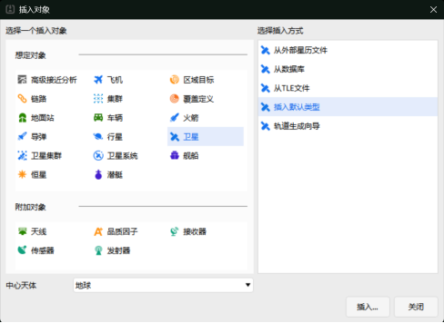

设置卫星属性，轨道预报器选择 <kbd>SGP4</kbd>，轨道数据采用从 CelesTrak 下载的 IRIDIUM-NEXT 真实 TLE 数据集，**卫星属性设置界面如下**。

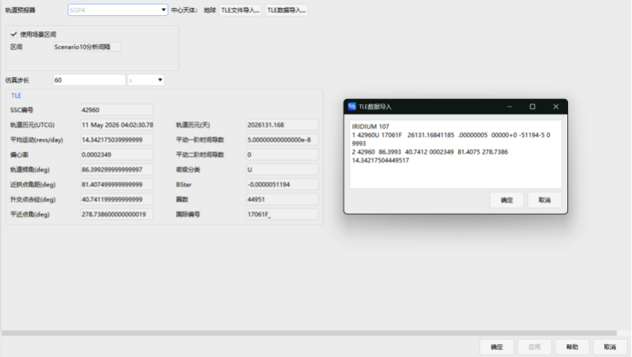

按照上述流程插入 Iridium 126 及其相邻六条星间链路对应的 Iridium 123、Iridium 167、Iridium 135、Iridium 116、Iridium 132、Iridium 107 共 7 颗卫星作为仿真对象。

为便于仿真分析，**在场景中将卫星分别重命名**为 Iridium126_role、Iridium123_共面前相、Iridium167_共面后相、Iridium135_左邻轨道面后相、Iridium116_左邻轨道面前相、Iridium132_右邻轨道面后相、Iridium107_右邻轨道面前相。**完成卫星插入后，ATK 场景如下**。

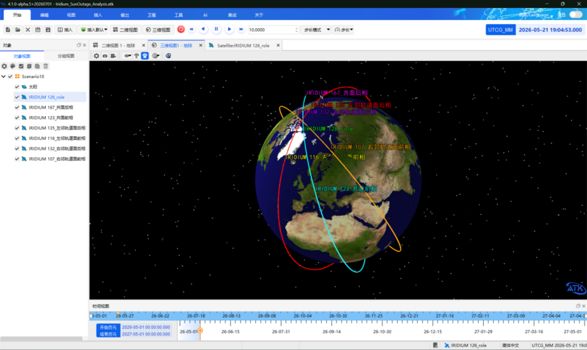

### 添加太阳对象

在【插入对象】窗口中选择 <kbd>行星</kbd>，插入方式选择 <kbd>插入默认类型</kbd>，随后进入行星属性设置界面，在【基本】—【定义】中选择 <kbd>太阳</kbd>，**设置界面如下**。

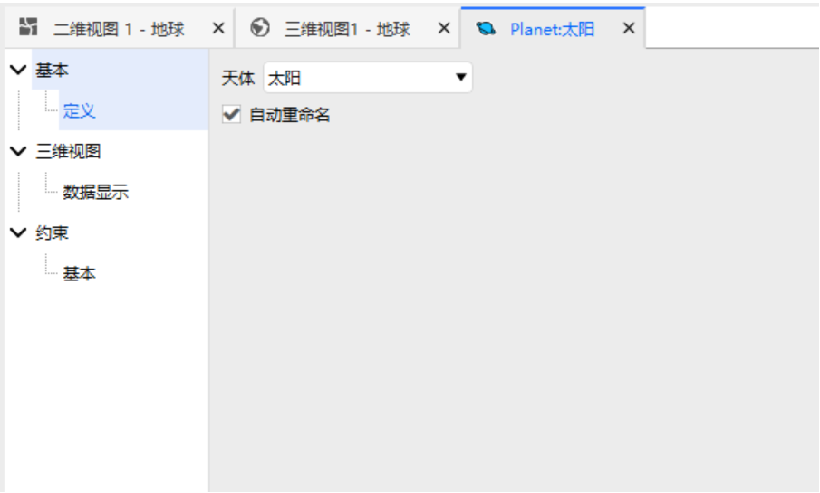

### 模拟共面与异面星间链路

1. **共面链路**

   选取与 Iridium 126 在同一轨道面内的 2 颗相邻卫星 Iridium 123、Iridium 167，利用传感器模拟 Iridium 126-Iridium 167、Iridium 126-Iridium 123 两条共面星间链路。

   首先**为 Iridium 126 添加 2 个附属传感器**：在【插入对象】窗口中选择 <kbd>传感器</kbd>，插入方式选择 <kbd>插入默认类型</kbd>，在弹出的对话框中选择 Iridium 126_role。

   模拟 Iridium 126-Iridium 167 链路时，将新插入的传感器命名为“传感器_共面后相”，在【基本】—【定义】中将传感器类型选择为 <kbd>简单圆锥</kbd>，半锥角设置为 2°，**传感器定义设置界面如下**。

   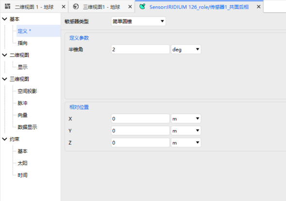

   在【基本】—【指向】中，将指向类型选择为 <kbd>目标定向</kbd>，并选择共面后相卫星 Iridium 167 作为目标，**传感器指向设置界面如下**。

   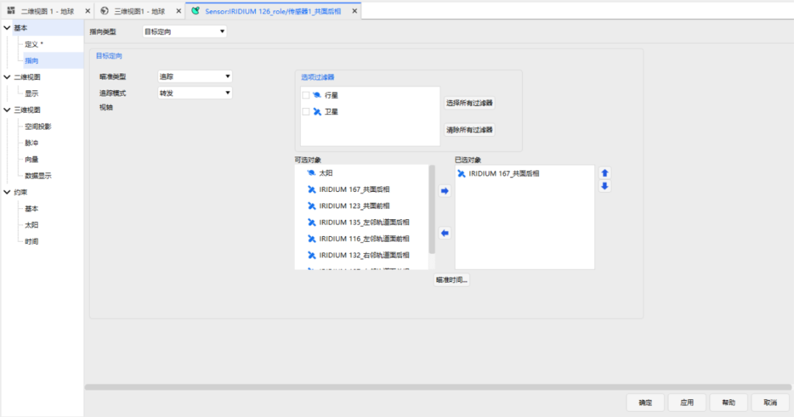

   完成设置后，Iridium 126 指向 Iridium 167 的星间链路三维视图如下。

   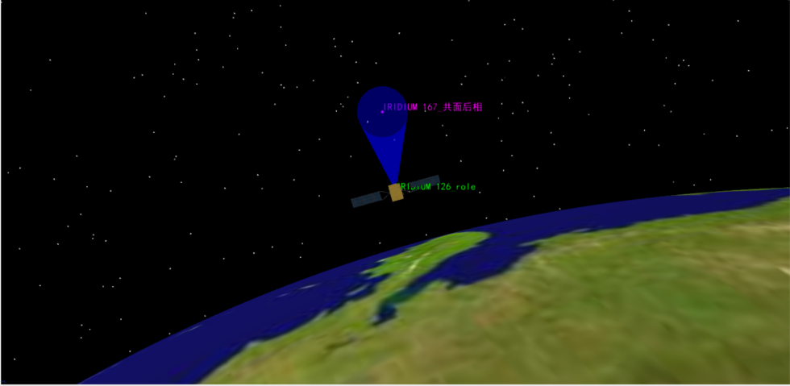

   同理，为 Iridium 126 插入指向共面前相卫星 Iridium 123 的传感器，命名为“传感器_共面前相”，用于模拟 Iridium 126-Iridium 123 链路，其三维视图如下。

   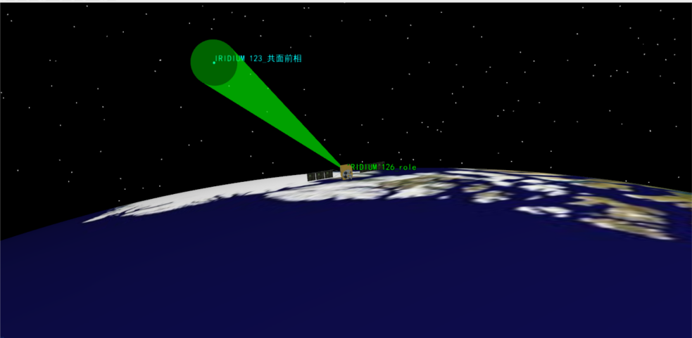

   **最终的共面链路三维视图如下。**

   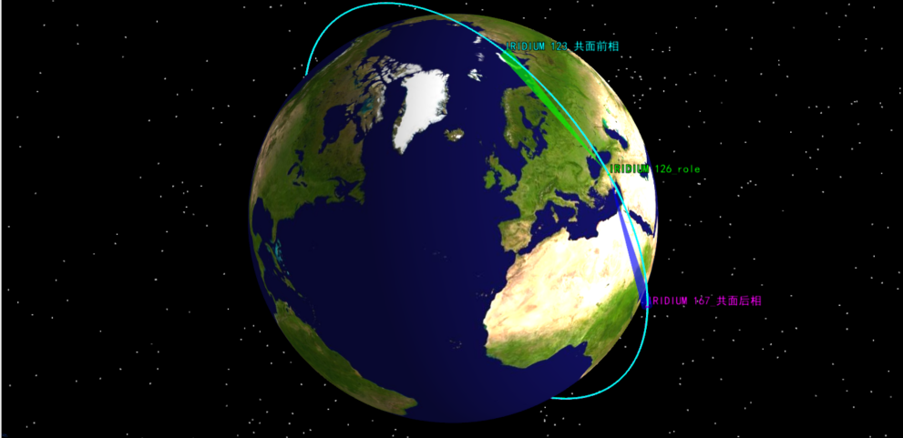

2. **异面链路**

   选取与 Iridium 126 在左右相邻轨道面内的 4 颗相邻卫星 Iridium 135、Iridium 116、Iridium 132、Iridium 107，利用传感器模拟 Iridium 126-Iridium 135、Iridium 126-Iridium 116、Iridium 126-Iridium 132、Iridium 126-Iridium 107 四条异面星间链路。

   首先为 Iridium 126 添加 4 个附属传感器，插入方式与共面链路相同。

   模拟 Iridium 126-Iridium 135 链路时，将新插入的传感器命名为“传感器_左邻轨道面后相”，在【基本】—【定义】中将传感器类型选择为 <kbd>简单圆锥</kbd>，半锥角设置为 2°，**传感器定义设置界面如下**。

   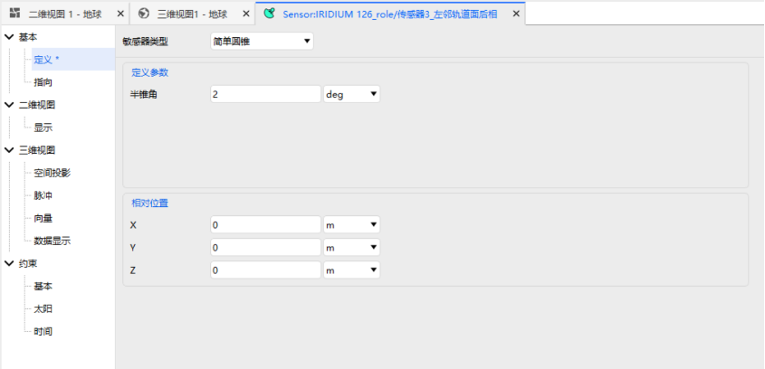

   在【基本】—【指向】中，将指向类型选择为 <kbd>目标定向</kbd>，并选择左邻轨道面后相卫星 Iridium 135 作为目标，**传感器指向设置界面如下**。

   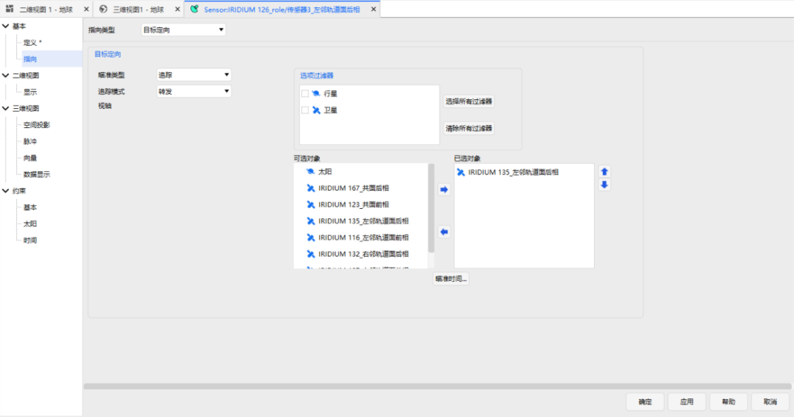

   完成设置后，Iridium 126 指向 Iridium 135 的星间链路三维视图如下。

   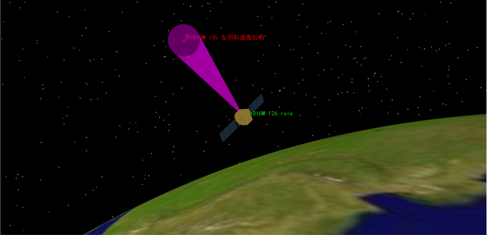

   同理，为 Iridium 126 分别插入指向左邻轨道面前相卫星 Iridium 116、右邻轨道面后相卫星 Iridium 132、右邻轨道面前相卫星 Iridium 107 的传感器，分别命名为“传感器_左邻轨道面前相”、“传感器_右邻轨道面后相”、“传感器_右邻轨道面前相”，**最终的异面链路三维视图如下**。

   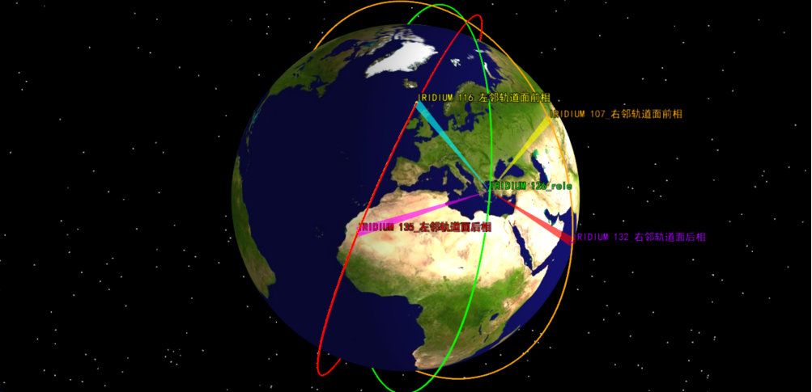

## 日凌可见性仿真

### 运行仿真计算

打开可见性分析工具，访问对象选择插入在 Iridium 126 上的 6 个传感器，分析对象选择 <kbd>太阳</kbd>，**可见性分析工具界面如下**。

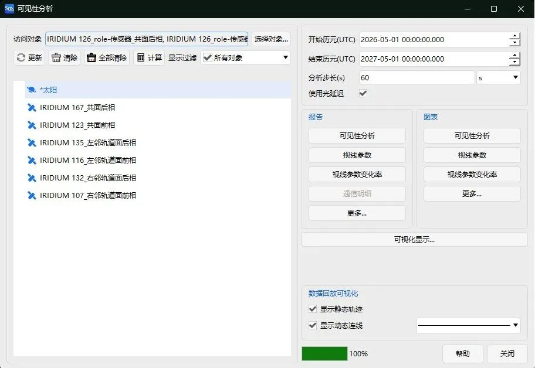

点击 <kbd>计算</kbd>，获得太阳落入传感器视场（即发生日凌）的时段。

### 共面链路日凌结果

输出可见性分析报告，选择“传感器_共面后相”、“传感器_共面前相”，获得时段数据报告。**“传感器_共面后相”对太阳的可见性报告界面如下**。

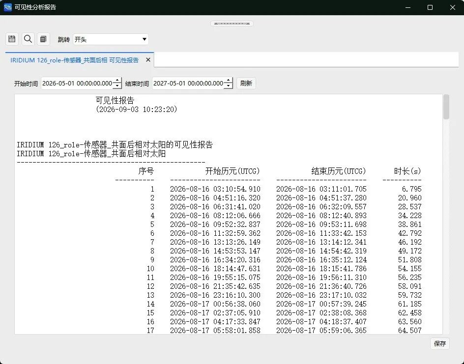

**“传感器_共面前相”对太阳的可见性报告界面如下。**

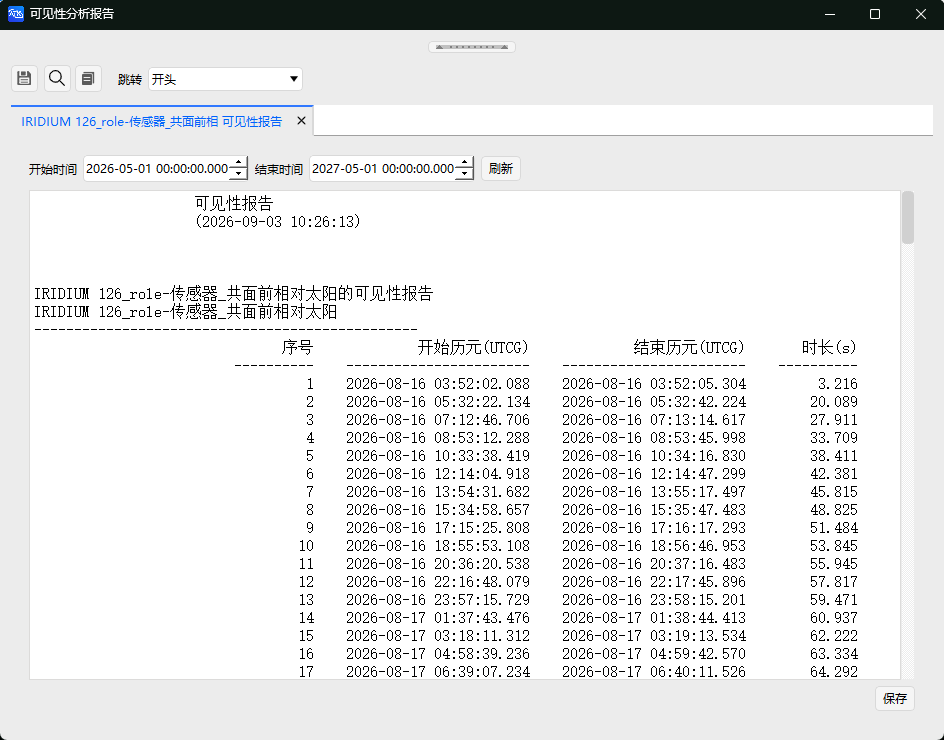

导出报告，统计共面链路年度日凌发生次数、累计时长、平均单次时长与时间占比，结果如下表所示。

| 链路 | 卫星对 | 发生次数 | 累计时长/s | 平均单次时长/s | 时间占比 |
| ---- | ------ | -------- | ---------- | -------------- | -------- |
| 共面后相 | 126→167 | 89 | 4545 | 51.1 | 0.0144% |
| 共面前相 | 126→123 | 87 | 4517 | 51.9 | 0.0143% |

### 异面链路日凌结果

选择“传感器_左邻轨道面后相”、“传感器_左邻轨道面前相”、“传感器_右邻轨道面后相”、“传感器_右邻轨道面前相”，输出可见性分析报告，获得时段数据报告，各传感器对太阳的可见性报告界面如下。

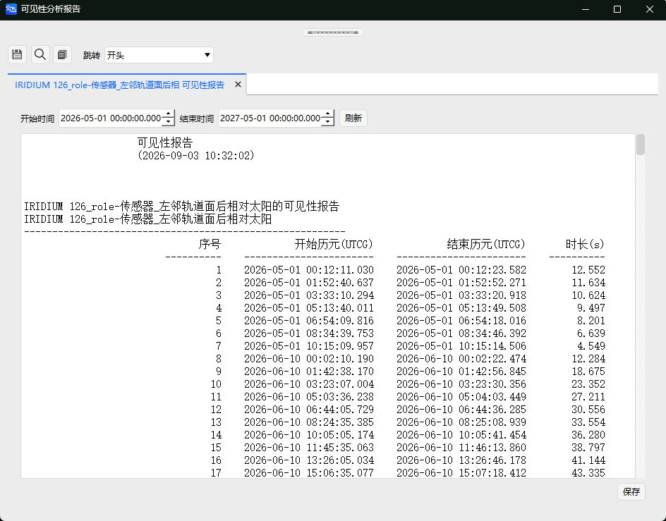

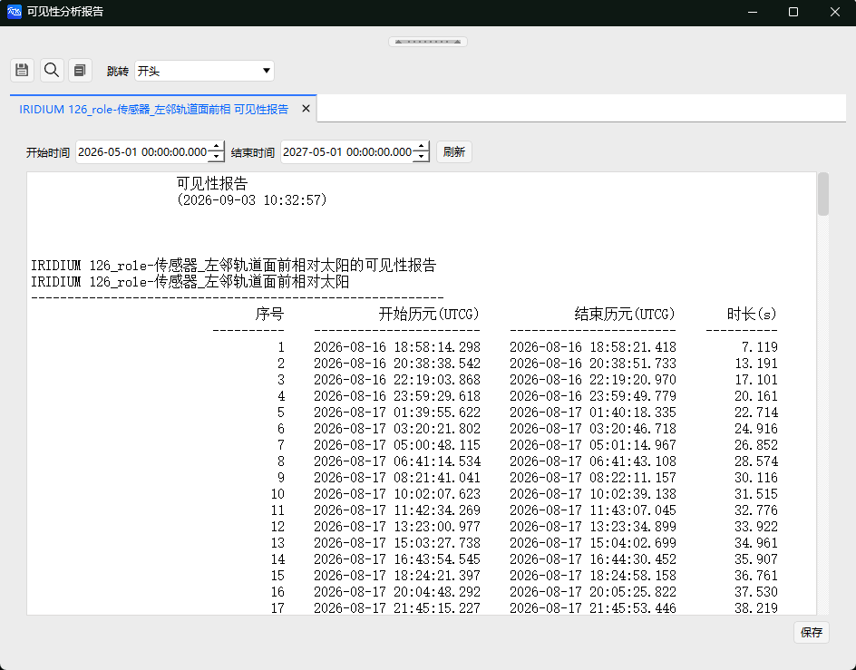

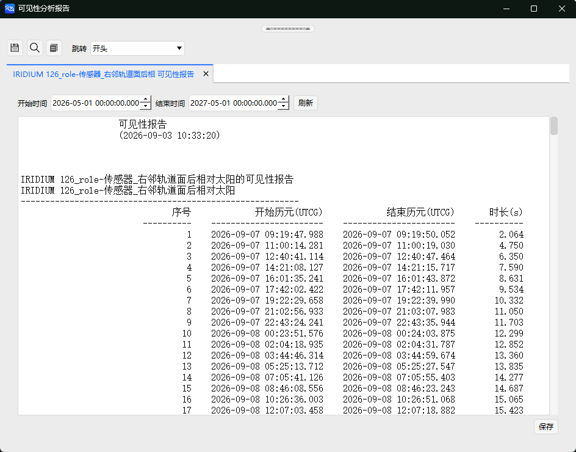

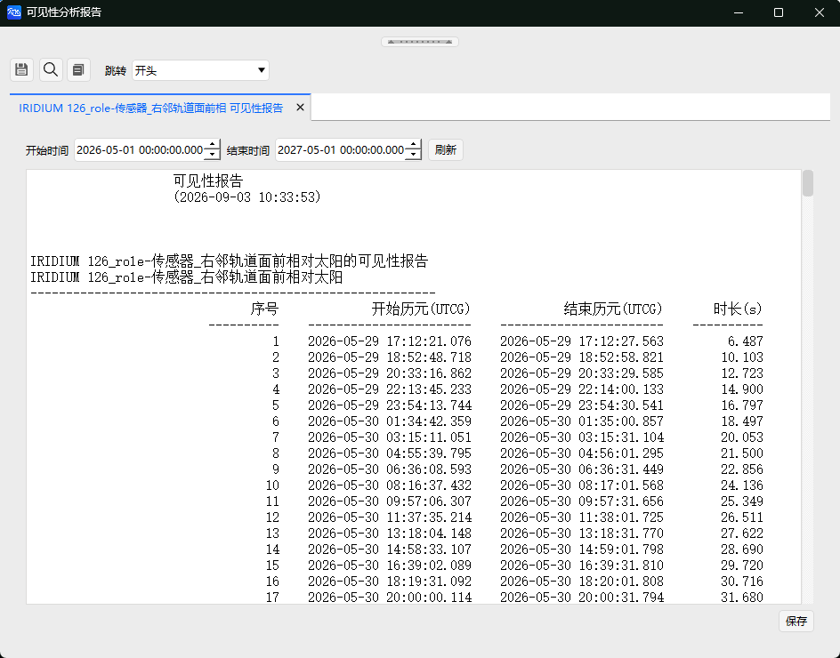

导出报告，统计异面链路年度日凌发生次数、累计时长、平均单次时长与时间占比，结果如下表所示。

| 链路 | 卫星对 | 发生次数 | 累计时长/s | 平均单次时长/s | 时间占比 |
| ---- | ------ | -------- | ---------- | -------------- | -------- |
| 左邻后相 | 126→135 | 423 | 26835 | 63.4 | 0.0851% |
| 左邻前相 | 126→116 | 96 | 3732 | 38.9 | 0.0118% |
| 右邻后相 | 126→132 | 263 | 7474 | 28.4 | 0.0237% |
| 右邻前相 | 126→107 | 1141 | 75324 | 66.0 | 0.2389% |

## 结果分析

### 链路类型对比分析

6 条链路 1 年共发生日凌 2099 次，累计约 122427 s。一年日凌发生次数、年度累计日凌时长、平均单次持续时间、年度时间占比的统计结果如下图，可直观看出各链路年度日凌统计的横向对比与时间分布。

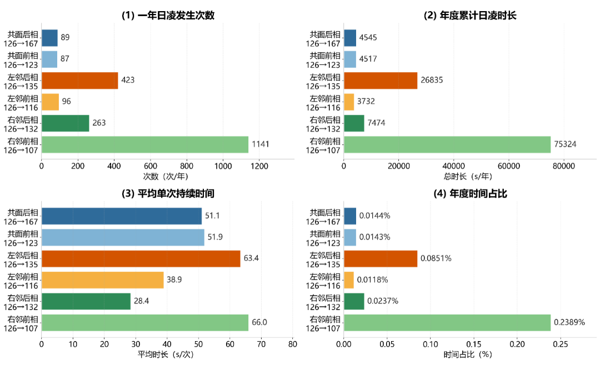

根据链路类型分析日凌次数与累计时长，结果如下图。右邻前相链路日凌发生 1141 次，累计时长 75324 s，远高于其余 5 条；共面前后相链路的各项统计结果相近；相比共面链路，异面链路之间差异显著，左邻轨道面后相链路与右邻轨道面前相链路相较其余两条异面链路日凌风险更高。

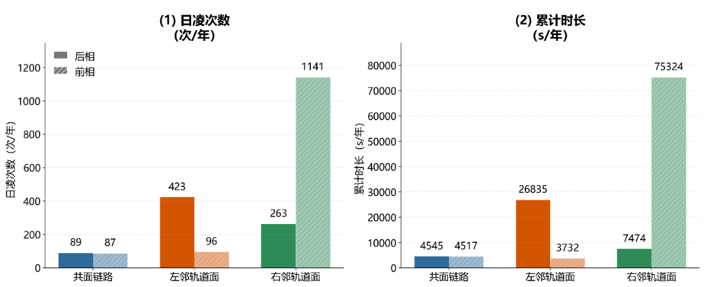

### 季节性分析

月度日凌次数与月累计日凌时长如下图。可以看出，日凌并非全年均匀发生，而是呈现明显季节性，集中爆发于少数月份。

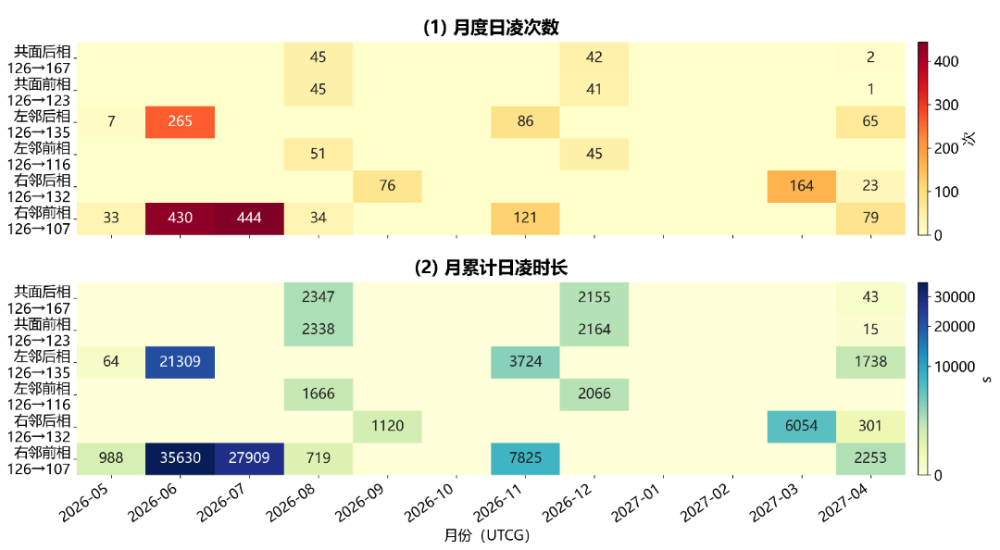

右邻前相日凌高度集中于 6 月至 7 月，共计 874 次，占该链路全年 1141 次的 77%；9 月至 10 月及 12 月至次年 3 月空缺，11 月存在一次高发窗口。为进一步分析该现象，使用 ATK 可见性工具输出右邻轨道面前相链路的日夹角：打开可见性分析工具，访问对象选择 Iridium 126_role，分析对象选择右邻轨道面前相卫星 Iridium 107，点击 <kbd>计算</kbd>，可见性分析界面如下。

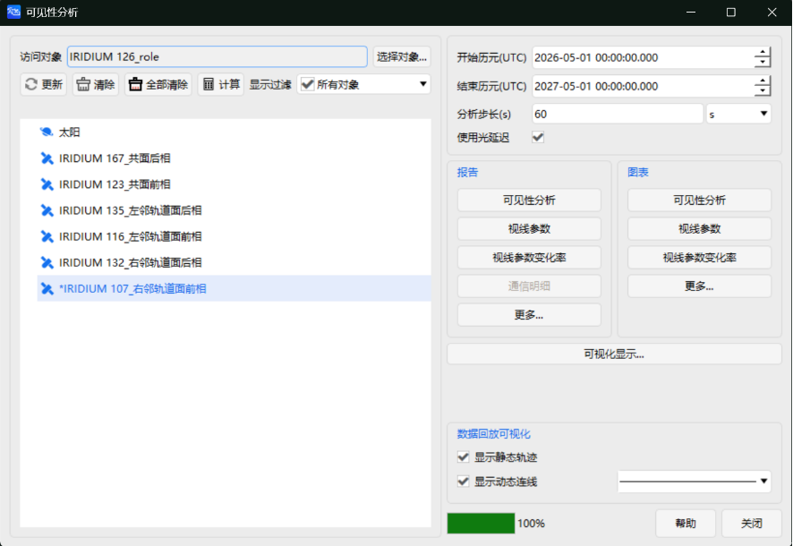

点击【图表】中的 <kbd>更多</kbd>，选择 <kbd>自定义</kbd>，再选择 <kbd>太阳视线规避角</kbd> 生成图表，即可得到日夹角的年内变化曲线，如下。

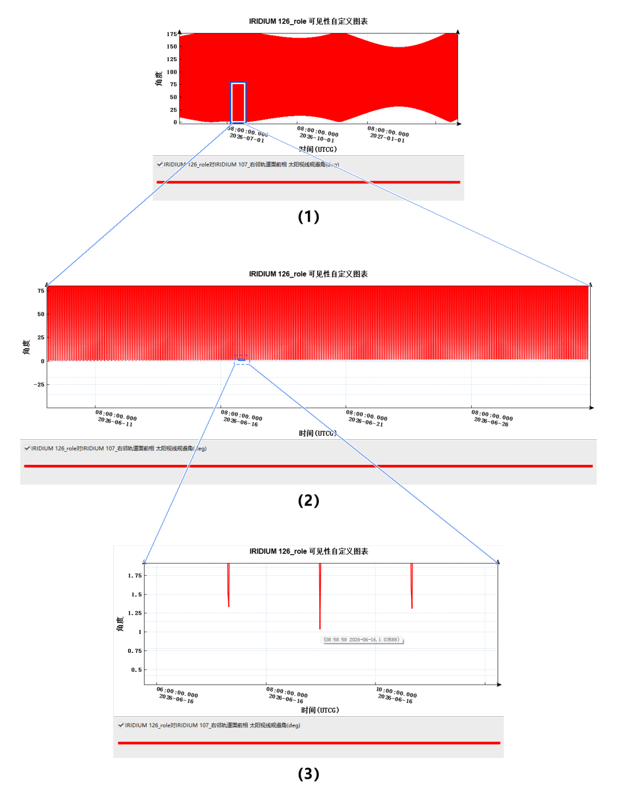

图中红色密集成带是该角在每个轨道周期快速往复扫动的结果，重点分析其下包络曲线，图中（2）与（3）给出了曲线的局部示意。曲线在 6 月至 7 月存在低洼窗口，因而高发日凌。

本案例中，太阳恰在 6 月至 7 月运行至右邻前相链路视轴附近：日夹角下包络降至 2° 风险角以内，每个轨道周期均满足触发条件，日凌密集发生，形成主高发窗口；此后太阳沿黄道继续推进并逐渐远离该视轴方向，日夹角回升至风险角以上，日凌大幅减少。

### 年度周期性分析

考虑到星座轨道相位与年度时间存在耦合，将仿真时长调整为 3 年，开始历元为 2026-05-01 00:00:00.000，结束历元为 2029-05-01 00:00:00.000，验证上述规律是否随年度相位迁移。分别绘制共面链路、左邻轨道面链路、右邻轨道面链路的年度相位迁移图，如下。

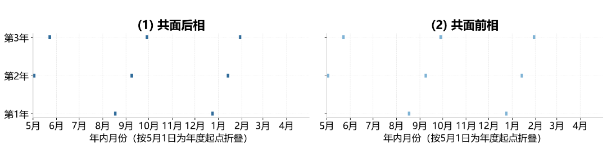

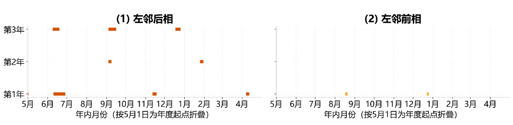

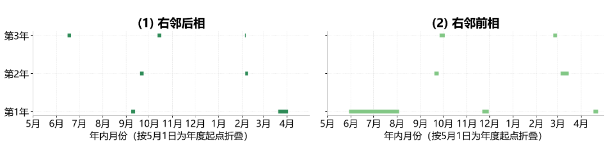

三年仿真周期下 Iridium 126 六条星间链路的年度日凌次数和累计日凌时长如下图。

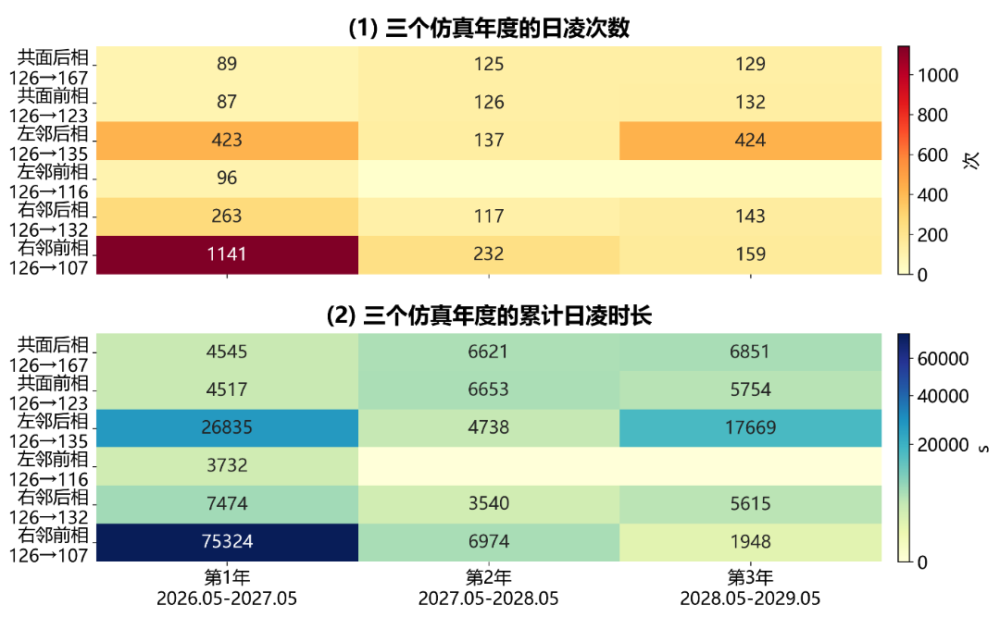

将仿真延长至三年可以发现，日凌的集中窗口并不逐年重复：右邻前相的峰值月份依次为 7 月、3 月、9 月，左邻后相为 6 月、1 月、9 月，逐年向相邻月份漂移。这是因为日凌发生取决于太阳方向与轨道面的相对几何——太阳视运动以回归年为周期，而铱星轨道面受轨道摄动以约 0.42°/天的速率持续进动，二者叠加使该相对几何以约 256 天为周期循环，而非一年；故每过一年窗口相位偏移约 109 天，不按年度复现。

## 总结与展望

本案例利用 ATK 以铱星星座为对象，完成了星间微波通信日凌的仿真分析，展示了 ATK 在星座建模、可见性分析、空间几何参数计算等方面的功能，体现了其在航天任务分析与设计领域的工程应用价值。ATK 作为国产化航天任务分析软件，能够完整分析铱星这类低轨通信星座的日凌现象，从而支持日凌规避策略的设计。

通过仿真分析，得到主要结论如下。

1. **链路风险高度分化，右邻前相为主导风险源。** 6 条链路一年共发生日凌 2099 次，累计约 122427 s；其中异面右邻前相链路（126→107）一项即达 1141 次、75324 s，占六条链路总时长的 60% 以上；而同轨共面前、后相基本对称且均为低风险，左邻前相仅 96 次。可见链路风险呈非均匀分布。

2. **日凌呈明显季节性集中，存在大段空缺窗口。** 右邻前相日凌高度集中于 6 月至 7 月，占该链路全年 1141 次的 77%，而 9 月至 10 月及 12 月至次年 3 月空缺，11 月存在一次高发窗口；其余链路亦各有固定高发月份。日凌并非全年均匀发生，而是集中爆发于少数月份。

3. **季节性窗口服从约 0.70 年的周期，而非年度复现。** 三年仿真显示，日凌集中窗口逐年向相邻月份漂移，其中右邻前相峰值月份依次为 7 月、3 月、9 月，左邻后相为 6 月、1 月、9 月，每过一年窗口相位偏移约 109 天。其根源是太阳视运动的回归年周期与铱星轨道面进动的叠加，使二者相对几何以约 256 天为周期循环。

实际运维中，可基于上述方法对各星间链路进行日凌窗口预报，按链路风险等级与高发月份实施差异化的时段管理与业务调度；进一步可纳入天线方向图、太阳活动周期、链路编码与调制方式等因素，细化风险角与影响程度评估，并构建多年度滚动预报机制，为低轨星座通信系统的健壮性设计提供支撑。

## 参考文献

[1] 李峰, 李兵, 陆纪杰. 卫星通信日凌干扰分析及预报研究[J]. 中国新通信, 2018, 20(17): 22.

[2] 星间微波通信日凌分析：从原理到规避策略.
